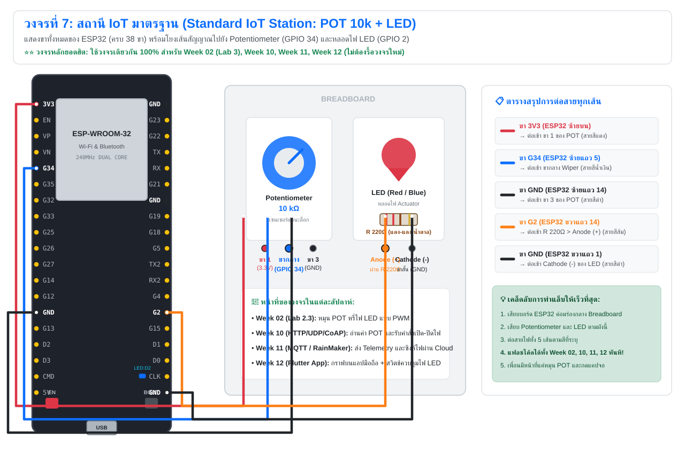
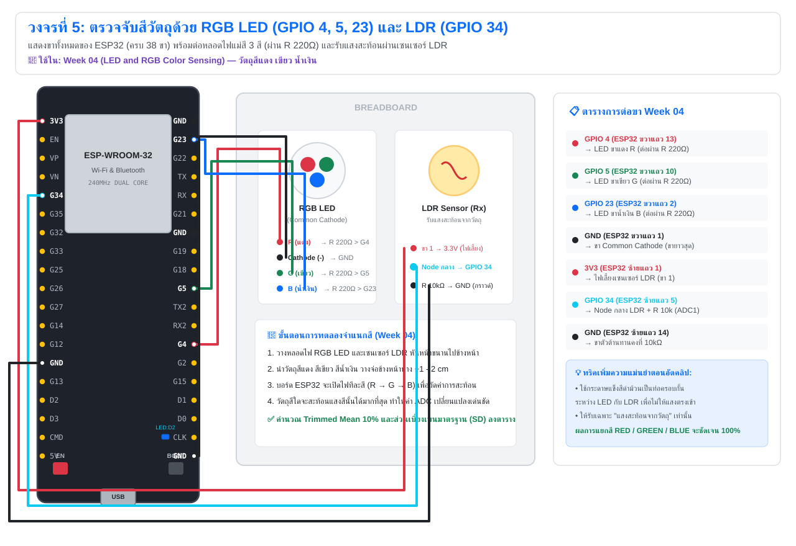
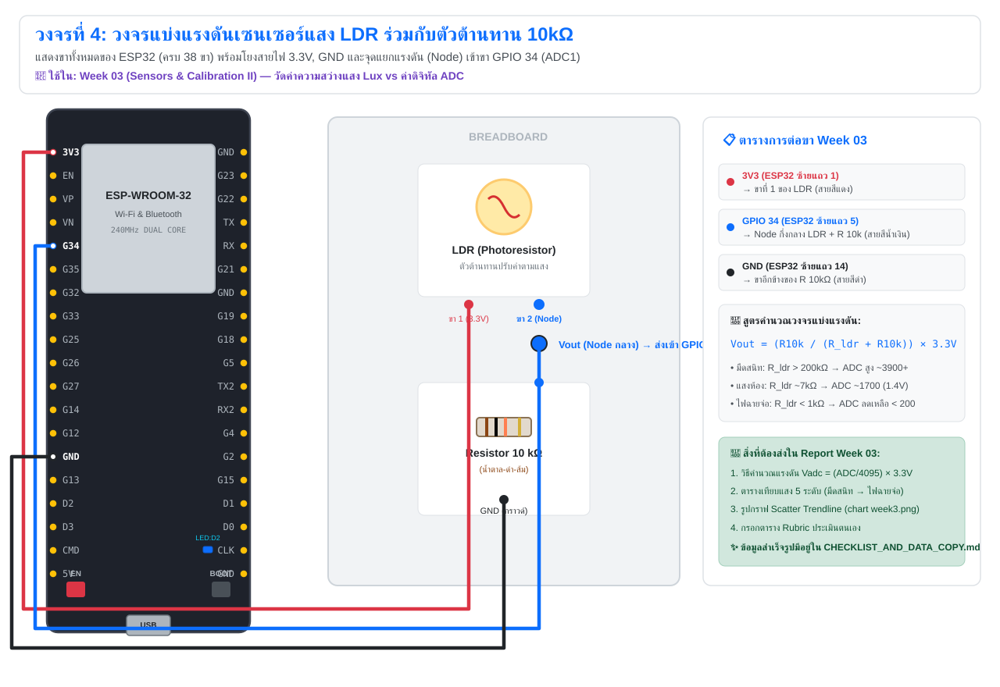
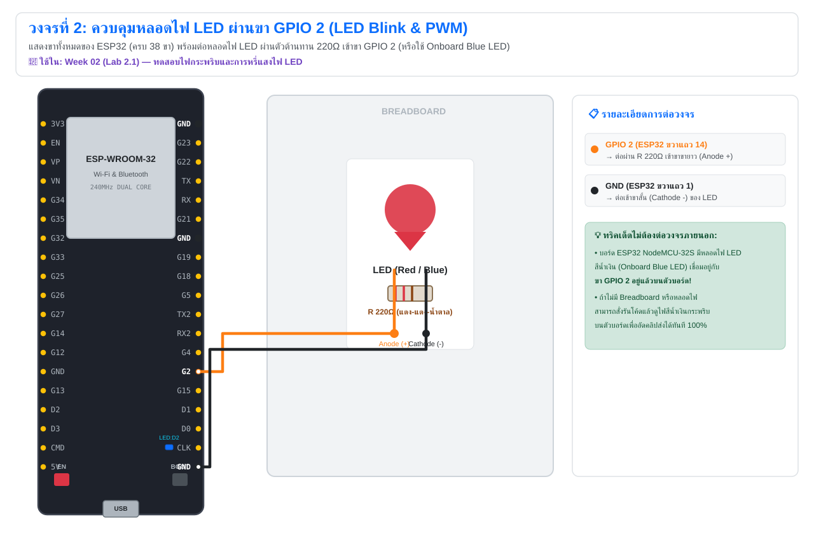
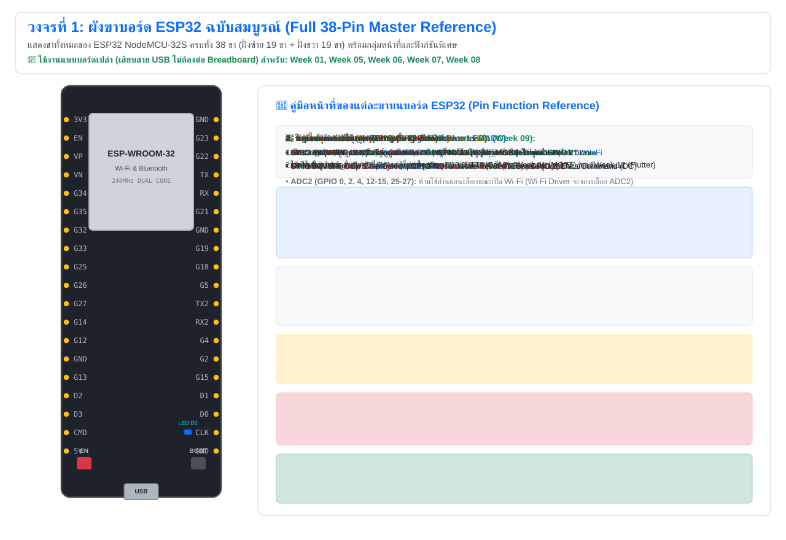

# 🔌 คู่มือผังวงจรฮาร์ดแวร์ฉบับสมบูรณ์ (แสดงขา ESP32 ครบทุกขา 38 Pins)

เอกสารนี้แสดง **ผังการต่อวงจรจริงทุกแล็บ** สำหรับวิชา **IoT-App-2569** โดยบอร์ดไมโครคอนโทรลเลอร์ที่ใช้คือ **ESP32 (NodeMCU-32S / ESP-WROOM-32)** ซึ่งในผังนี้ **แสดงขาทั้งหมดของ ESP32 ครบทุกขา (38 ขา: ฝั่งซ้าย 19 ขา + ฝั่งขวา 19 ขา)** พร้อมระบุชื่อขาและ **โยงเส้นสายไฟจากขาจริงบนบอร์ดไปยังอุปกรณ์บน Breadboard อย่างชัดเจน 100%**

---

## 🗺️ ตารางสรุป: แล็บไหนใช้วงจรซ้ำกันบ้าง? (ไม่ต้องรื้อบอร์ดใหม่!)

| รหัสผังวงจร | รายการอุปกรณ์ที่ต่อกับ ESP32 | สัปดาห์ที่ใช้วงจรนี้ (แล็บที่เกี่ยวข้อง) | สถานะการรื้อวงจร |
| :---: | :--- | :--- | :---: |
| ⭐ **วงจรที่ 7** | **Standard IoT Station: POT (GPIO 34) + LED (GPIO 2)** | **Week 02 (Lab 2.3), Week 10, Week 11, Week 12** | ⭐ **ต่อครั้งเดียว ใช้ซ้ำได้ถึง 4 สัปดาห์ ไม่ต้องรื้อวงจรเลย!** |
| **วงจรที่ 6** | **จอแสดงผล SPI OLED 7 ขา + POT (GPIO 34)** | **Week 09 (SPI OLED and Kestrel UI)** | วงจรเฉพาะ Week 09 |
| **วงจรที่ 5** | **หลอดไฟ RGB LED (G4, G5, G23) + LDR (GPIO 34)** | **Week 04 (LED & RGB Color Sensing)** | วงจรเฉพาะ Week 04 |
| **วงจรที่ 4** | **เซนเซอร์วัดแสง LDR + R 10kΩ (GPIO 34)** | **Week 03 (Sensors & Calibration II)** | วงจรเฉพาะ Week 03 |
| **วงจรที่ 3** | **Potentiometer 10kΩ (GPIO 34)** | **Week 02 (Lab 2.2), Week 08 (Lab 8.3)** | วงจรย่อย (อยู่ในวงจรที่ 7 อยู่แล้ว) |
| **วงจรที่ 2** | **หลอดไฟ LED + R 220Ω (GPIO 2)** | **Week 02 (Lab 2.1)** | วงจรย่อย (อยู่ในวงจรที่ 7 อยู่แล้ว) |
| **วงจรที่ 1** | **บอร์ดเปล่า (Bare Board)** เสียบสาย USB เส้นเดียว | **Week 01, Week 05, Week 06, Week 07, Week 08 (Lab 8.1, 8.2, 8.4, 8.5)** | **ไม่ต้องต่อ Breadboard!** เสียบสาย USB อย่างเดียว |

---

## 🖼️ รายละเอียดผังวงจรจริง (แสดงขา ESP32 ครบทุกขา พร้อมเส้นโยง)

---

### ⭐⭐⭐ วงจรที่ 7: สถานี IoT มาตรฐาน (Standard IoT Station: POT + LED)
* **สัปดาห์ที่ใช้:** **Week 02 (Lab 2.3)**, **Week 10 (HTTP/UDP/CoAP)**, **Week 11 (MQTT & RainMaker)**, **Week 12 (Flutter Mobile)**
* **คำกำกับ:** **วงจรหลักที่สำคัญที่สุด!** แสดงขา ESP32 ครบ 38 ขา โดยโยงสายไฟ 5 เส้น:
  1. **สายสีแดง (3.3V):** จากขาซ้ายแถว 1 (`3V3`) &rarr; ขา 1 ของ Potentiometer
  2. **สายสีน้ำเงิน (Signal):** จากขาซ้ายแถว 5 (`GPIO 34`) &rarr; ขากลาง (Wiper) ของ Potentiometer
  3. **สายสีดำ (GND):** จากขาซ้ายแถว 14 (`GND`) &rarr; ขา 3 ของ Potentiometer
  4. **สายสีส้ม (LED Out):** จากขาขวาแถว 14 (`GPIO 2`) &rarr; ตัวต้านทาน 220Ω &rarr; ขาขายาว (Anode +) ของ LED
  5. **สายสีดำ (GND):** จากขาขวาแถว 1 (`GND`) &rarr; ขาขาสั้น (Cathode -) ของ LED

> 💡 **กลยุทธ์ทำแล็บให้เร็วที่สุด:** ต่อวงจรที่ 7 นี้บน Breadboard ครั้งเดียวตอนทำ Week 02 (Lab 2.3) แล้ว **ปล่อยวงจรนี้ไว้เลย** เมื่อถึง Week 10, Week 11, และ Week 12 สามารถหยิบบอร์ดนี้มาเสียบสาย USB แล้วแฟลชโค้ดได้ทันทีโดยไม่ต้องต่อสายไฟใหม่แม้แต่เส้นเดียว!

---

### 🟣 วงจรที่ 6: จอแสดงผลกราฟิก SPI OLED SSD1306 (7 ขา) + Potentiometer
* **สัปดาห์ที่ใช้:** **Week 09 (SPI OLED and Kestrel UI)**
* **คำกำกับ:** แสดงขา ESP32 ครบ 38 ขา พร้อมโยงสายบัส SPI2 ความเร็วสูง 10 MHz 5 ขา + ไฟเลี้ยง 2 ขา + Potentiometer 10k บนขา GPIO 34

#### 📌 ตารางการเชื่อมต่อขา OLED (SSD1306 7-Pin) เข้ากับ ESP32
| ขาบนโมดูล OLED | ชื่อสัญญาณ | ตำแหน่งขาบน ESP32 (ครบ 38 ขา) | สีสายไฟ | หน้าที่ในการทำงาน |
| :---: | :---: | :---: | :---: | :--- |
| **Pin 1: GND** | Ground | **ขาขวาแถว 1 (`GND`)** | สีดำ | กราวด์ระบบ |
| **Pin 2: VCC** | Power 3.3V | **ขาซ้ายแถว 1 (`3V3`)** | สีแดง | ไฟเลี้ยงจอภาพ (3.3V) |
| **Pin 3: D0** | SCK / Clock | **ขาขวาแถว 9 (`GPIO 18`)** | สีเขียว | สัญญาณนาฬิกา SPI2 Clock |
| **Pin 4: D1** | MOSI / Data | **ขาขวาแถว 2 (`GPIO 23`)** | สีม่วง | สัญญาณข้อมูลส่งออกจาก ESP32 |
| **Pin 5: RES** | Hardware Reset | **ขาขวาแถว 13 (`GPIO 4`)** | สีฟ้า | สัญญาณรีเซ็ตจอภาพ (Active Low) |
| **Pin 6: DC** | Data / Command | **ขาขวาแถว 14 (`GPIO 2`)** | สีชมพู | สลับโหมดคำสั่ง (0) หรือข้อมูลภาพ (1) |
| **Pin 7: CS** | Chip Select | **ขาขวาแถว 10 (`GPIO 5`)** | สีส้ม | สัญญาณเลือกไอซีจอภาพ (Active Low) |
| **POT Wiper** | Analog In | **ขาซ้ายแถว 5 (`GPIO 34`)** | สีน้ำเงิน | อ่านค่าตัวต้านทานปรับค่าได้ (ADC1_CH6) |

---

### 🔴 วงจรที่ 5: ตรวจจับสีวัตถุด้วย RGB LED + LDR (Color Sensing Unit)
* **สัปดาห์ที่ใช้:** **Week 04 (LED & RGB Color Sensing)**
* **คำกำกับ:** แสดงขา ESP32 ครบ 38 ขา พร้อมต่อหลอดไฟแม่สี 3 สี (ผ่านตัวต้านทาน 220Ω) และรับแสงสะท้อนผ่านเซนเซอร์ LDR

#### 📌 ตารางการเชื่อมต่อขา Week 04
| อุปกรณ์ | ขาเป้าหมาย | ตำแหน่งขาบน ESP32 | สีสายไฟ |
| :--- | :--- | :---: | :---: |
| **RGB LED** | ขา R (แดง) ผ่าน R 220Ω | **ขาขวาแถว 13 (`GPIO 4`)** | สีแดง |
| **RGB LED** | ขา G (เขียว) ผ่าน R 220Ω | **ขาขวาแถว 10 (`GPIO 5`)** | สีเขียว |
| **RGB LED** | ขา B (น้ำเงิน) ผ่าน R 220Ω | **ขาขวาแถว 2 (`GPIO 23`)** | สีน้ำเงิน |
| **RGB LED** | ขา Common Cathode (ขายาวสุด) | **ขาขวาแถว 1 (`GND`)** | สีดำ |
| **เซนเซอร์ LDR** | ขาที่ 1 ของ LDR | **ขาซ้ายแถว 1 (`3V3`)** | สีแดง |
| **เซนเซอร์ LDR** | จุด Node กลาง (ระหว่าง LDR กับ R 10k) | **ขาซ้ายแถว 5 (`GPIO 34`)** | สีฟ้า |
| **เซนเซอร์ LDR** | ขาอีกข้างหนึ่งของตัวต้านทาน 10kΩ | **ขาซ้ายแถว 14 (`GND`)** | สีดำ |

---

### 🟠 วงจรที่ 4: วงจรแบ่งแรงดันเซนเซอร์แสง LDR + R 10kΩ
* **สัปดาห์ที่ใช้:** **Week 03 (Sensors & Calibration II)**
* **คำกำกับ:** แสดงขา ESP32 ครบ 38 ขา โดยต่อตัวต้านทานไวแสง LDR อนุกรมกับตัวต้านทานคงที่ 10kΩ แล้วดึงจุดแยกแรงดันเข้าขา GPIO 34 (ADC1)

---

### 🔵 วงจรที่ 3: ตัวต้านทานปรับค่าได้ (Potentiometer 10k บนขา GPIO 34)
* **สัปดาห์ที่ใช้:** **Week 02 (Lab 2.2)**, **Week 08 (Lab 8.3)**
* **คำกำกับ:** แสดงขา ESP32 ครบ 38 ขา หมุนปรับแรงดันแอนะล็อก 0.00V ถึง 3.30V เข้าสู่ขา GPIO 34

---

### 🟡 วงจรที่ 2: หลอดไฟ LED Blink & PWM (GPIO 2)
* **สัปดาห์ที่ใช้:** **Week 02 (Lab 2.1)**
* **คำกำกับ:** แสดงขา ESP32 ครบ 38 ขา ต่อหลอดไฟ LED ผ่านตัวต้านทาน 220Ω เข้าขา GPIO 2 (หรือใช้หลอด Blue LED บนบอร์ด)

---

### 🟢 วงจรที่ 1: ผังขาบอร์ด ESP32 ฉบับสมบูรณ์ (Full 38-Pin Master Reference)
* **สัปดาห์ที่ใช้:** **Week 01, Week 05, Week 06, Week 07, Week 08 (Lab 8.1, 8.2, 8.4, 8.5)**
* **คำกำกับ:** ใช้แบบบอร์ดเปล่า เสียบสาย Micro-USB เข้าคอมพิวเตอร์อย่างเดียว ไม่ต้องต่อ Breadboard

