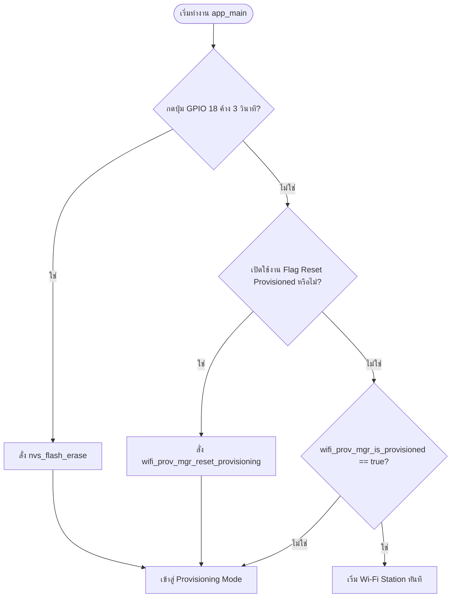
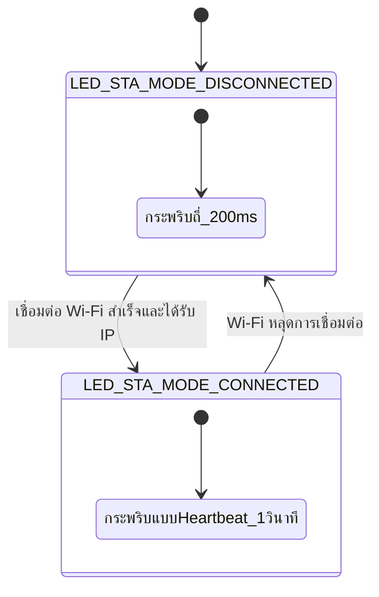
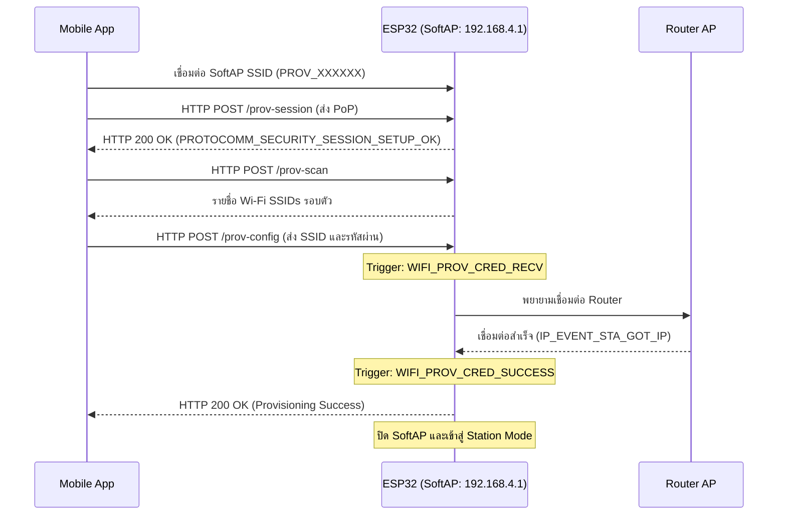
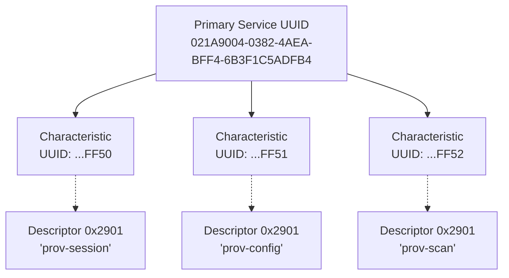
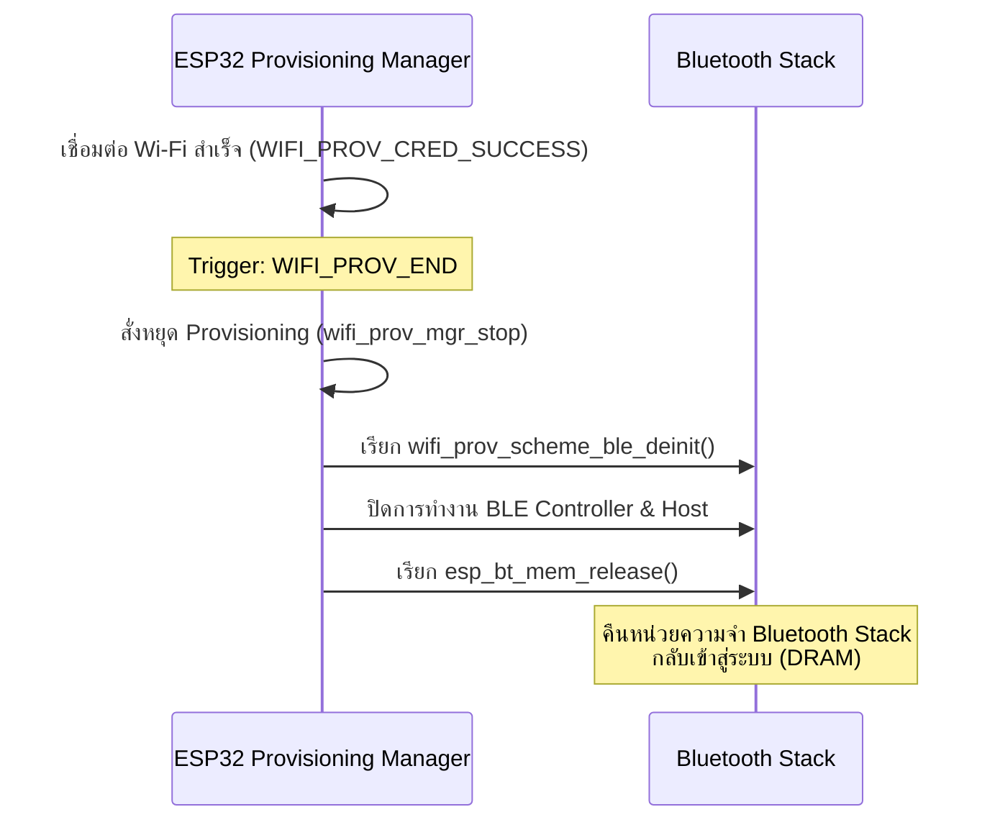
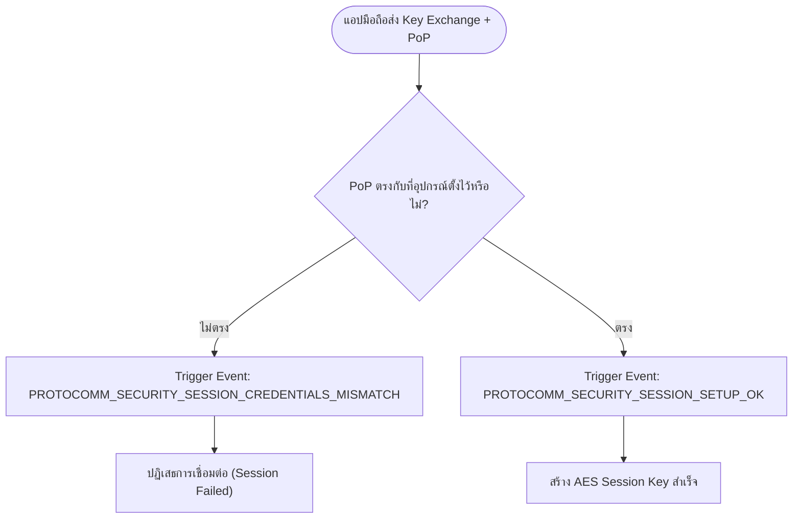
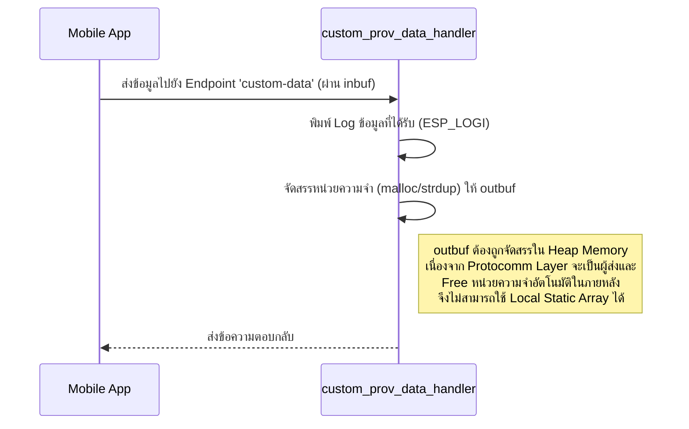

# รายงานผลการทดลองสัปดาห์ที่ 7: Wi-Fi Provisioning
**รหัสนักศึกษา:** 67030183

---

## Lab 7.1: การศึกษากลไก Reset Provisioning 3 รูปแบบ และ NVS Memory Forensics

### ตารางบันทึกผลการทดลอง

| รูปแบบการ Reset                  | คำสั่ง / พฤติกรรมที่ทำ               | พฤติกรรมของ LED แต่ละดวงหลังเปิดเครื่อง | สถานะใน Serial Monitor |
| :------------------------------- | :----------------------------------- | :-------------------------------------- | :--------------------- |
| **1. CLI Erase**                 | `idf.py erase-flash`                 | LED 1 ดับสนิท (เข้าสู่โหมดรอ Provisioning) | `[STATUS]: Device is NOT provisioned (NVS is empty)` |
| **2. Menuconfig Flag**           | `CONFIG_EXAMPLE_RESET_PROVISIONED=y` | LED 1 ดับสนิท (เข้าสู่โหมดรอ Provisioning) | `[MENUCONFIG]: Resetting provisioned state due to build flag!` |
| **3. Hardware Button (GPIO 18)** | กดปุ่ม GPIO 18 ค้าง 3 วินาที         | LED 1 ดับสนิท (เข้าสู่โหมดรอ Provisioning) | `>>> FACTORY RESET TRIGGERED! ERASING NVS FLASH <<<` |

### คำถามท้ายการทดลอง
1. เพราะเหตุใดการกดปุ่ม BOOT (GPIO 0) ค้างไว้ในจังหวะรีเซ็ตบอร์ด จึงทำให้โปรแกรมค้างอยู่ที่ ROM Bootloader และไม่ยอมทำงานต่อ?
   - **ตอบ:** ขา GPIO 0 ทำหน้าที่เป็น Strapping Pin สำหรับเลือกโหมดการบูต หากมีสถานะเป็น LOW (0) ในขณะรีเซ็ต ชิป ESP32 จะเข้าสู่โหมด ROM Download Bootloader (รอรับการแฟลชโปรแกรม) ทำให้ตัวประมวลผลหยุดรอและไม่รันเฟิร์มแวร์ Application หลัก (`app_main()`)
2. เพราะเหตุใดคำสั่ง `idf.py erase-flash` จึงทำให้ข้อมูลเฟิร์มแวร์ Application หายไปด้วย ในขณะที่ `nvs_flash_erase()` ไม่ทำให้เฟิร์มแวร์หาย?
   - **ตอบ:** คำสั่ง `idf.py erase-flash` เป็นการลบข้อมูลในหน่วยความจำ Flash ทั้งชิปทุกพาร์ติชัน (รวมถึงเฟิร์มแวร์และ Bootloader) แต่ฟังก์ชัน `nvs_flash_erase()` เป็นคำสั่งในระดับซอฟต์แวร์ที่สั่งลบข้อมูลเฉพาะในพาร์ติชัน NVS (Non-Volatile Storage) ที่เก็บคอนฟิกเท่านั้น จึงไม่กระทบกับพาร์ติชันโปรแกรม
3. การออกแบบปุ่ม Factory Reset บนอุปกรณ์ IoT เชิงพาณิชย์ เหตุใดจึงต้องกำหนดให้ผู้ใช้กดปุ่มค้างไว้ 3-5 วินาที แทนที่จะสั่งลบข้อมูลทันทีที่แตะปุ่มเพียงเสี้ยววินาที?
   - **ตอบ:** เพื่อป้องกันการเผลอไปกดปุ่มหรือโดนปุ่มโดยไม่ได้ตั้งใจ (Accidental Press) ซึ่งอาจทำให้ผู้ใช้สูญเสียการตั้งค่าเครือข่ายทั้งหมด การกำหนดให้กดค้างเป็นการยืนยันความตั้งใจของผู้ใช้ว่าต้องการทำ Factory Reset จริงๆ
4. หากอุปกรณ์ IoT ถูกติดตั้งอยู่บนเสาสูงหรือฝังอยู่ในผนัง วิธีการ Reset ทางกายภาพรูปแบบใดเหมาะสมที่สุด?
   - **ตอบ:** หากไม่สามารถเข้าถึงอุปกรณ์เพื่อกดปุ่มได้โดยตรง วิธีที่เหมาะสมคือการทำ Reset ผ่านลำดับการเปิด-ปิดแหล่งจ่ายไฟ (Power-cycle Reset) เช่น การเปิด-ปิดเบรกเกอร์ไฟ 5 ครั้งติดกัน ให้อุปกรณ์นับจำนวนครั้งการบูตที่ผิดปกติแล้วเข้าสู่โหมด Factory Reset เอง หรือผ่านแอปมือถือที่เชื่อมต่อไว้ (Remote Reset)

### กิจกรรมถอดรหัสซอร์สโค้ดและเขียนผังงาน (Code Deconstruction & Flowchart Assignment)

#### ภารกิจที่ 1: ผังงานการตัดสินใจช่วง Bootstrapping & Reset Decision


#### ภารกิจที่ 2: ผังสถานะการเปลี่ยนจังหวะไฟ LED 1 (Wi-Fi STA Indicator)


### บันทึก Log การทำงาน (Lab 7.1 - Hardware Reset)
```text
rst:0x1 (POWERON_RESET),boot:0x13 (SPI_FAST_FLASH_BOOT)
configsip: 0, SPIWP:0xee
clk_drv:0x00,q_drv:0x00,d_drv:0x00,cs0_drv:0x00,hd_drv:0x00,wp_drv:0x00
mode:DIO, clock div:2
load:0x3fff0030,len:6260
load:0x40078000,len:15540
load:0x40080400,len:4
--- 0x40080400: _init at ??:?
ho 8 tail 4 room 4
load:0x40080404,len:3904
entry 0x40080640
I (31) boot: ESP-IDF v5.2.3 2nd stage bootloader
I (31) boot: compile time Aug 24 2026 09:17:10
I (31) boot: Multicore bootloader
I (32) boot: chip revision: v3.1
I (35) boot.esp32: SPI Speed      : 40MHz
I (39) boot.esp32: SPI Mode       : DIO
I (43) boot.esp32: SPI Flash Size : 2MB
I (46) boot: Enabling RNG early entropy source...
I (51) boot: Partition Table:
I (53) boot: ## Label            Usage          Type ST Offset   Length
I (60) boot:  0 nvs              WiFi data        01 02 00009000 00006000
I (66) boot:  1 phy_init         RF data          01 01 0000f000 00001000
I (73) boot:  2 factory          factory app      00 00 00010000 00100000
I (79) boot: End of partition table
I (82) esp_image: segment 0: paddr=00010020 vaddr=3f400020 size=1bd80h (114048) map
I (129) esp_image: segment 1: paddr=0002bda8 vaddr=3ffb0000 size=03cd8h ( 15576) load
I (135) esp_image: segment 2: paddr=0002fa88 vaddr=40080000 size=00590h (  1424) load
I (136) esp_image: segment 3: paddr=00030020 vaddr=400d0020 size=8ee6ch (585324) map
I (341) esp_image: segment 4: paddr=000bee94 vaddr=40080590 size=165b8h ( 91576) load
I (388) boot: Loaded app from partition at offset 0x10000
I (388) boot: Disabling RNG early entropy source...
I (398) cpu_start: Multicore app
I (408) cpu_start: Pro cpu start user code
I (408) cpu_start: cpu freq: 160000000 Hz
I (408) cpu_start: Application information:
I (408) cpu_start: Project name:     lab7_1_reset_nvs_forensics
I (414) cpu_start: App version:      18ddd5a-dirty
I (418) cpu_start: Compile time:     Aug 24 2026 09:24:42
I (423) cpu_start: ELF file SHA256:  f38761855...
I (428) cpu_start: ESP-IDF:          v5.2.3
I (432) cpu_start: Min chip rev:     v0.0
I (435) cpu_start: Max chip rev:     v3.99 
I (439) cpu_start: Chip rev:         v3.1
I (443) heap_init: Initializing. RAM available for dynamic allocation:
I (449) heap_init: At 3FFAE6E0 len 00001920 (6 KiB): DRAM
I (454) heap_init: At 3FFB7DD8 len 00028228 (160 KiB): DRAM
I (460) heap_init: At 3FFE0440 len 00003AE0 (14 KiB): D/IRAM
I (465) heap_init: At 3FFE4350 len 0001BCB0 (111 KiB): D/IRAM
I (471) heap_init: At 40096B48 len 000094B8 (37 KiB): IRAM
I (477) spi_flash: detected chip: generic
I (479) spi_flash: flash io: dio
W (482) spi_flash: Detected size(4096k) larger than the size in the binary image header(2048k). Using the size in the binary image header.
I (495) main_task: Started on CPU0
I (505) main_task: Calling app_main()
I (505) gpio: GPIO[2]| InputEn: 0| OutputEn: 1| OpenDrain: 0| Pullup: 0| Pulldown: 0| Intr:0 
I (505) gpio: GPIO[18]| InputEn: 1| OutputEn: 0| OpenDrain: 0| Pullup: 1| Pulldown: 0| Intr:0 
I (515) LAB7_1_RESET: Hold GPIO 18 button for 3 seconds to trigger Factory Reset...
I (1515) LAB7_1_RESET: Holding button... 1/3 seconds
I (2515) LAB7_1_RESET: Holding button... 2/3 seconds
I (3515) LAB7_1_RESET: Holding button... 3/3 seconds
W (3515) LAB7_1_RESET: =================================================
W (3515) LAB7_1_RESET: >>> FACTORY RESET TRIGGERED! ERASING NVS FLASH <<<
W (3515) LAB7_1_RESET: =================================================
W (3525) LAB7_1_RESET: [FORENSIC]: User requested Flash Erase!
I (3585) wifi:wifi driver task: 3ffc0500, prio:23, stack:6656, core=0
I (3595) wifi:wifi firmware version: 82f54d2
I (3595) wifi:wifi certification version: v7.0
I (3595) wifi:config NVS flash: enabled
I (3595) wifi:config nano formating: disabled
I (3595) wifi:Init data frame dynamic rx buffer num: 32
I (3605) wifi:Init static rx mgmt buffer num: 5
I (3605) wifi:Init management short buffer num: 32
I (3615) wifi:Init dynamic tx buffer num: 32
I (3615) wifi:Init static rx buffer size: 1600
I (3615) wifi:Init static rx buffer num: 10
I (3625) wifi:Init dynamic rx buffer num: 32
I (3625) wifi_init: rx ba win: 6
I (3635) wifi_init: tcpip mbox: 32
I (3635) wifi_init: udp mbox: 6
I (3635) wifi_init: tcp mbox: 6
I (3635) wifi_init: tcp tx win: 5760
I (3645) wifi_init: tcp rx win: 5760
I (3645) wifi_init: tcp mss: 1440
I (3645) wifi_init: WiFi IRAM OP enabled
I (3655) wifi_init: WiFi RX IRAM OP enabled
W (3655) LAB7_1_RESET: --------------------------------------------------
W (3665) LAB7_1_RESET: [STATUS]: Device is NOT provisioned (NVS is empty)
W (3665) LAB7_1_RESET: Ready for Provisioning Lab 7-2 (SoftAP) or 7-3 (BLE)!
W (3675) LAB7_1_RESET: --------------------------------------------------
```


---

## Lab 7.2: SoftAP Provisioning and HTTP Sniffing

### ตารางบันทึกผลการทดลอง

| รายการตรวจสอบ | ค่าที่บันทึกได้จากการทดลอง |
| :--- | :--- |
| **1. ชื่อ SoftAP SSID ของ ESP32** | `PROV_205524` |
| **2. รหัส PoP (Proof of Possession)** | `abcd1234` |
| **3. ข้อความใน QR Code Payload (JSON)** | `{"ver":"v1","name":"PROV_205524","pop":"abcd1234","transport":"softap"}` |
| **4. พฤติกรรมไฟ LED 3 (GPIO 5) ช่วงรอ vs ช่วงส่งข้อมูล** | ช่วงรอ: สว่างค้าง (บ่งบอกว่าเปิด SoftAP รอรับข้อมูลอยู่)<br/>ช่วงส่ง: ดับลงเมื่อเชื่อมต่อ Wi-Fi และได้ IP สำเร็จ |
| **5. IP Address ที่ ESP32 ได้รับจาก Router** | `172.20.10.6` |
| **6. เวลาที่ใช้ตั้งแต่เริ่มจนจบกระบวนการ (วินาที)** | ประมาณ 6-10 วินาที (นับจากตอนกดปุ่ม Provision บนแอป) |

### คำถามท้ายการทดลอง
1. ในโหมด SoftAP Scheme สมาร์ตโฟนส่งข้อมูลหา ESP32 ผ่านโปรโตคอลและ IP Address ใด?
   - **ตอบ:** สมาร์ตโฟนส่งข้อมูลผ่านโปรโตคอล **HTTP** (ผ่านกลไก Protocomm) ไปยัง IP Address **192.168.4.1** (ซึ่งเป็น Default IP ของ ESP32 ในโหมด SoftAP)
2. หากผู้ใช้ป้อนรหัสผ่าน Wi-Fi ผิดในแอปมือถือ จะเกิด Event ใดขึ้นบน ESP32 (`WIFI_PROV_CRED_FAIL` หรือไม่) และ ESP32 มีพฤติกรรมอย่างไร?
   - **ตอบ:** จะเกิด Event `WIFI_PROV_CRED_FAIL` ขึ้นใน ESP32 โดยระบบจะแจ้งกลับไปยังแอปพลิเคชันว่ารหัสผ่านผิด และจะยังคงอยู่ในโหมด Provisioning ต่อไป (LED 3 ยังคงติดสว่าง) เพื่อรอให้ผู้ใช้พิมพ์รหัสผ่านใหม่ส่งเข้ามาอีกครั้ง โดยไม่ต้องเริ่มสแกน QR Code ใหม่
3. ทำไมผู้ผลิต IoT ส่วนใหญ่จึงมองว่ากระบวนการเชื่อมต่อแบบ SoftAP มีขั้นตอนที่ยุ่งยากสำหรับผู้ใช้ทั่วไปเมื่อเทียบกับ BLE?
   - **ตอบ:** เพราะการใช้ SoftAP จะบังคับให้สมาร์ตโฟนต้องสลับไปเกาะ Wi-Fi ของอุปกรณ์ (ESP32) ทำให้ผู้ใช้สูญเสียการเชื่อมต่ออินเทอร์เน็ตชั่วคราว นอกจากนี้สมาร์ตโฟนรุ่นใหม่ๆ มักมีฟีเจอร์ "สลับกลับไปยัง Wi-Fi ที่มีอินเทอร์เน็ตอัตโนมัติ" ซึ่งอาจทำให้เน็ตหลุดออกจาก ESP32 กลางคันระหว่างตั้งค่า ทำให้ล้มเหลวบ่อย ในขณะที่ BLE สามารถรับส่งข้อมูลเบื้องหลังได้โดยไม่ต้องตัดการเชื่อมต่อ Wi-Fi ของผู้ใช้เลย

### กิจกรรมถอดรหัสซอร์สโค้ดและเขียนผังงาน (Code Deconstruction & Sequence Flow Assignment)

#### ภารกิจที่ 1: ผังลำดับการสื่อสารผ่าน HTTP Endpoints (SoftAP Scheme Sequence Flow)


### บันทึก Log การทำงาน (Lab 7.2 - SoftAP Provisioning)
```text
W (555767) wifi:Password length matches WPA2 standards, authmode threshold changes from OPEN to WPA2
I (555787) LAB7_2_SOFTAP: =================================================
I (555787) LAB7_2_SOFTAP: [CREDENTIALS RECEIVED]:
I (555787) LAB7_2_SOFTAP:   -> Target SSID     : Siwapat’s iPhone
I (555787) LAB7_2_SOFTAP:   -> Target Password : 0954276527
I (555797) LAB7_2_SOFTAP: =================================================
I (559887) wifi:primary chan differ, old=1, new=6, start CSA timer
I (560287) wifi:switch to channel 6
I (560287) wifi:ap channel adjust o:1,1 n:6,2
I (560287) wifi:new:<6,0>, old:<1,0>, ap:<6,2>, sta:<0,0>, prof:1
I (560297) wifi:new:<6,2>, old:<6,0>, ap:<6,2>, sta:<6,0>, prof:1
I (560297) wifi:state: init -> auth (b0)
I (560307) wifi:state: auth -> assoc (0)
I (560317) wifi:state: assoc -> run (10)
I (560397) wifi:connected with Siwapat’s iPhone, aid = 1, channel 6, BW20, bssid = 72:05:cd:c7:45:bb
I (560397) wifi:security: WPA2-PSK, phy: bgn, rssi: -33
I (560407) wifi:pm start, type: 1

I (560407) wifi:dp: 1, bi: 102400, li: 3, scale listen interval from 307200 us to 307200 us
I (560427) wifi:AP's beacon interval = 102400 us, DTIM period = 1
I (561917) LAB7_2_SOFTAP: =================================================
I (561917) LAB7_2_SOFTAP: [ONLINE]: Got IP: 172.20.10.6
I (561917) LAB7_2_SOFTAP: =================================================
I (561917) esp_netif_handlers: sta ip: 172.20.10.6, mask: 255.255.255.240, gw: 172.20.10.1
I (561927) wifi_prov_mgr: STA Got IP
I (561937) LAB7_2_SOFTAP: [SUCCESS]: Provisioning Completed Successfully!
I (566987) wifi:station: 86:c1:5f:56:bd:f0 leave, AID = 1, bss_flags is 33721459, bss:0x3ffb9174
I (566987) wifi:new:<6,0>, old:<6,2>, ap:<6,2>, sta:<6,0>, prof:1
I (566987) wifi:<ba-del>idx:2, tid:0
I (566987) wifi:<ba-del>idx:3, tid:1
I (566997) wifi:<ba-del>idx:4, tid:5
I (566997) wifi:mode : sta (84:1f:e8:20:55:24)
I (567017) wifi_prov_mgr: Provisioning stopped
W (567017) LAB7_2_SOFTAP: [SOFTAP]: Mobile Phone disconnected from ESP32 SoftAP
I (567017) LAB7_2_SOFTAP: [PROV EVENT]: De-initializing Provisioning Manager
I (567067) wifi:<ba-add>idx:0 (ifx:0, 72:05:cd:c7:45:bb), tid:0, ssn:2, winSize:64
```

---

## Lab 7.3: BLE Provisioning and GATT Forensics

### ตารางบันทึกผลการทดลอง

| รายการตรวจสอบ | ผลการทดลอง / ข้อมูลที่สังเกตได้ |
| :--- | :--- |
| **1. BLE Device Name ที่สแกนเจอ** | `PROV_205524` |
| **2. Primary Service UUID (128-bit)** | `021A9004-0382-4AEA-BFF4-6B3F1C5ADFB4` |
| **3. Characteristic Endpoint ที่พบ (0x2901)** | 1. `021AFF50-0382-4AEA-BFF4-6B3F1C5ADFB4` (เช่น prov-session)<br/>2. `021AFF51-0382-4AEA-BFF4-6B3F1C5ADFB4` (เช่น prov-config)<br/>3. `021AFF52-0382-4AEA-BFF4-6B3F1C5ADFB4` (เช่น prov-scan) |
| **4. พฤติกรรมไฟ LED 2 (GPIO 4) ช่วงรอ vs ช่วงต่อ BLE** | ช่วงรอ: สว่างค้าง (บ่งบอกว่าบอร์ดกำลังเปิด BLE Advertising)<br/>ช่วงต่อ: ดับลงเมื่อ Provisioning สำเร็จ |
| **5. พฤติกรรมเมื่อต่อ Wi-Fi สำเร็จ** | มี (ปรากฏ Log `wifi_prov_scheme_ble: BTDM memory released`) |

### คำถามท้ายการทดลอง
1. เหตุใด BLE Provisioning จึงไม่ส่งผลให้สัญญาณ Wi-Fi บนสมาร์ตโฟนของผู้ใช้หลุดระหว่างทำรายการ?
   - **ตอบ:** เพราะเทคโนโลยี BLE (Bluetooth Low Energy) ทำงานแยกส่วนจากการเชื่อมต่อ Wi-Fi ของสมาร์ตโฟน สมาร์ตโฟนจึงสามารถสื่อสารส่งข้อมูลตั้งค่าผ่านบลูทูธได้เบื้องหลัง โดยที่ผู้ใช้ยังคงเกาะ Wi-Fi บ้านและใช้งานอินเทอร์เน็ตได้ตามปกติ (ต่างจาก SoftAP ที่ต้องสลับเครือข่าย)
2. Descriptor `0x2901` มีความสำคัญอย่างไรต่อการที่แอปพลิเคชันมือถือจะทราบว่า Characteristic แต่ละตัวใช้ทำหน้าที่อะไร?
   - **ตอบ:** Descriptor `0x2901` (Characteristic User Description) ทำหน้าที่เก็บข้อความอธิบายแบบอ่านได้ (String) ว่า Characteristic นั้นๆ มีไว้สำหรับทำอะไร (เช่น "prov-session", "prov-config", "prov-scan") ช่วยให้แอปมือถือค้นหา Endpoint ที่ถูกต้องได้โดยอัตโนมัติ
3. การที่ ESP-IDF มีฟังก์ชัน `esp_bt_mem_release()` มีประโยชน์อย่างไรต่อการทำงานของแอปพลิเคชัน IoT หลังเชื่อมต่อ Wi-Fi สำเร็จ?
   - **ตอบ:** ชิป ESP32 มีทรัพยากรหน่วยความจำ (RAM) ที่จำกัด เมื่อการทำ Provisioning ด้วยบลูทูธเสร็จสิ้นแล้ว การคืนหน่วยความจำในส่วนของ Bluetooth (BTDM) กลับคืนให้ระบบ จะทำให้มีพื้นที่ RAM ว่างเหลือมากขึ้นสำหรับรันแอปพลิเคชันหลักของ IoT ต่อไป (เช่น การส่งข้อมูล MQTT หรือรัน Web Server)

### กิจกรรมถอดรหัสซอร์สโค้ดและเขียนผังงาน (Code Deconstruction & BLE GATT Architecture Assignment)

#### ภารกิจที่ 1: ผังโครงสร้าง GATT Tree & Endpoint Mapping


#### ภารกิจที่ 2: ผังลำดับการคืนหน่วยความจำ Bluetooth (BLE Lifecycle & Memory Reclaim Flow)


### บันทึก Log การทำงาน (Lab 7.3 - BLE Provisioning)

#### 1. Log จากตัวบอร์ด ESP32 (Terminal)
```text
entry 0x40080640
I (31) boot: ESP-IDF v5.2.3 2nd stage bootloader
I (31) boot: compile time Aug 24 2026 10:14:31
I (31) boot: Multicore bootloader
I (32) boot: chip revision: v3.1
I (35) boot.esp32: SPI Speed      : 40MHz
I (39) boot.esp32: SPI Mode       : DIO
I (43) boot.esp32: SPI Flash Size : 2MB
I (46) boot: Enabling RNG early entropy source...
I (51) boot: Partition Table:
I (53) boot: ## Label            Usage          Type ST Offset   Length
I (60) boot:  0 nvs              WiFi data        01 02 00009000 00006000
I (66) boot:  1 phy_init         RF data          01 01 0000f000 00001000
I (73) boot:  2 factory          factory app      00 00 00010000 00150000
I (79) boot: End of partition table
I (82) esp_image: segment 0: paddr=00010020 vaddr=3f400020 size=229b0h (141744) map
I (138) esp_image: segment 1: paddr=000329d8 vaddr=3ffbdb60 size=059f4h ( 23028) load
I (147) esp_image: segment 2: paddr=000383d4 vaddr=40080000 size=07c44h ( 31812) load
I (160) esp_image: segment 3: paddr=00040020 vaddr=400d0020 size=b55d4h (742868) map
I (415) esp_image: segment 4: paddr=000f55fc vaddr=40087c44 size=16108h ( 90376) load
I (465) boot: Loaded app from partition at offset 0x10000
I (465) boot: Disabling RNG early entropy source...
I (475) cpu_start: Multicore app
I (485) cpu_start: Pro cpu start user code
I (485) cpu_start: cpu freq: 160000000 Hz
I (485) cpu_start: Application information:
I (485) cpu_start: Project name:     lab7_3_ble_provisioning
I (490) cpu_start: App version:      18ddd5a-dirty
I (495) cpu_start: Compile time:     Aug 24 2026 10:14:23
I (500) cpu_start: ELF file SHA256:  dae8fd293...
I (504) cpu_start: ESP-IDF:          v5.2.3
I (508) cpu_start: Min chip rev:     v0.0
I (512) cpu_start: Max chip rev:     v3.99 
I (516) cpu_start: Chip rev:         v3.1
I (520) heap_init: Initializing. RAM available for dynamic allocation:
I (526) heap_init: At 3FFAFF10 len 000000F0 (0 KiB): DRAM
I (531) heap_init: At 3FFB6388 len 00001C78 (7 KiB): DRAM
I (536) heap_init: At 3FFB9A20 len 00004108 (16 KiB): DRAM
I (541) heap_init: At 3FFC9BE0 len 00016420 (89 KiB): DRAM
I (547) heap_init: At 3FFE0440 len 00003AE0 (14 KiB): D/IRAM
I (552) heap_init: At 3FFE4350 len 0001BCB0 (111 KiB): D/IRAM
I (558) heap_init: At 4009DD4C len 000022B4 (8 KiB): IRAM
I (564) spi_flash: detected chip: generic
I (566) spi_flash: flash io: dio
W (569) spi_flash: Detected size(4096k) larger than the size in the binary image header(2048k). Using the size in the binary image header.
I (582) coexist: coex firmware version: 27d8387
I (587) main_task: Started on CPU0
I (597) main_task: Calling app_main()
I (597) gpio: GPIO[2]| InputEn: 0| OutputEn: 1| OpenDrain: 0| Pullup: 0| Pulldown: 0| Intr:0 
I (597) gpio: GPIO[4]| InputEn: 0| OutputEn: 1| OpenDrain: 0| Pullup: 0| Pulldown: 0| Intr:0 
I (637) wifi:wifi driver task: 3ffcd998, prio:23, stack:6656, core=0
I (637) wifi:wifi firmware version: 82f54d2
I (637) wifi:wifi certification version: v7.0
I (637) wifi:config NVS flash: enabled
I (637) wifi:config nano formating: disabled
I (647) wifi:Init data frame dynamic rx buffer num: 32
I (647) wifi:Init static rx mgmt buffer num: 5
I (657) wifi:Init management short buffer num: 32
I (657) wifi:Init dynamic tx buffer num: 32
I (657) wifi:Init static rx buffer size: 1600
I (667) wifi:Init static rx buffer num: 10
I (667) wifi:Init dynamic rx buffer num: 32
I (677) wifi_init: rx ba win: 6
I (677) wifi_init: tcpip mbox: 32
I (677) wifi_init: udp mbox: 6
I (677) wifi_init: tcp mbox: 6
I (687) wifi_init: tcp tx win: 5760
I (687) wifi_init: tcp rx win: 5760
I (687) wifi_init: tcp mss: 1440
I (697) wifi_init: WiFi IRAM OP enabled
I (697) wifi_init: WiFi RX IRAM OP enabled
I (697) wifi_prov_scheme_ble: BT memory released
I (707) LAB7_3_BLE: Starting BLE Provisioning (Name: PROV_205524, PoP: abcd1234)
I (717) phy_init: phy_version 4840,a40f0ac,Aug 16 2024,16:48:06
W (717) phy_init: failed to load RF calibration data (0x1102), falling back to full calibration
W (787) phy_init: saving new calibration data because of checksum failure, mode(2)
I (797) wifi:mode : sta (84:1f:e8:20:55:24)
I (797) wifi:enable tsf
I (807) BTDM_INIT: BT controller compile version [b022216]
I (807) BTDM_INIT: Bluetooth MAC: 84:1f:e8:20:55:26
I (1057) protocomm_nimble: BLE Host Task Started
I (1067) wifi_prov_mgr: Provisioning started with service name : PROV_205524 
I (1067) LAB7_3_BLE: [PROV EVENT]: BLE Provisioning Started (Advertising)!
I (1067) LAB7_3_BLE: --------------------------------------------------
I (1077) LAB7_3_BLE: [QR CODE URL]: Click or copy the URL below:
I (1077) LAB7_3_BLE: https://espressif.github.io/esp-jumpstart/qrcode.html?data=%7B%22ver%22%3A%22v1%22%2C%22name%22%3A%22PROV_205524%22%2C%22pop%22%3A%22abcd1234%22%2C%22transport%22%3A%22ble%22%7D
I (1097) LAB7_3_BLE: Payload JSON: {"ver":"v1","name":"PROV_205524","pop":"abcd1234","transport":"ble"}
I (1107) NimBLE: GAP procedure initiated: advertise; 
I (1107) NimBLE: disc_mode=2
I (1117) NimBLE:  adv_channel_map=0 own_addr_type=0 adv_filter_policy=0 adv_itvl_min=256 adv_itvl_max=256
I (1127) NimBLE: 

I (1127) LAB7_3_BLE: --------------------------------------------------
I (1127) main_task: Returned from app_main()
I (22257) LAB7_3_BLE: [BLE]: Smartphone Connected to GATT Server!
I (22427) protocomm_nimble: mtu update event; conn_handle=0 cid=4 mtu=256
W (548597) LAB7_3_BLE: [BLE]: Smartphone Disconnected from GATT Server
W (548597) LAB7_3_BLE: [BLE]: Smartphone Disconnected from GATT Server
I (548597) NimBLE: GAP procedure initiated: advertise; 
I (548597) NimBLE: disc_mode=2
I (548607) NimBLE:  adv_channel_map=0 own_addr_type=0 adv_filter_policy=0 adv_itvl_min=256 adv_itvl_max=256
I (548617) NimBLE: 

I (566967) LAB7_3_BLE: [BLE]: Smartphone Connected to GATT Server!
I (567167) protocomm_nimble: mtu update event; conn_handle=0 cid=4 mtu=256
W (631697) wifi:Password length matches WPA2 standards, authmode threshold changes from OPEN to WPA2
I (631727) LAB7_3_BLE: =================================================
I (631727) LAB7_3_BLE: [BLE CREDENTIALS RECEIVED]:
I (631727) LAB7_3_BLE:   -> SSID     : Siwapat’s iPhone
I (631727) LAB7_3_BLE:   -> Password : 0954276527
I (631737) LAB7_3_BLE: =================================================
I (637817) wifi:new:<6,0>, old:<1,0>, ap:<255,255>, sta:<6,0>, prof:1
I (637827) wifi:state: init -> auth (b0)
I (637837) wifi:state: auth -> assoc (0)
I (637847) wifi:state: assoc -> run (10)
I (637907) wifi:connected with Siwapat’s iPhone, aid = 1, channel 6, BW20, bssid = 6a:37:ae:ff:ae:9a
I (637907) wifi:security: WPA2-PSK, phy: bgn, rssi: -48
I (637917) wifi:pm start, type: 1

I (637917) wifi:dp: 1, bi: 102400, li: 3, scale listen interval from 307200 us to 307200 us
I (637987) wifi:AP's beacon interval = 102400 us, DTIM period = 1
I (639427) LAB7_3_BLE: =================================================
I (639427) LAB7_3_BLE: [ONLINE]: Connected to Wi-Fi with IP: 172.20.10.6
I (639427) LAB7_3_BLE: =================================================
I (639437) esp_netif_handlers: sta ip: 172.20.10.6, mask: 255.255.255.240, gw: 172.20.10.1
I (639437) wifi_prov_mgr: STA Got IP
I (639447) LAB7_3_BLE: [SUCCESS]: BLE Provisioning Successful!
W (642437) LAB7_3_BLE: [BLE]: Smartphone Disconnected from GATT Server
W (642437) LAB7_3_BLE: [BLE]: Smartphone Disconnected from GATT Server
I (642447) NimBLE: GAP procedure initiated: advertise; 
I (642447) NimBLE: disc_mode=2
I (642447) NimBLE:  adv_channel_map=0 own_addr_type=0 adv_filter_policy=0 adv_itvl_min=256 adv_itvl_max=256
I (642457) NimBLE: 

I (643167) NimBLE: GAP procedure initiated: stop advertising.

I (643177) NimBLE: GAP procedure initiated: stop advertising.

I (643187) wifi_prov_mgr: Provisioning stopped
I (643187) LAB7_3_BLE: [PROV EVENT]: De-initializing BLE & Releasing BT Memory...
I (643187) wifi_prov_scheme_ble: BTDM memory released
```

#### 2. Log จากแอป nRF Connect (สมาร์ตโฟน)
```text
[10:19:10.054] Normal: Scanner On.
[10:19:10.077] Normal: Device Scanned.
[10:19:19.645] Normal: Connected.
[10:19:19.757] Normal: Discovered 021A9004-0382-4AEA-BFF4-6B3F1C5ADFB4 Services.
[10:19:19.814] Normal: Service Discovery returned nil Services.
[10:19:19.937] Normal: Discovered 021AFF4F-0382-4AEA-BFF4-6B3F1C5ADFB4, 021AFF50-0382-4AEA-BFF4-6B3F1C5ADFB4, 021AFF51-0382-4AEA-BFF4-6B3F1C5ADFB4, 021AFF52-0382-4AEA-BFF4-6B3F1C5ADFB4, and 021AFF53-0382-4AEA-BFF4-6B3F1C5ADFB4 Characteristics for Service 021A9004-0382-4AEA-BFF4-6B3F1C5ADFB4.
[10:19:19.993] Normal: 021AFF4F-0382-4AEA-BFF4-6B3F1C5ADFB4 has no Descriptors.
[10:19:20.055] Normal: 021AFF50-0382-4AEA-BFF4-6B3F1C5ADFB4 has no Descriptors.
[10:19:20.113] Normal: 021AFF51-0382-4AEA-BFF4-6B3F1C5ADFB4 has no Descriptors.
[10:19:20.174] Normal: 021AFF52-0382-4AEA-BFF4-6B3F1C5ADFB4 has no Descriptors.
[10:19:20.326] Normal: 021AFF53-0382-4AEA-BFF4-6B3F1C5ADFB4 has no Descriptors.
[10:28:00.274] Normal: Connected.
[10:28:00.333] Normal: Discovered 021A9004-0382-4AEA-BFF4-6B3F1C5ADFB4 Services.
[10:28:00.392] Normal: Discovered 021AFF4F-0382-4AEA-BFF4-6B3F1C5ADFB4, 021AFF50-0382-4AEA-BFF4-6B3F1C5ADFB4, 021AFF51-0382-4AEA-BFF4-6B3F1C5ADFB4, 021AFF52-0382-4AEA-BFF4-6B3F1C5ADFB4, and 021AFF53-0382-4AEA-BFF4-6B3F1C5ADFB4 Characteristics for Service 021A9004-0382-4AEA-BFF4-6B3F1C5ADFB4.
```

---

## Lab 7.4: Security Schemes and Custom Data Endpoint

### กิจกรรมถอดรหัสซอร์สโค้ดและเขียนผังงาน (Code Deconstruction & Security Flow Assignment)

#### ภารกิจที่ 1: ผังขั้นตอนการตรวจสอบ PoP (Security Handshake Decision Flow)


#### ภารกิจที่ 2: ผังการรับส่งข้อมูลผ่าน Custom Endpoint (Custom Data Handler Flow)


### บันทึก Log การทดลอง (Terminal)

**กรณีป้อน PoP ผิดพลาด (`wrong1234`):**
```text
E (331747) security1: Key mismatch. Close connection
E (331747) security1: Session setup error -1
E (331747) protocomm_nimble: Invalid content received, killing connection
E (331757) LAB7_4_CUSTOM: --------------------------------------------------
E (331757) LAB7_4_CUSTOM: [SECURITY ALERT]: INVALID PoP / Unauthorized Access!
E (331767) LAB7_4_CUSTOM: --------------------------------------------------
```

**กรณีป้อน PoP ถูกต้อง (`abcd1234`):**
```text
I (372007) LAB7_4_CUSTOM: --------------------------------------------------
I (372007) LAB7_4_CUSTOM: [SECURITY SUCCESS]: Valid PoP! Secured Session OK!
I (372017) LAB7_4_CUSTOM: --------------------------------------------------
```

### ตารางบันทึกผลการทดลอง

| สถานการณ์ทดสอบ | ค่า PoP ที่ป้อน | ผลลัพธ์บนแอปมือถือ | ข้อความ Log ใน Serial Monitor |
| :--- | :--- | :--- | :--- |
| **1. ป้อน PoP ผิดพลาด** | `wrong1234` | แสดงข้อความ Error (Provisioning Failed / Incorrect PoP) | `[SECURITY ALERT]: INVALID PoP / Unauthorized Access!` |
| **2. ป้อน PoP ถูกต้อง** | `abcd1234` | เชื่อมต่อและตั้งค่า Wi-Fi ได้สำเร็จ | `[SECURITY SUCCESS]: Valid PoP! Secured Session OK!` |
| **3. ส่ง Custom Data** | `TEST_DATA_999` | (ไม่มีผลลัพธ์แสดงบนแอปปกติ) | `[CUSTOM DATA RECEIVED]: TEST_DATA_999` |

### คำถามท้ายการทดลอง
1. การใช้ **Proof-of-Possession (PoP)** ช่วยป้องกันการโจมตีประเภทใดได้บ้าง?
   - **ตอบ:** ช่วยป้องกันการโจมตีแบบ Man-in-the-Middle (MitM) และ Unauthorized Access (การแอบตั้งค่าโดยไม่ได้รับอนุญาต) เนื่องจากมีเพียงผู้ที่รู้รหัส PoP (ซึ่งมักจะแปะเป็น QR Code บนตัวอุปกรณ์จริง) เท่านั้นที่จะสร้าง Secured Session เพื่อตั้งค่า Wi-Fi ได้
2. หากไม่มีการใช้ PoP (เช่น ใน Security 0) ผู้โจมตีที่อยู่ในรัศมีสัญญาณบลูทูธสามารถทำสิ่งใดกับอุปกรณ์ได้บ้าง?
   - **ตอบ:** ผู้โจมตีสามารถดักจับ (Sniff) ข้อมูลที่ลอยอยู่ในอากาศเพื่อขโมยรหัส Wi-Fi บ้านเราไปได้ (เพราะไม่ได้เข้ารหัส) และยังสามารถแอบส่งรหัสผ่าน Wi-Fi ปลอมเข้าไปเปลี่ยนการตั้งค่า เพื่อแย่งการควบคุม (Hijack) อุปกรณ์ไปเป็นของตัวเองได้ทันที
3. ในการประยุกต์ใช้งานเชิงพาณิชย์จริง เราสามารถนำ **Custom Data Endpoint** ไปใช้ส่งข้อมูลประเภทใดได้อีกบ้าง (ยกตัวอย่าง 2 กรณี)?
   - **ตอบ:** 1. ส่งข้อมูล **User Token / User ID** เพื่อผูกอุปกรณ์เข้ากับบัญชีของผู้ใช้งานบนระบบ Cloud ทันทีที่ตั้งค่าเสร็จ 2. ส่งข้อมูล **Configuration** เบื้องต้น เช่น URL ของ MQTT Broker, โซนเวลา (Timezone), หรือรูปแบบการทำงานของเซนเซอร์
4. ในฟังก์ชัน `custom_prov_data_handler()` เหตุใดหน่วยความจำที่จัดสรรให้ `*outbuf` จึงถูก Free โดย Protocomm Layer อัตโนมัติหลังจากส่งข้อมูลเสร็จ?
   - **ตอบ:** เพราะระบบ Protocomm ถูกออกแบบมาให้จัดการหน่วยความจำแยกส่วนกัน โดยฟังก์ชัน Handler มีหน้าที่แค่จอง (Allocate) เมมโมรี่เพื่อสร้างคำตอบ ส่วนการส่งข้อมูลผ่าน BLE/Wi-Fi เป็นหน้าที่ของ Protocomm Layer ซึ่งเมื่อมันส่งข้อมูลเรียบร้อยแล้ว มันจะทำการ Free หน่วยความจำทิ้งให้โดยอัตโนมัติ เพื่อป้องกันปัญหา Memory Leak (ลืมคืนหน่วยความจำ) จากตัวผู้เขียนโค้ดครับ
