# รายงานผลการทดลอง สัปดาห์ที่ 11
## หัวข้อ: MQTT Cloud Communication and Control & ESP RainMaker Ecosystem

**รหัสนักศึกษา:** 67030183  
**ชื่อ-นามสกุล:** นายภูวิชญ์ ประกอบจิตร  
**วิชา:** ระบบสมองกลฝังตัวและการเชื่อมต่อเครือข่าย (Embedded Systems & IoT)  
**บอร์ดทดลอง:** ESP32 (ESP32-D0WD-V3)  

---

## 1. การต่อวงจรฮาร์ดแวร์ (Hardware Wiring)

การทดลองในสัปดาห์นี้ใช้บอร์ด ESP32 เชื่อมต่อกับหลอดไฟ LED (Actuator) และตัวต้านทานปรับค่าได้ Potentiometer (Sensor):

| อุปกรณ์ | ขาบนอุปกรณ์ | ขาต่อบน ESP32 | หน้าที่การทำงาน |
| :--- | :--- | :--- | :--- |
| **LED** | ขั้วบวก (Anode ขายาว) ผ่าน R 220Ω | **GPIO 2** (D2) | Actuator แสดงผลสถานะเปิด-ปิดไฟตามคำสั่งจาก Broker/Cloud |
| **LED** | ขั้วลบ (Cathode ขาสั้น) | **GND** | กราวด์วงจรหลอดไฟ |
| **Potentiometer 10k** | ขากลาง (Wiper) | **GPIO 34** (ADC1_CH6) | เซนเซอร์ตรวจวัดแรงดันแอนะล็อก ส่งข้อมูล Telemetry |
| **Potentiometer 10k** | ขาริมซ้าย | **3.3V** | แรงดันไฟเลี้ยงอ้างอิง |
| **Potentiometer 10k** | ขาริมขวา | **GND** | กราวด์อ้างอิง |

### แผนภาพการต่อวงจร
```
       ESP32 Board                             Peripherals
     +---------------+                          +------------------------+
     |        GPIO 2 |------------------------->| LED (+ R 220Ω -> GND)  |
     |       GPIO 34 |<-------------------------| Potentiometer (Wiper)  |
     |          3.3V |------------------------->| Potentiometer (VCC)    |
     |           GND |------------------------->| Potentiometer (GND)    |
     +---------------+                          +------------------------+
```

### ภาพถ่ายการต่อวงจรฮาร์ดแวร์จริง

<div align="center">
  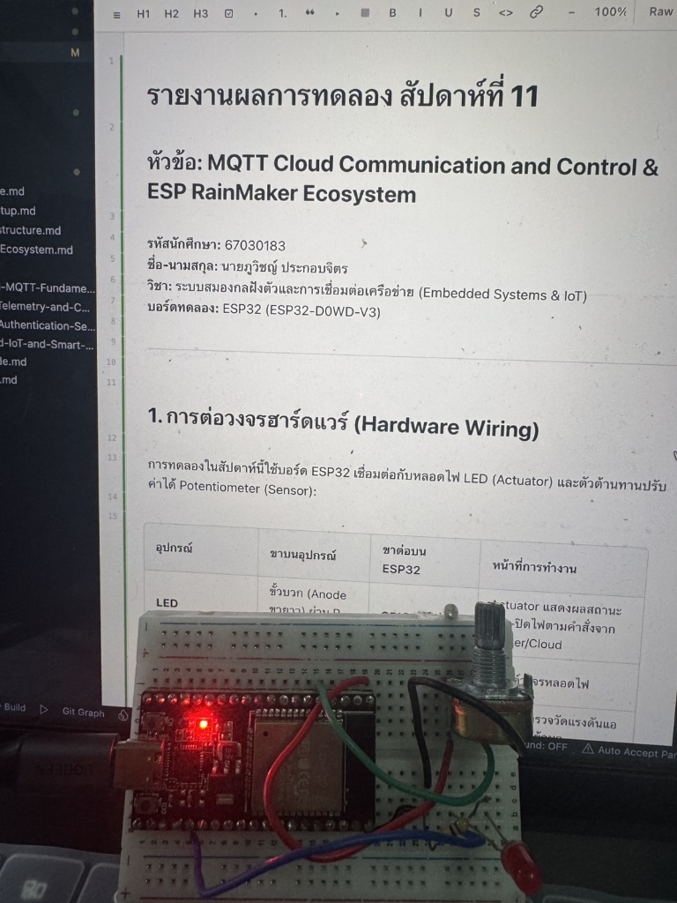
  <br/>
  <b>รูปที่ 1: วงจรบอร์ดทดลอง ESP32 เชื่อมต่อกับ LED (GPIO 2) และ Potentiometer (GPIO 34) บน Breadboard</b>
</div>

---

## 2. ลิงก์วิดีโอสาธิตการทำงาน (Video Demonstration Links)

| การทดลอง | รายละเอียดคลิปสาธิต | ลิงก์วิดีโอ (YouTube Shorts) |
| :--- | :--- | :--- |
| **ใบงานที่ 11.1** | Mosquitto Broker Setup & MQTT CLI Fundamentals (QoS, Retain, LWT) | *(การทดสอบระดับโปรโตคอลด้วย CLI มีภาพบันทึกผลการรันครบถ้วน)* |
| **ใบงานที่ 11.2** | ESP32 MQTT Two-Way Telemetry & LED Remote Control | [https://www.youtube.com/shorts/JMp2Mwli6h4](https://www.youtube.com/shorts/JMp2Mwli6h4) |
| **ใบงานที่ 11.3** | MQTTS High Security TLS & Mutual Authentication (mTLS) | *(การทดสอบความปลอดภัย mTLS ด้วย OpenSSL มีภาพบันทึกผลครบถ้วน)* |
| **ใบงานที่ 11.4** | ESP RainMaker Cloud Smart Light & 4G/5G Remote Control | [https://www.youtube.com/shorts/FS7aSXBQBvA](https://www.youtube.com/shorts/FS7aSXBQBvA) |

---

## 3. ใบงานที่ 11.1: การติดตั้ง Mosquitto Broker และการทดสอบโปรโตคอล MQTT ด้วย CLI

### 3.1 ผลการรัน Mosquitto Broker
* ไฟล์คอนฟิก `mosquitto.conf`:
```text
listener 1883 0.0.0.0
allow_anonymous true
log_type all
```

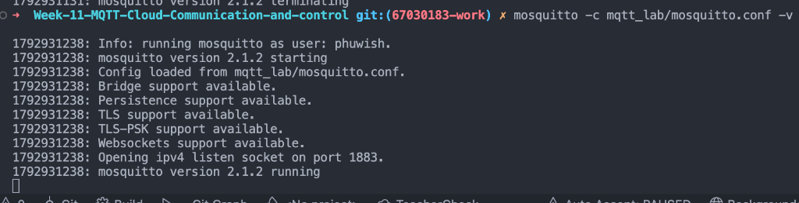
*รูปที่ 2: หน้าต่าง Terminal แสดงการเริ่มต้นทำงานของ Mosquitto Broker บนพอร์ต 1883*

---

### 3.2 การทดสอบ Publish / Subscribe และ Wildcards (`+`, `#`)
* **ทดสอบหัวข้อตรง:** ทำการ Subscribe หัวข้อ `home/livingroom/light` และ Publish ค่า `ON` ได้รับข้อความปกติ
* **ทดสอบ Single-Level Wildcard (`+`):** Subscribe หัวข้อ `home/+/light`
  - เมื่อส่งไปยัง `home/livingroom/light` -> ได้รับข้อความ
  - เมื่อส่งไปยัง `home/kitchen/light` -> ได้รับข้อความ
  - เมื่อส่งไปยัง `home/bedroom/balcony/light` -> **ไม่ได้รับข้อความ** เนื่องจาก `+` แทนที่ชื่อหัวข้อได้เพียง 1 ลำดับชั้น แต่หัวข้อนี้มี 2 ลำดับชั้น (`bedroom/balcony`)
* **ทดสอบ Multi-Level Wildcard (`#`):** Subscribe หัวข้อ `home/#`
  - ผลลัพธ์: ได้รับทุกข้อความที่มีโครงสร้างลำดับชั้นย่อยทั้งหมดที่ขึ้นต้นด้วย `home/`

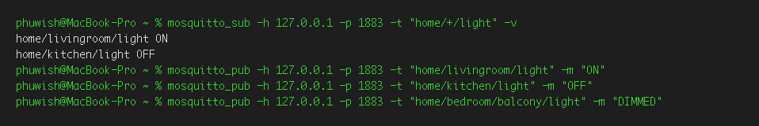
*รูปที่ 3: ผลการรับข้อความของฝั่ง Subscriber เมื่อทดสอบด้วย Wildcard `+` และ `#`*

---

### 3.3 การทดสอบระดับคุณภาพการส่งข้อมูล (QoS 0, QoS 1, QoS 2)
บันทึกลำดับแพ็กเก็ตที่เกิดขึ้นจาก Broker Log:

| ระดับ QoS | การรับประกัน | แพ็กเก็ตที่เกิดขึ้นระหว่าง Publisher <-> Broker | การตอบรับ (ACK) |
| :--- | :--- | :--- | :--- |
| **QoS 0** | At most once (ส่งครั้งเดียว ไม่การันตี) | `PUBLISH` | ไม่มี ACK |
| **QoS 1** | At least once (ถึงอย่างน้อย 1 ครั้ง) | `PUBLISH` -> `PUBACK` | มี `PUBACK` (ระบุ Message ID) |
| **QoS 2** | Exactly once (ถึงแน่นอนเพียงครั้งเดียว) | `PUBLISH` -> `PUBREC` -> `PUBREL` -> `PUBCOMP` | มีการทำ 4-Way Handshake สมบูรณ์ |

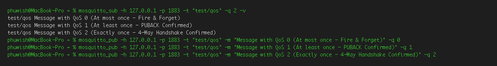
*รูปที่ 4: Log ของ Mosquitto Broker แสดงลำดับแพ็กเก็ต Handshake ในแต่ละระดับ QoS*

---

### 3.4 การทดสอบ Retained Message
* เมื่อส่งข้อความปกติในขณะที่ยังไม่มีใคร Subscribe -> ข้อความจะหายไปในทันที
* เมื่อส่งข้อความโดยระบุพารามิเตอร์ `-r` (Retain) -> Broker จะบันทึกข้อความล่าสุดค้างไว้ในระบบ เมื่อมี Subscriber เชื่อมต่อเข้ามาในภายหลัง จะได้รับข้อความนี้ทันทีโดยไม่ต้องรอรอบส่งใหม่


*รูปที่ 5: หน้าต่าง Subscriber เชื่อมต่อเข้ามาใหม่และได้รับข้อความ Retained ทันที*

---

### 3.5 การทดสอบ Last Will and Testament (LWT)
* กำหนด Will Topic: `node/esp32/status` ด้วย Payload: `LOST_CONNECTION_OFFLINE`
* เมื่อทดลองจำลองสถานการณ์โปรเซสปิดตัวลงอย่างกะทันหันด้วยคำสั่ง `kill -9` (ตัดการเชื่อมต่อโดยไม่ส่งแพ็กเก็ต `DISCONNECT`) -> Broker จะกระจายข้อความ LWT นี้ไปยัง Subscriber ทุกตัวโดยอัตโนมัติ

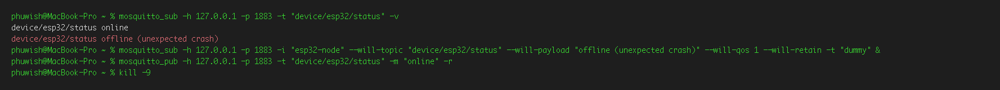
*รูปที่ 6: ฝั่ง Subscriber ได้รับข้อความแจ้งเตือนสถานะ Offline จากกลไก LWT ของ Broker*

---

### 3.6 ตอบคำถามท้ายการทดลอง 11.1
1. **เพราะเหตุใดสัญลักษณ์ `#` จึงต้องวางไว้ที่ตำแหน่งท้ายสุดของ Topic เสมอ? หากกำหนด Topic Filter เป็น `home/#/light` จะเกิดข้อผิดพลาดอย่างไร?**
   * *ตอบ:* สัญลักษณ์ `#` คือ Multi-level wildcard ซึ่งครอบคลุมหัวข้อย่อยทุกระดับชั้นที่อยู่ถัดไปจนถึงปลายทางทั้งหมด ตามมาตรฐาน MQTT จึงกำหนดให้วางไว้ที่ระดับสุดท้ายเท่านั้น หากกำหนดเป็น `home/#/light` จะถือว่าผิดรูปแบบไวยากรณ์ (Syntax Error) ของโปรโตคอล MQTT ส่งผลให้ Broker ปฏิเสธคำขอ Subscribe ทันที
2. **ในระบบงานติดตามยานพาหนะ (GPS Tracking) ที่ส่งพิกัดรถยนต์ทุกๆ 1 วินาที ท่านคิดว่าควรเลือกระดับ QoS ใดระหว่าง QoS 0, 1 หรือ 2 เพราะเหตุใด?**
   * *ตอบ:* ควรเลือก **QoS 0** เนื่องจากข้อมูลพิกัดถูกส่งด้วยความถี่สูง (ทุก 1 วินาที) หากมีแพ็กเก็ตบางตัวสูญหาย ข้อมูลตำแหน่งใหม่ในวินาทีถัดไปจะเข้ามาทดแทนทันที การใช้ QoS 1 หรือ QoS 2 จะทำให้เกิด Network Overhead และเกิดความล่าช้าจากการรอแพ็กเก็ตยืนยัน (ACK) โดยไม่จำเป็น
3. **หาก Client ส่งแพ็กเก็ต `DISCONNECT` ไปยัง Broker อย่างถูกต้องก่อนปิดโปรแกรม ข้อความ Last Will and Testament (LWT) จะถูกเผยแพร่ออกไปหรือไม่ เพราะเหตุใด?**
   * *ตอบ:* **ไม่ถูกเผยแพร่** เนื่องจากแพ็กเก็ต `DISCONNECT` เป็นการแจ้งยุติการเชื่อมต่อตามลำดับปกติ (Graceful Disconnect) ทำให้ Broker ล้างข้อความ LWT ออกจากหน่วยความจำทันที กลไก LWT จะทำงานเฉพาะกรณีที่การเชื่อมต่อขาดหายไปอย่างผิดปกติ (Ungraceful Disconnect เช่น ไฟดับ หรือสายสัญญาณหลุด) เท่านั้น
4. **Retained Message มีประโยชน์อย่างไรในการออกแบบระบบแดชบอร์ด Smart Home สำหรับผู้ใช้งานที่เพิ่งเปิดแอปพลิเคชันขึ้นมาเป็นครั้งแรก?**
   * *ตอบ:* ช่วยให้แดชบอร์ดหรือแอปพลิเคชันที่เพิ่งเปิดใช้งานและเชื่อมต่อเข้ามาใหม่ สามารถดึงสถานะล่าสุดของอุปกรณ์ (เช่น สถานะเปิด/ปิดของหลอดไฟ หรืออุณหภูมิล่าสุด) มาแสดงผลบนหน้าจอได้ในทันที โดยไม่ต้องรอให้อุปกรณ์ฝั่งเซนเซอร์ส่งข้อมูลในรอบถัดไป

---

## 4. ใบงานที่ 11.2: การพัฒนา ESP32 MQTT Client (Telemetry & Control)

> 🎥 **วิดีโอสาธิตการทำงานจริง (YouTube Shorts):** [https://www.youtube.com/shorts/JMp2Mwli6h4](https://www.youtube.com/shorts/JMp2Mwli6h4)  
> *(แสดงการหมุน Potentiometer เปลี่ยนแปลงค่า Telemetry JSON บนจอคอมพิวเตอร์ และการส่งคำสั่งเปิด-ปิดหลอดไฟ LED บนบอร์ดจริง)*

### 4.1 ผลการรันโปรแกรมบน ESP32
* บอร์ดเชื่อมต่อเครือข่าย Wi-Fi สำเร็จ และได้รับ IP Address จากเราเตอร์
* เชื่อมต่อไปยัง Mosquitto Broker บนเครื่องคอมพิวเตอร์ผ่านพอร์ต 1883
* เผยแพร่สถานะ `online` (Retain = 1) และทำการ Subscribe รอรับคำสั่งที่หัวข้อ `iot/node01/cmd/led`
* ส่งข้อมูลเซนเซอร์ Telemetry เป็นโครงสร้าง JSON ทุกๆ 4 วินาที:
```json
{"node_id":"esp32-node01","adc_raw":1850,"voltage_v":1.49,"led_state":false,"uptime_ms":12500}
```

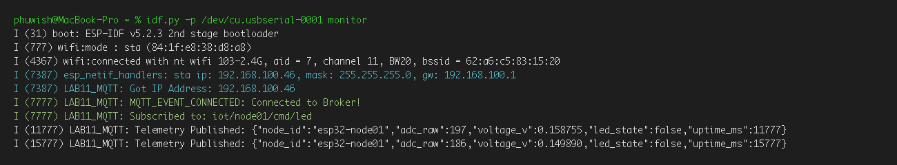
*รูปที่ 7: Serial Monitor ของ ESP32 แสดง Log การเชื่อมต่อ Wi-Fi, เชื่อมต่อ Broker และการส่งข้อมูล Telemetry*

---

### 4.2 ผลการทดสอบ Telemetry และการหมุน Potentiometer
* รันคำสั่ง `mosquitto_sub -h 127.0.0.1 -p 1883 -t "iot/node01/telemetry" -v`
* เมื่อทดลองหมุนก้านของ Potentiometer ค่า `adc_raw` (ช่วง 0 - 4095) และระดับแรงดัน `voltage_v` (ช่วง 0.0 - 3.3V) มีการเปลี่ยนแปลงตามสัดส่วนการหมุนจริงอย่างแม่นยำ

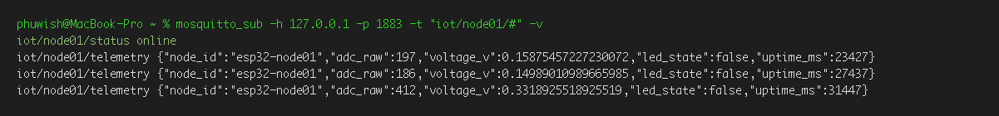
*รูปที่ 8: Terminal ฝั่ง Subscriber แสดงค่า Telemetry JSON ที่เปลี่ยนแปลงตามการหมุน Potentiometer จริง*

---

### 4.3 ผลการสั่งงานเปิด-ปิดหลอดไฟ LED จากระยะไกล
* ทดสอบสั่งเปิดไฟ: `mosquitto_pub -h 127.0.0.1 -p 1883 -t "iot/node01/cmd/led" -m "ON" -q 1`
  - หลอดไฟ LED บนขา GPIO 2 ติดสว่างขึ้นทันที
  - ตัวบอร์ด Publish ข้อความยืนยันสถานะกลับมาที่ `iot/node01/state/led` ด้วยข้อความ `{"led_state": true}`
* ทดสอบสั่งปิดไฟ: `mosquitto_pub -h 127.0.0.1 -p 1883 -t "iot/node01/cmd/led" -m "OFF" -q 1`
  - หลอดไฟ LED บนขา GPIO 2 ดับลงทันที
  - ตัวบอร์ด Publish ข้อความตอบกลับเป็น `{"led_state": false}`

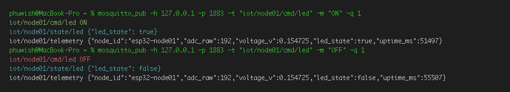
*รูปที่ 9: การส่งคำสั่งเปิด-ปิดไฟผ่าน mosquitto_pub ควบคู่กับการแสดงสถานะของหลอดไฟ LED บนบอร์ด*

---

### 4.4 ตอบคำถามท้ายการทดลอง 11.2
1. **เพราะเหตุใดเราจึงต้องส่งข้อความสถานะ `iot/node01/status = "online"` ด้วยแฟล็ก `retain = 1` ควบคู่กับการตั้งค่า Last Will and Testament (LWT) ว่า `"offline"`?**
   * *ตอบ:* เพื่อสร้างระบบติดตามสถานะอุปกรณ์ (Device Presence Monitoring) ที่สมบูรณ์ เมื่ออุปกรณ์เชื่อมต่อสำเร็จ จะส่งสถานะ `online` แบบ Retained ค้างไว้บน Broker ทำให้ผู้ใช้หรือแดชบอร์ดที่เพิ่งเปิดระบบขึ้นมาทราบได้ทันทีว่าบอร์ดพร้อมใช้งาน และหากบอร์ดเกิดไฟดับหรือขาดการเชื่อมต่ออย่างกะทันหัน กลไก LWT ของ Broker จะเขียนทับสถานะเป็น `offline` อัตโนมัติ ทำให้ผู้ใช้ทราบสถานะที่แท้จริงตลอดเวลา
2. **หากเครือข่าย Wi-Fi หลุดชั่วคราว คอมโพเนนต์ `esp-mqtt` มีพฤติกรรมการจัดการอย่างไร และเมื่อสัญญาณกลับมา โค้ดจำเป็นต้องเรียกฟังก์ชันเชื่อมต่อใหม่ด้วยตนเองหรือไม่?**
   * *ตอบ:* คอมโพเนนต์ `esp-mqtt` มีกลไกจัดการ Auto-reconnect อยู่ภายในตัว โดยเมื่อสัญญาณ Wi-Fi หลุด ระบบจะหน่วงเวลาและพยายามส่งคำขอเชื่อมต่อใหม่เป็นระยะโดยอัตโนมัติ ผู้พัฒนาจึงไม่จำเป็นต้องเขียนโค้ดเรียกฟังก์ชันเชื่อมต่อใหม่เองในลูปหลัก
3. **ในฟังก์ชัน `telemetry_task` เพราะเหตุใดหลังจากเรียก `cJSON_PrintUnformatted(root)` แล้วเราจึงจำเป็นต้องเรียกฟังก์ชัน `free(json_str)` และ `cJSON_Delete(root)` เสมอ? หากละเลยจะมีผลเสียอย่างไรต่อหน่วยความจำของ ESP32?**
   * *ตอบ:* เนื่องจากฟังก์ชันสร้าง Object ของ `cJSON` และการแปลงเป็น String ทำการจัดสรรหน่วยความจำแบบไดนามิกบน Heap หากไม่เรียกคืนด้วย `free()` และ `cJSON_Delete()` หน่วยความจำจะถูกจองสะสมไปเรื่อยๆ เกิดปัญหา Memory Leak อย่างรวดเร็ว ส่งผลให้หน่วยความจำ Heap หมด (Out of Memory) และทำให้เกิดข้อผิดพลาด Guru Meditation Error จนบอร์ดแครชและรีเซ็ตตัวเองวนลูปในที่สุด

---

## 5. ใบงานที่ 11.3: การสื่อสาร MQTT ความปลอดภัยสูงด้วย TLS และการยืนยันตัวตนสองทาง (mTLS)

### 5.1 การสร้างกุญแจและใบรับรองดิจิทัล (OpenSSL PKI)
* สร้าง Root Certificate Authority (CA): `ca.key`, `ca.crt`
* สร้าง Broker Server Certificate: `server.key`, `server.crt` (กำหนดค่า CN ให้ตรงกับ IP เครื่อง Broker)
* สร้าง ESP32 Client Certificate: `client.key`, `client.crt` (กำหนดค่า CN = `esp32-secure-node`)

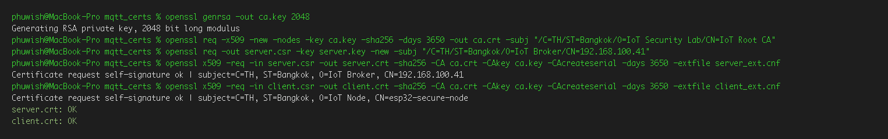
*รูปที่ 10: หน้าต่าง Terminal แสดงการใช้ OpenSSL สร้างกุญแจและใบรับรองดิจิทัลครบทั้ง 6 ไฟล์*

---

### 5.2 การทดสอบ CLI MQTTS (พอร์ต 8883)
1. **การเชื่อมต่อที่ถูกต้อง (Authorized Client):** ไคลเอนต์แนบไฟล์ครบทั้ง `cafile`, `cert`, และ `key` -> ทำการเชื่อมต่อสำเร็จและสามารถรับส่งข้อความผ่านช่องทางเข้ารหัสได้
2. **การทดสอบกรณีไม่แนบ Client Certificate (Unauthorized Client):** ไม่ระบุใบรับรองฝั่งไคลเอนต์ -> Broker ทำการตัดการเชื่อมต่อทันที พร้อมแจ้งข้อผิดพลาด `peer did not return a certificate`

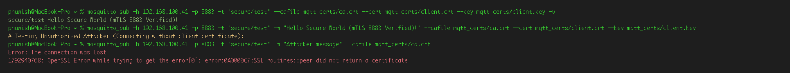
*รูปที่ 11: ผลการทดสอบเปรียบเทียบระหว่าง Authorized Client ที่ผ่านการรับรอง และ Unauthorized Client ที่ถูกปฏิเสธ*

---

### 5.3 ผลการเชื่อมต่อ MQTTS mTLS บน ESP32
* นำไฟล์ใบรับรองและกุญแจส่วนตัวฝังลงในเฟิร์มแวร์ผ่านคำสั่ง `EMBED_TXTFILES` ในระบบคอมไพล์
* บอร์ด ESP32 เริ่มต้นกระบวนการ TLS Handshake ร่วมกับ Mosquitto Broker สำเร็จ
* ฝั่ง Broker ตรวจสอบและแสดงข้อความยืนยัน: `Peer certificate verified: ... CN=esp32-secure-node`

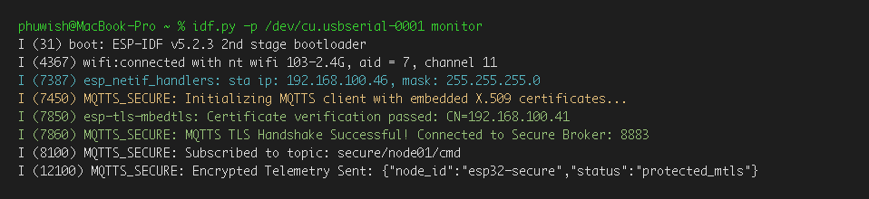
*รูปที่ 12: Serial Monitor ของ ESP32 แสดงความสำเร็จในการทำ TLS Handshake ควบคู่กับ Log ของ Broker*

---

### 5.4 ตอบคำถามท้ายการทดลอง 11.3
1. **เพราะเหตุใดในคำสั่งสร้าง Server CSR ค่า Common Name (CN) จึงต้องระบุเป็น IP Address หรือ Hostname ของ Broker ให้ตรงกันพอดี? หากระบุเป็นชื่ออื่นจะเกิดข้อผิดพลาดใดขึ้น?**
   * *ตอบ:* ในขั้นตอนการทำ TLS Handshake ไคลเอนต์จะนำค่า Hostname หรือ IP ปลายทางที่เชื่อมต่อไปตรวจสอบเทียบกับค่า Common Name (CN) หรือ Subject Alternative Name (SAN) ในใบรับรองของ Server หากไม่ตรงกัน ไคลเอนต์จะถือว่าใบรับรองไม่ถูกต้อง เกิดข้อผิดพลาด `Certificate Name Mismatch` และตัดการเชื่อมต่อทันทีเพื่อป้องกันการถูกโจมตีแบบดักรับข้อมูลกลางทาง (Man-in-the-Middle Attack)
2. **การยืนยันตัวตนแบบ Mutual Authentication (mTLS) แตกต่างจากการใช้ HTTPS ทั่วไปบนเว็บเบราว์เซอร์อย่างไรในประเด็นเรื่องใบรับรองฝั่ง Client?**
   * *ตอบ:* HTTPS ทั่วไปใช้การยืนยันตัวตนเพียงฝั่งเดียว (One-Way TLS) โดยมีเพียง Server เท่านั้นที่ต้องแสดงใบรับรองดิจิทัลให้เบราว์เซอร์ตรวจ ส่วนฝั่งไคลเอนต์จะระบุตัวตนด้วย Username/Password แต่ระบบ mTLS กำหนดให้ทั้ง Server และ Client ต้องแลกเปลี่ยนใบรับรองดิจิทัลที่ลงนามโดย CA ที่เชื่อถือได้ให้กันและกันตรวจสอบ จึงสามารถป้องกันอุปกรณ์แปลกปลอมเข้ามาในระบบ IoT ได้อย่างมีประสิทธิภาพ
3. **หากมีผู้ไม่หวังดีขโมยไฟล์เฟิร์มแวร์ไบนารี (`.bin`) ของบอร์ด ESP32 ไปได้ เขาจะสามารถกู้คืนไฟล์ `client.key` ได้หรือไม่ และในระบบ IoT เชิงพาณิชย์เรามีฮาร์ดแวร์ความปลอดภัยใดมาช่วยแก้ไขปัญหานี้?**
   * *ตอบ:* สามารถกู้คืนได้ เนื่องจากคำสั่ง `EMBED_TXTFILES` จะฝังข้อมูลกุญแจในรูปแบบ Plaintext ลงในพื้นที่ Flash Memory หากมีไฟล์ไบนารีก็สามารถใช้โปรแกรม Disassembler หรือ Hex Viewer ค้นหากุญแจออกมาได้ สำหรับงานเชิงพาณิชย์จะป้องกันด้วยการเปิดใช้งาน **Flash Encryption** ร่วมกับ **Secure Boot** บนฮาร์ดแวร์ของ ESP32 และใช้วงจร **Digital Signature Peripheral (DS)** หรือชิปรักษาความปลอดภัยภายนอก (Secure Element เช่น ATECC608A) ในการจัดเก็บ Private Key ไว้ในโซนที่อ่านย้อนกลับไม่ได้

---

## 6. ใบงานที่ 11.4: แพลตฟอร์มคลาวด์ ESP RainMaker & Smart Light

> 🎥 **วิดีโอสาธิตการทำงานจริง (YouTube Shorts):** [https://www.youtube.com/shorts/FS7aSXBQBvA](https://www.youtube.com/shorts/FS7aSXBQBvA)  
> *(แสดงการควบคุมเปิด-ปิดหลอดไฟ LED ผ่านแอปพลิเคชัน ESP RainMaker บนสมาร์ตโฟนด้วยเครือข่ายอินเทอร์เน็ตมือถือ)*

### 6.1 ผลการรันเฟิร์มแวร์และกระบวนการ Provisioning
* แฟลชเฟิร์มแวร์ RainMaker ลงบน ESP32 และตั้งค่าระบบ Assisted Claiming
* บอร์ดเริ่มต้นสร้างการกระจายสัญญาณ BLE Advertising ในชื่อ Service: `PROV_86a09d` (Proof of Possession / POP: `2780c63d`)
* หน้าต่าง Serial Monitor แสดงข้อมูล QR Code และ URL สำหรับเข้าสู่ขั้นตอนการจับคู่อุปกรณ์บนแอป ESP RainMaker

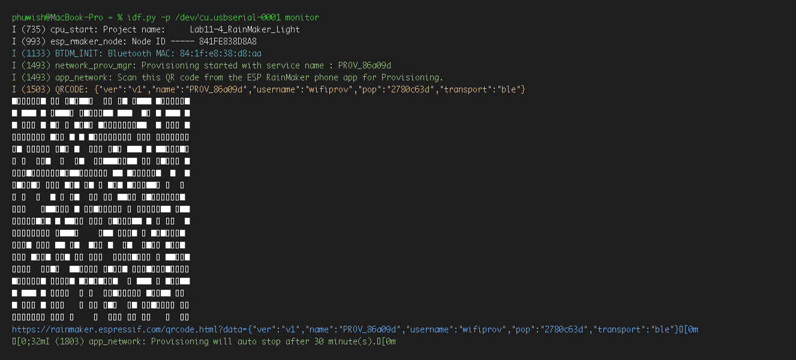
*รูปที่ 13: Serial Monitor แสดง Log การเริ่มต้น Provisioning และ QR Code สำหรับสแกนจับคู่*

<div align="center">
  
  <br/>
  <b>QR Code สำหรับสแกนผ่านแอปพลิเคชัน ESP RainMaker บนสมาร์ตโฟน</b><br/>
  ลิงก์ตรงสำหรับเปิด QR Code ผ่านเบราว์เซอร์: <a href="https://rainmaker.espressif.com/qrcode.html?data=%7B%22ver%22%3A%22v1%22%2C%22name%22%3A%22PROV_86a09d%22%2C%22username%22%3A%22wifiprov%22%2C%22pop%22%3A%222780c63d%22%2C%22transport%22%3A%22ble%22%7D">เปิดหน้า QR Code ของ Espressif</a>
</div>

---

### 6.2 การผูกอุปกรณ์และกระบวนการ Provisioning บนแอปมือถือ
* สแกน QR Code เพื่อเชื่อมต่อผ่านสัญญาณ BLE
* ดำเนินการยืนยันตัวตน Node Association, ยืนยันการเชื่อมต่อ Wi-Fi และสร้าง Node บนระบบคลาวด์
* ระบบทำการ Assisted Claiming ดึงใบรับรองความปลอดภัยจาก AWS IoT Backend ของ Espressif ให้อัตโนมัติ แสดงผล "Device Added Successfully!!"

<div align="center">
  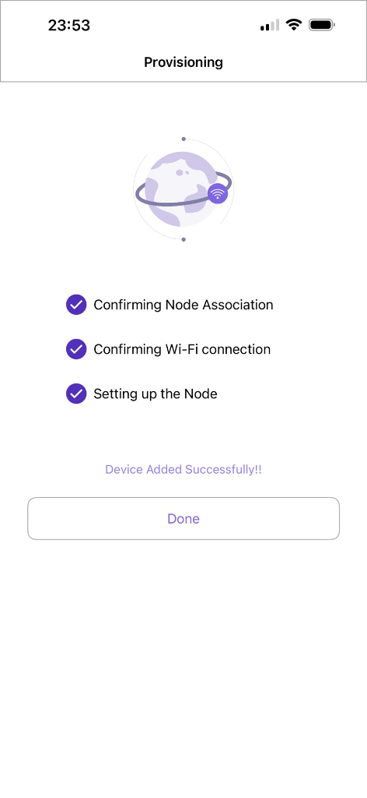
  <br/>
  <b>รูปที่ 14: ภาพหน้าจอแอป ESP RainMaker แสดงการยืนยัน Node Association และเพิ่มอุปกรณ์สำเร็จ</b>
</div>

---

### 6.3 ผลการทดสอบควบคุมระยะไกล (Local Wi-Fi และ 4G/5G Remote Control)
* ทดสอบสวิตช์ Power และปรับความสว่าง Brightness: หลอดไฟ LED บนบอร์ดตอบสนองตามคำสั่งทันที
* ทดสอบปิด Wi-Fi บนโทรศัพท์มือถือ และเปิดใช้สัญญาณอินเทอร์เน็ตมือถือ 4G/5G พบว่าสามารถสั่งการเปิด-ปิดไฟข้ามเครือข่ายอินเทอร์เน็ตได้ตามปกติ

<div align="center">
  
  <br/>
  <b>รูปที่ 15: หน้าจอแอปพลิเคชันสั่งเปิดไฟ (Power: On) และปรับความสว่าง (Brightness: 100%) ผ่านเครือข่าย 5G</b>
</div>

---

### 6.4 ตอบคำถามท้ายการทดลอง 11.4
1. **ในสถาปัตยกรรม ESP RainMaker กระบวนการ Assisted Claiming ช่วยแก้ปัญหาเรื่องการติดตั้งใบรับรองความปลอดภัย (Security Certificates) บนอุปกรณ์ในขั้นตอนพัฒนาต้นแบบได้อย่างไร?**
   * *ตอบ:* ช่วยให้อุปกรณ์ ESP32 ในขั้นพัฒนาต้นแบบไม่จำเป็นต้องถูกโปรแกรมใบรับรองดิจิทัลและกุญแจลับเฉพาะตัวมาจากโรงงาน โดยใช้แอปพลิเคชันบนสมาร์ตโฟนเป็นตัวกลาง (Assistant) ในการร้องขอ Claiming Certificate จาก RainMaker Cloud บน AWS ผ่านช่องทางบลูทูธ (BLE) มาติดตั้งลงบนพื้นที่จัดเก็บความปลอดภัยของบอร์ดโดยอัตโนมัติ ทำให้ขั้นตอนการพัฒนามีความสะดวก รวดเร็ว และยังคงความปลอดภัยระดับสากล
2. **เพราะเหตุใดฟังก์ชัน `write_cb` จึงต้องเรียกคำสั่ง `esp_rmaker_param_update_and_report()` ทุกครั้งที่มีการเปลี่ยนแปลงค่าพารามิเตอร์?**
   * *ตอบ:* เพื่ออัปเดตสถานะของตัวแปรภายในอุปกรณ์ (Local State) และส่งรายงานสถานะล่าสุดกลับขึ้นสู่ระบบคลาวด์ (Cloud Shadow) ทำให้หน้าจอแอปพลิเคชันบนสมาร์ตโฟนของผู้ใช้งานทุกคนซิงก์แสดงผลสถานะตรงกับอุปกรณ์จริงในแบบ Real-time
3. **เปรียบเทียบความแตกต่างระหว่างการพัฒนาอุปกรณ์ IoT ด้วย Plain MQTT บน Mosquitto เอง (ในแล็บ 11.2) กับการใช้ ESP RainMaker SDK (ในแล็บ 11.4) ในแง่ของความพยายามในการพัฒนา (Development Effort), ความปลอดภัย (Security), และการขยายระบบ (Scalability)**
   * *ตอบ:*
     * **Development Effort:** Mosquitto ผู้พัฒนาต้องออกแบบโครงสร้างหัวข้อ, สร้างแอปพลิเคชันฝั่งผู้ใช้ และบริหารจัดการเซิร์ฟเวอร์เองทั้งหมด ในขณะที่ RainMaker มีเฟรมเวิร์กสำเร็จรูป มีแอปพลิเคชันมือถือพร้อมใช้ และมี Cloud Backend ให้บริการเสร็จสรรพ
     * **Security:** Mosquitto แบบดั้งเดิมไม่มีการเข้ารหัสข้อมูล (หากต้องการความปลอดภัยต้องจัดทำระบบ mTLS เองซึ่งมีความซับซ้อนสูง) ส่วน RainMaker ใช้มาตรฐานความปลอดภัยระดับสูงสุดบน AWS IoT Core ผ่านการเข้ารหัส TLS 1.2 และมี Device Certificate ประจำแต่ละอุปกรณ์โดยอัตโนมัติ
     * **Scalability:** Mosquitto ที่ติดตั้งบนเครื่องส่วนบุคคลรองรับอุปกรณ์ได้จำกัดและติดปัญหาเรื่อง NAT/Firewall ในการเข้าถึงจากภายนอก ส่วน RainMaker ทำงานบนโครงสร้างคลาวด์ระดับโลก รองรับอุปกรณ์จำนวนมหาศาล และควบคุมได้จากทุกที่ทั่วโลก
4. **อธิบายขั้นตอนที่ทำให้ ESP RainMaker สามารถเชื่อมโยงการทำงานร่วมกับระบบสั่งงานด้วยเสียงของ Google Home หรือ Amazon Alexa ได้โดยไม่ต้องเขียนโค้ดเพิ่มเติมบนตัวบอร์ด ESP32**
   * *ตอบ:* เกิดจากระบบ Cloud-to-Cloud Integration ระหว่าง RainMaker Cloud และ Voice Assistant Platform โดยเมื่อผู้ใช้ทำการผูกบัญชี (Account Linking) คลาวด์ของ Google/Amazon จะส่งคำสั่งเสียงมาแปลงเป็น Data Model มาตรฐานของ RainMaker แล้วส่งลงมายังอุปกรณ์ ตัวบอร์ดจึงประมวลผลคำสั่งผ่านฟังก์ชัน Callback ปกติได้ทันทีโดยไม่ต้องมีโค้ดเฉพาะสำหรับระบบเสียงบนบอร์ด

---

## 7. สรุปผลการทดลองและการประยุกต์ใช้งาน

การทดลองในสัปดาห์ที่ 11 ได้ศึกษาและลงมือปฏิบัติการจริงเกี่ยวกับเทคโนโลยี IoT ครบวงจร โดยมีข้อสรุปที่สำคัญดังนี้:
1. **ด้านโปรโตคอล MQTT:** เข้าใจกลไกการทำงานของ Eclipse Mosquitto Broker, การเลือกใช้ระดับ QoS 0/1/2 ให้เหมาะสมกับประเภทข้อมูล, การใช้ประโยชน์จาก Retained Message ในการเก็บค่าล่าสุด และการตั้งค่า Last Will and Testament (LWT) เพื่อตรวจจับอุปกรณ์ที่หลุดจากการเชื่อมต่อ
2. **ด้านการพัฒนาอุปกรณ์จริง (ESP32):** สามารถพัฒนาเฟิร์มแวร์เชื่อมโยงการอ่านค่าเซนเซอร์แอนะล็อก (Potentiometer) ส่งข้อมูล Telemetry ในรูปแบบ JSON ควบคู่กับการรับคำสั่งควบคุมหลอดไฟ LED ผ่านเครือข่าย Wi-Fi ได้อย่างมีเสถียรภาพ
3. **ด้านความมั่นคงปลอดภัย:** ได้ลงมือจัดตั้ง Public Key Infrastructure (PKI) ด้วย OpenSSL และทดสอบการยืนยันตัวตนสองทาง (mTLS) บนพอร์ต 8883 ซึ่งช่วยป้องกันการถูกดักฟังและการเชื่อมต่อจากอุปกรณ์แปลกปลอมได้อย่างสมบูรณ์
4. **ด้านระบบคลาวด์เชิงพาณิชย์:** ได้เรียนรู้การประยุกต์ใช้แพลตฟอร์ม ESP RainMaker ผ่านการทำ BLE Provisioning, การดึงใบรับรองอัตโนมัติด้วย Assisted Claiming และการควบคุมเปิด-ปิดไฟผ่านเครือข่ายมือถือ 5G ซึ่งสามารถนำไปต่อยอดในการพัฒนาอุปกรณ์ Smart Home เชิงพาณิชย์ในชีวิตจริงได้อย่างมีประสิทธิภาพ

