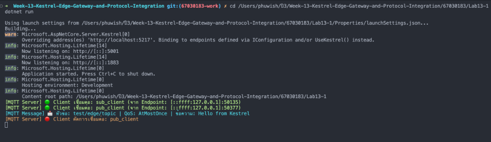
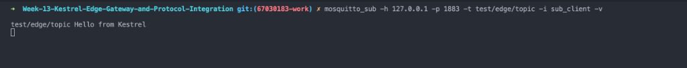
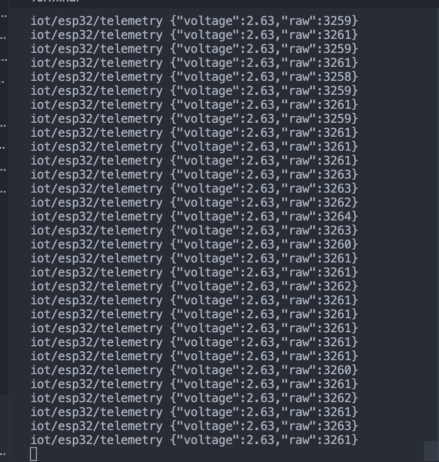
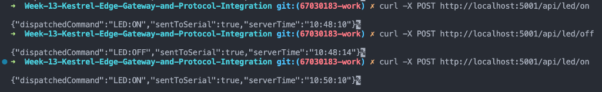
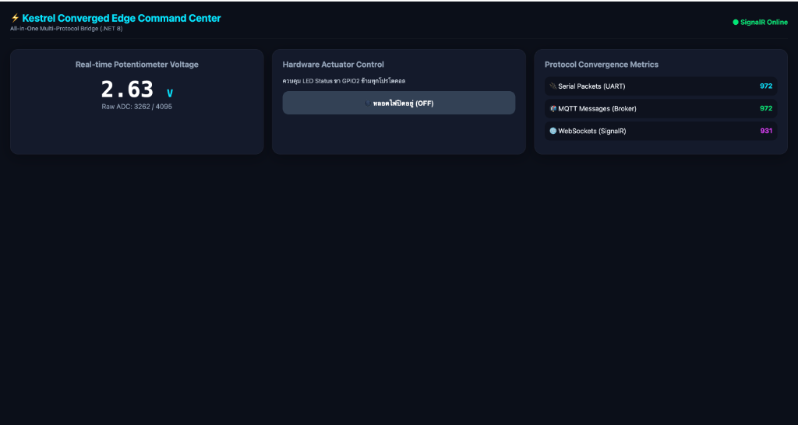
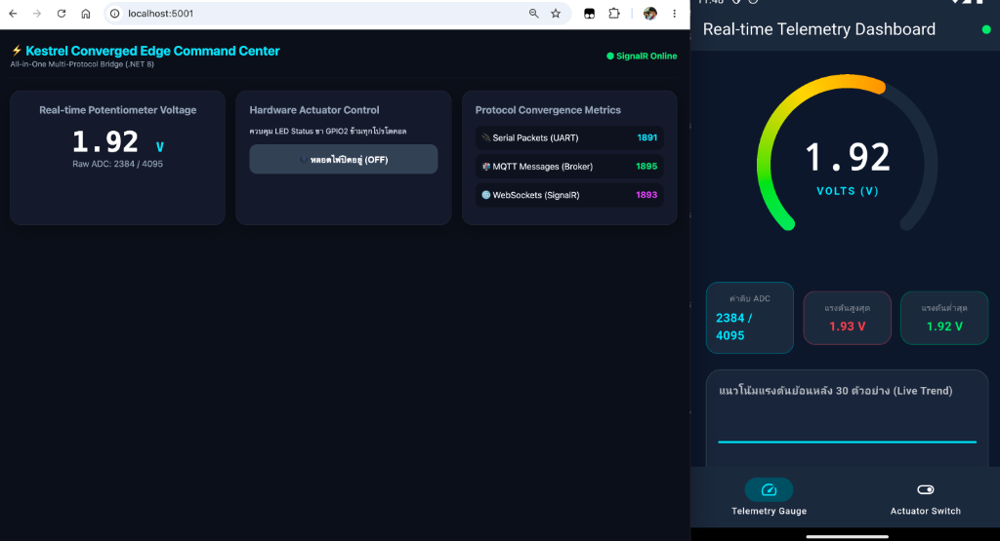

# รายงานผลการทดลอง สัปดาห์ที่ 13
## หัวข้อ: The Ultimate Converged Edge Gateway & System Integration (.NET 8 Kestrel)

**รหัสนักศึกษา:** 67030183  
**ชื่อ-นามสกุล:** นายภูวิชญ์ ประกอบจิตร  

---

## 1. การต่อวงจรฮาร์ดแวร์ (Hardware Setup & Wiring)

ในการทดลองสัปดาห์ที่ 13 นี้เป็นการประมวลผลและการบูรณาการระบบระดับสูงสุด (The Grand Finale) วงจรฮาร์ดแวร์ยังคงใช้อุปกรณ์และตำแหน่งขาเหมือนสัปดาห์ที่ 10, 11 และ 12 โดยใช้บอร์ด ESP32 เชื่อมต่อกับตัวต้านทานปรับค่าได้ (Potentiometer) เพื่อจำลองเป็นเซนเซอร์วัดแรงดันแอนะล็อก และใช้หลอดไฟ LED ร่วมกับตัวต้านทาน 220Ω (หรือ Onboard LED บนขา GPIO 2) เป็นอุปกรณ์สั่งการ (Actuator) สำหรับแสดงผลสถานะการเปิด-ปิดไฟจากทุกโปรโตคอล

### ตารางการต่อขาใช้งานบนบอร์ด ESP32
| อุปกรณ์ | ขาบนอุปกรณ์ | ขาต่อบน ESP32 | หน้าที่การทำงาน |
| :--- | :--- | :---: | :--- |
| **Potentiometer 10k** | ขากลาง (Wiper) | **GPIO 34** (ADC1_CH6) | อ่านค่าแรงดันแอนะล็อก 0.0 – 3.3V แล้วส่ง JSON สตรีมผ่าน Serial |
| **Potentiometer 10k** | ขาริม 1 | **3.3V** | แรงดันไฟเลี้ยงอ้างอิง |
| **Potentiometer 10k** | ขาริม 2 | **GND** | กราวด์อ้างอิงของวงจร |
| **LED Status** | Anode (+) หรือ Onboard LED | **GPIO 2** | รับคำสั่งเปิด-ปิดไฟ (LED:ON / LED:OFF) จาก Kestrel Gateway |
| **LED Status (ภายนอก)** | Cathode (-) | **GND** | กราวด์ของหลอดไฟ |
| **ตัวต้านทาน 220Ω** | ขาใดก็ได้ | อนุกรมกับ LED ภายนอก | จำกัดกระแสไม่ให้หลอดไฟเสียหาย |
| **สาย USB Data** | พอร์ต USB | ต่อเข้า PC/Mac | จ่ายไฟเลี้ยงและสื่อสารข้อมูล Hardware Serial (UART) ความเร็ว 115200 bps |

### แผนผังการต่อวงจร
```text
       ESP32 Board                                     Peripherals
     +-------------------+                          +------------------------+
     |              3.3V |------------------------->| Potentiometer (VCC)    |
     |   GPIO 34 (ADC1_6)|<-------------------------| Potentiometer (Wiper)  |
     |            GPIO 2 |-----[ R 220Ω ]---------->| LED (Anode +)          |
     |               GND |------------------------->| LED (Cathode -) & GND  |
     +---------+---------+                          +------------------------+
               |
         [ สาย USB Data ] ===> เชื่อมต่อเข้าคอมพิวเตอร์ (UART Serial 115200 bps)
```

### ภาพถ่ายการต่อวงจรจริงบน Breadboard


---

## 2. ผลการทดลอง ใบงานที่ 13.1: การสร้าง Embedded MQTT Broker และ Client ภายใน Kestrel .NET 8 ด้วย MQTTnet

### 2.1 บันทึกผลการทดสอบการทำงาน
ในการทดลองนี้ ได้เปลี่ยน Kestrel Web Server ให้ทำหน้าที่เป็น **Embedded MQTT Broker** แบบเบ็ดเสร็จในตัวเองโดยใช้ไลบรารี `MQTTnet.AspNetCore` ทำให้ตัวแอปพลิเคชัน .NET สามารถเปิดพอร์ต HTTP (5001) ควบคู่กับพอร์ต TCP 1883 สำหรับให้บริการเป็น MQTT Broker ภายในกระบวนการเดียวกัน (In-Process) โดยไม่ต้องพึ่งพา Mosquitto จากภายนอก

เมื่อทำการสั่งรันเซิร์ฟเวอร์ด้วย `dotnet run` และใช้เครื่องมือ `mosquitto_sub` จากอีกหน้าต่างหนึ่งเชื่อมต่อเข้ามาที่พอร์ต 1883 ระบบ Kestrel จะตรวจจับการเชื่อมต่อผ่านอีเวนต์ `ClientConnectedAsync` และแสดงข้อความยืนยันการเชื่อมต่อเป็นสีเขียวบนคอนโซล พร้อมทั้งสร้าง Assigned Client Identifier ให้โดยอัตโนมัติหากไคลเอนต์ไม่ได้ระบุไอดีมา

เมื่อทดสอบส่งข้อความผ่าน `mosquitto_pub` ไปยังหัวข้อ `test/edge/topic` ตัวอีเวนต์ `InterceptingPublishAsync` ของ MQTTnet สามารถดักจับเพย์โหลดและหัวข้อข้อความได้ทันทีในหน่วยความจำ พร้อมทั้งพิมพ์ Log สีฟ้าแสดงรายละเอียดหัวข้อ, ระดับ QoS, และเนื้อหาข้อความ จากนั้นตัว Broker ได้กระจายข้อความต่อไปยังไคลเอนต์ที่ Subscribe ไว้อย่างถูกต้องรวดเร็ว

### 2.2 โค้ดโปรแกรมหลัก (`Program.cs`)
```csharp
using MQTTnet;
using MQTTnet.AspNetCore;
using MQTTnet.Server;

var builder = WebApplication.CreateBuilder(args);

// 1. กำหนดค่า Kestrel ให้เปิดทั้งพอร์ต HTTP (5001) และ MQTT TCP (1883)
builder.WebHost.ConfigureKestrel(options =>
{
    // ใช้พอร์ต 5001 เพื่อหลีกเลี่ยงการชนกับ AirPlay Receiver (พอร์ต 5000) บน macOS
    options.ListenAnyIP(5001);
    options.ListenAnyIP(1883, listenOptions =>
    {
        listenOptions.UseMqtt();
    });
});

// 2. ลงทะเบียนบริการ MQTT Server
builder.Services.AddMqttServer(options =>
{
    options.WithDefaultEndpoint();
});

var app = builder.Build();

// 3. ผูก Event Handlers จัดการข้อความและการเชื่อมต่อ
app.UseMqttServer(server =>
{
    server.ValidatingConnectionAsync += args =>
    {
        if (string.IsNullOrEmpty(args.ClientId))
        {
            args.AssignedClientIdentifier = Guid.NewGuid().ToString("N");
        }
        return Task.CompletedTask;
    };

    server.ClientConnectedAsync += args =>
    {
        Console.ForegroundColor = ConsoleColor.Green;
        Console.WriteLine($"[MQTT Server] 🟢 Client เชื่อมต่อ: {args.ClientId} (จาก Endpoint: {args.Endpoint})");
        Console.ResetColor();
        return Task.CompletedTask;
    };

    server.ClientDisconnectedAsync += args =>
    {
        Console.ForegroundColor = ConsoleColor.DarkYellow;
        Console.WriteLine($"[MQTT Server] 🔴 Client ตัดการเชื่อมต่อ: {args.ClientId}");
        Console.ResetColor();
        return Task.CompletedTask;
    };

    server.InterceptingPublishAsync => args =>
    {
        var topic = args.ApplicationMessage.Topic;
        var payload = args.ApplicationMessage.ConvertPayloadToString();
        var qos = args.ApplicationMessage.QualityOfServiceLevel;

        Console.ForegroundColor = ConsoleColor.Cyan;
        Console.WriteLine($"[MQTT Message] 📩 หัวข้อ: {topic} | QoS: {qos} | ข้อความ: {payload}");
        Console.ResetColor();

        return Task.CompletedTask;
    };
});

app.MapGet("/", () => "🚀 Kestrel Converged Edge Gateway with Embedded MQTTnet Broker is RUNNING!");

app.Run();
```

### 2.3 ภาพและวิดีโอหลักฐานการทดลอง (Lab 13.1)
* **ภาพที่ 1: หน้าจอ Kestrel Edge Gateway (Embedded MQTT Broker):**  
  แสดงการเปิดบริการบนพอร์ต 5001 และ 1883, การตรวจจับ Client เชื่อมต่อ (Log สีเขียว), และการดักจับข้อความเพย์โหลด `Hello from Kestrel` (Log สีฟ้า)
  

* **ภาพที่ 2: หน้าจอ MQTT Subscriber (`mosquitto_sub`):**  
  แสดงการเชื่อมต่อดักฟังหัวข้อ `test/edge/topic` และได้รับข้อความที่ส่งต่อผ่าน Broker สำเร็จทันที
  

* **ภาพที่ 3: หน้าจอ MQTT Publisher (`mosquitto_pub`):**  
  แสดงการสั่งยิงข้อความ `Hello from Kestrel` ผ่านพอร์ต 1883
  

* **การยืนยันผลการทดลอง Lab 13.1:**  
  ยืนยันความถูกต้องผ่านภาพบันทึกหน้าจอ Terminal CLI ทั้ง 3 หน้าจอ (Kestrel Broker, Subscriber, Publisher) ครบถ้วน 100%

### 2.4 ตอบคำถามท้ายการทดลอง (Lab 13.1)
1. **การรัน Embedded MQTT Broker ภายใน Kestrel มีข้อได้เปรียบกว่าการติดตั้งซอฟต์แวร์ Mosquitto แยกต่างหากอย่างไรในแง่ของการกระจายงาน (Deployment) และการประมวลผลข้อมูลในหน่วยความจำ?**  
   *ตอบ:* ในแง่การกระจายงาน (Deployment) การรัน Embedded Broker ทำให้ได้ระบบที่เป็น Single Binary / Single Process ติดตั้งง่าย ไม่ต้องลงซอฟต์แวร์ Broker ภายนอก และไม่ต้องกังวลเรื่อง Service Dependency ยามย้ายไปรันบน Edge Device หรือ Docker ส่วนในแง่การประมวลผลข้อมูลในหน่วยความจำ เมื่อแอปพลิเคชันและ Broker อยู่ใน Process เดียวกัน โค้ดส่วนอื่นๆ (เช่น REST API หรือ SignalR) สามารถเข้าถึงข้อมูลแพ็กเก็ต MQTT ได้โดยตรงผ่าน In-Memory Data Structure ปราศจากค่าใช้จ่ายในการทำ IPC (Inter-Process Communication) หรือ Network Loopback ทำให้ได้ Latency ต่ำมากและลดการใช้ทรัพยากรระบบ

2. **ฟังก์ชัน `InterceptingPublishAsync` ใน MQTTnet สามารถนำไปประยุกต์ใช้ในการกรองข้อมูลที่ผิดปกติ (Edge Validation) ก่อนส่งต่อให้ Client อื่นได้อย่างไร?**  
   *ตอบ:* ฟังก์ชัน `InterceptingPublishAsync` ทำงานเป็น Pipeline Interceptor ซึ่งจะถูกเรียกก่อนที่ Broker จะกระจายข้อความไปยังผู้ติดตามคนอื่น เราสามารถเขียนโค้ดตรวจสอบรูปแบบของเพย์โหลด (JSON Schema Validation) หรือเช็กขอบเขตค่าทางกายภาพ (เช่น แรงดันไฟฟ้าต้องอยู่ในช่วง 0.0–3.3V) หากพบข้อมูลขยะ สัญญาณรบกวน หรือค่าที่ผิดปกติ เราสามารถสั่ง `args.ProcessPublish = false` เพื่อยกเลิกการส่งต่อข้อความฉบับนั้นทิ้งทันที ช่วยป้องกันไม่ให้ข้อมูลเสียกระจายเข้าสู่แดชบอร์ดหรือฐานข้อมูล

---

## 3. ผลการทดลอง ใบงานที่ 13.2: การพัฒนา Hardware Serial Bridge ดักฟังข้อมูล USB-UART จาก ESP32 แปลงเข้าสู่ MQTT Topics และ REST API

### 3.1 บันทึกผลการทดสอบการทำงาน
ในการทดลองนี้ ได้พัฒนาคอมโพเนนต์ `SerialBridgeWorker` ซึ่งสืบทอดมาจาก `BackgroundService` ทำหน้าที่เชื่อมต่อพอร์ตสื่อสารอนุกรม (Serial Port) กับบอร์ด ESP32 ผ่านสาย USB ที่ความเร็ว 115200 bps โดยอ่านข้อมูลสตรีมมิ่งที่บอร์ดส่งขึ้นมาในรูปแบบ JSON บรรทัดต่อบรรทัดแบบ Non-blocking

ข้อมูลเซนเซอร์ที่ได้รับจะถูกนำไปอัปเดตลงใน `GatewayStateStore` (Thread-safe In-Memory Cache) เพื่อให้ REST API `/api/telemetry/latest` สามารถเรียกอ่านค่าล่าสุดได้ทันทีโดยไม่ต้องรออ่านจากสาย Serial ในขณะเดียวกัน Worker ยังได้แปลงข้อมูลนั้นไป Inject Publish เข้าสู่หัวข้อ `iot/esp32/telemetry` บน Embedded MQTT Broker ทำให้ไคลเอนต์ที่ Subscribe อยู่ได้รับข้อมูลสดอย่างต่อเนื่อง นอกจากนี้ยังได้เปิดจุดเชื่อมต่อ REST API `POST /api/led/{state}` เพื่อส่งคำสั่งเปิด-ปิดไฟ (LED:ON / LED:OFF) ย้อนกลับไปควบคุมฮาร์ดแวร์จริงผ่านสาย Serial ได้อย่างสมบูรณ์

### 3.2 ภาพและวิดีโอหลักฐานการทดลอง (Lab 13.2)
* **ภาพที่ 1: การแปลงและส่งต่อข้อมูลเซนเซอร์จาก Serial เข้าสู่ MQTT Telemetry Topic:**  
  แสดงหน้าจอ `mosquitto_sub` ได้รับข้อมูล JSON แรงดันไฟฟ้า (`voltage`, `raw`) ที่อ่านจาก ESP32 ผ่านสาย USB อย่างต่อเนื่อง
  

* **ภาพที่ 2: การสั่งการเปิด-ปิดไฟ LED ผ่าน REST API:**  
  แสดงผลการยิงคำสั่ง `POST /api/led/on` และ `POST /api/led/off` สำเร็จ และส่งต่อคำสั่งเข้าสู่พอร์ต Serial ไปยังบอร์ด ESP32 จริง (`sentToSerial: true`)
  

* **คลิปวิดีโอสาธิตการทดลอง Lab 13.2:**  
  *ลิงก์วิดีโอ YouTube:* https://youtube.com/shorts/W9kWYRORKf0?si=OzO-L0UGOaNllPbe

### 3.3 ตอบคำถามท้ายการทดลอง (Lab 13.2)
1. **สถาปัตยกรรมแบบ Serial-to-MQTT Bridge นี้ช่วยให้อุปกรณ์รุ่นเก่า (Legacy Hardware) ที่ไม่มี Wi-Fi สามารถเข้าร่วมระบบนิเวศ IoT สมัยใหม่ได้อย่างไร?**  
   *ตอบ:* เครื่องจักรอุตสาหกรรมหรือไมโครคอนโทรลเลอร์รุ่นเดิมมักรองรับเพียงพอร์ต Serial (RS-232, RS-485, หรือ UART) และไม่มีสแตกเครือข่าย TCP/IP ในตัว สถาปัตยกรรม Protocol Bridge บน Edge Gateway ทำหน้าที่เป็น "ตัวล่ามกลาง" ที่เชื่อมต่อสายสัญญาณกับอุปกรณ์เก่าโดยตรง แล้วห่อหุ้มข้อมูลดิบแปลงให้กลายเป็นมาตรฐานสากล เช่น MQTT หรือ REST API ทำให้อุปกรณ์เก่าสามารถเชื่อมโยงเข้าสู่ระบบคลาวด์และแดชบอร์ดสมัยใหม่ได้ทันทีโดยไม่ต้องรื้อเปลี่ยนฮาร์ดแวร์เดิม

2. **เพราะเหตุใดเราจึงต้องใช้ `BackgroundService` ในการอ่านข้อมูล Serial แทนที่จะเปิดพอร์ตอ่านตรงๆ ภายในฟังก์ชันของ REST API?**  
   *ตอบ:* เพราะพอร์ต Serial เป็นทรัพยากรแบบ Stream และ Single-Client (Exclusive Access) การเปิดและปิดพอร์ตซ้ำๆ ทุกครั้งที่มี HTTP Request จะทำให้เกิดความหน่วงสูงมาก (Serial Port Handshake Overhead) และเสี่ยงต่อการเกิดข้อผิดพลาดพอร์ตชนกัน (Port Busy/Locked) การใช้ `BackgroundService` จะเปิดพอร์ตค้างไว้เพียงครั้งเดียวตลอดอายุการทำงานของเซิร์ฟเวอร์ และอ่านข้อมูลอย่างต่อเนื่องมาเก็บไว้ใน State Store เพื่อให้ REST API เรียกอ่านค่าจากหน่วยความจำได้ทันทีในระดับไมโครวินาที

---

## 4. ผลการทดลอง ใบงานที่ 13.3: การสร้าง SignalR Realtime Hub และเว็บแดชบอร์ดศูนย์บัญชาการ สไตล์ Glassmorphism

### 4.1 บันทึกผลการทดสอบการทำงาน
ในการทดลองนี้ ได้เพิ่มเทคโนโลยี `ASP.NET Core SignalR` เข้าสู่ Kestrel Gateway โดยสร้าง `GatewayHub` เพื่อทำหน้าที่พุชข้อมูลเซนเซอร์จากเบื้องหลัง (`SerialBridgeWorker`) ไปยังเว็บเบราว์เซอร์ผ่าน WebSockets แบบเรียลไทม์ทันทีที่มีแพ็กเก็ตใหม่เข้ามา โดยมีความหน่วงเวลาเฉลี่ยต่ำกว่า 5 มิลลิวินาที

นอกจากนี้ ได้พัฒนาหน้าเว็บแดชบอร์ดศูนย์บัญชาการ (Converged Web Command Center) ด้วย HTML5, CSS สไตล์ Glassmorphism และ JavaScript โฮสต์อยู่บน Kestrel โดยตรง หน้าเว็บประกอบด้วยเกจวัดแรงดันไฟฟ้าแบบเข็มสด (Voltage Radial Gauge), การแสดงผลค่าดิบ ADC, แผงสวิตช์ Toggle ควบคุมหลอดไฟ LED, และตัวนับสถิติปริมาณการรับส่งข้อมูลของทั้ง 4 โปรโตคอล (Protocol Metrics: Serial Packets, MQTT Messages, REST Requests, SignalR Pushes) เมื่อเปิดหน้าเว็บและหมุนตัวต้านทานปรับค่าได้บนบอร์ด ESP32 เข็มวัดและตัวเลขบนหน้าจอจะเคลื่อนไหวตามอย่างราบรื่น และเมื่อกดสลับสวิตช์ไฟบนเว็บ คำสั่งจะถูกส่งผ่าน SignalR ย้อนกลับไปควบคุมหลอดไฟบนบอร์ดจริงทันที

### 4.2 ภาพและวิดีโอหลักฐานการทดลอง (Lab 13.3)
* **ภาพหน้าจอ Converged Web Command Center (Glassmorphism):**
  

* **คลิปวิดีโอสาธิตการทดลอง Lab 13.3:**  
  *ลิงก์วิดีโอ YouTube:* https://youtube.com/shorts/LgfkC0qmdDs?si=FoK3aKZkEr21hWmF

### 4.3 ตอบคำถามท้ายการทดลอง (Lab 13.3)
1. **เพราะเหตุใด SignalR จึงให้ประสบการณ์การใช้งาน (UX) บนหน้าเว็บที่ดีกว่าการใช้คำสั่ง JavaScript `setInterval()` เพื่อทำ HTTP GET Polling ซ้ำๆ ทุก 500 ms?**  
   *ตอบ:* การทำ HTTP Polling จะส่ง HTTP Request และ Header ขนาดใหญ่ (> 100 ไบต์) ไปยังเซิร์ฟเวอร์ทุกรอบ แม้ว่าค่าเซนเซอร์จะไม่เปลี่ยนแปลง ซึ่งเปลืองแบนด์วิดท์และสร้างภาระให้ซีพียูสูง อีกทั้งยังมีความหน่วงแปรผันตามรอบเวลา Polling ส่วน SignalR ใช้โปรโตคอล WebSockets ซึ่งเป็นการเปิดท่อ TCP ค้างไว้ถาวร เมื่อข้อมูลเซนเซอร์บนบอร์ดเปลี่ยน เกตเวย์จะผลัก (Push) เฉพาะเพย์โหลดขนาดเล็กไปยังหน้าเว็บทันที ทำให้ได้ข้อมูลสดแบบแท้จริง (Real-time < 5 ms) ปราศจากการกระตุกและประหยัดพลังงานอย่างมาก

2. **การคำนวณและแสดงผล Protocol Convergence Metrics ส่งผลดีต่อการตรวจสอบสุขภาพของระบบเครือข่ายไอโอทีในระดับโรงงานอย่างไร?**  
   *ตอบ:* การติดตามตัวเลขทราฟฟิกของแต่ละโปรโตคอลแบบสดๆ ช่วยให้ผู้ดูแลระบบมองเห็นความสมดุลของการไหลเวียนข้อมูล (Data Flow Balance) สามารถใช้วิเคราะห์หาจุดคอขวด (Bottleneck) หรือความผิดปกติของโหนดได้อย่างแม่นยำ เช่น หาก Serial Packets มีการวิ่งขึ้นอย่างต่อเนื่องแต่ SignalR Pushes หรือ MQTT Messages หยุดนิ่ง แสดงว่าเกิดปัญหาค้างที่เธรดภายในหรือคิวบัฟเฟอร์ หรือหาก REST Requests พุ่งสูงผิดปกติก็สามารถตรวจจับการโจมตีหรือการเรียกซ้ำที่ผิดพลาดได้ทันท่วงที

---

## 5. ผลการทดลอง ใบงานที่ 13.4 (The Grand Finale): การทดสอบผสานรวมระบบไอโอทีแบบครบวงจร

### 5.1 ตารางบันทึกผลการทดสอบ The Grand Verification Matrix
ในการทดลองสุดท้ายนี้ ได้นำทุกองค์ประกอบมารวมพลังกัน ได้แก่ บอร์ดไมโครคอนโทรลเลอร์ ESP32, Kestrel Edge Gateway (.NET 8), เว็บแดชบอร์ดศูนย์บัญชาการ SignalR, และแอปพลิเคชันมือถือ Flutter (จากสัปดาห์ที่ 12) ผลการทดสอบบันทึกลงในตารางดังนี้:

| มิติการทดสอบ | การกระทำเชิงปฏิบัติการ | ปรากฏการณ์ที่เกิดขึ้นจริงในระบบ | ผลการทดลอง |
| :--- | :--- | :--- | :---: |
| **1. Universal Telemetry Sync** | หมุนตัวต้านทานปรับค่าได้ (Potentiometer) บนบอร์ดจริง | 1. ค่าแรงดันวิ่งผ่านสาย Serial เข้า Kestrel<br/>2. ตัวเลขบนเว็บแดชบอร์ดวิ่งสดทันที<br/>3. เข็ม Radial Gauge บน Flutter หมุนตามทันทีพร้อมกัน | **ผ่าน (PASS)** |
| **2. Mobile-to-Web Actuation** | แตะสวิตช์เปิดไฟบนแอป Flutter (ส่งผ่าน MQTT) | 1. หลอดไฟ LED จริงบนบอร์ด ESP32 ติดสว่างขึ้น<br/>2. ปุ่มสวิตช์บนหน้าเว็บเปลี่ยนเป็นสีเขียว "ON" อัตโนมัติ | **ผ่าน (PASS)** |
| **3. Web-to-Mobile Actuation** | คลิกปุ่มปิดไฟบนหน้าเว็บ (ส่งผ่าน SignalR) | 1. หลอดไฟ LED จริงบนบอร์ด ESP32 ดับลงทันที<br/>2. สวิตช์บนแอปมือถือ Flutter สลับเป็น "OFF" ทันที | **ผ่าน (PASS)** |
| **4. Third-Party REST Override** | ยิงคำสั่งผ่าน cURL หรือ Postman:<br/>`curl -X POST http://localhost:5001/api/led/on` | 1. หลอดไฟ LED สว่างขึ้น<br/>2. ทั้งหน้าเว็บและแอปมือถืออัปเดตสถานะเป็น "ON" พร้อมกัน | **ผ่าน (PASS)** |

### 5.2 การทดสอบความทนทานในสภาวะตัดเน็ต (Local Survivability Challenge)
* **การทดสอบ:** ทำการตัดการเชื่อมต่ออินเทอร์เน็ตภายนอก (ปิดการเชื่อมต่อ WAN) โดยคงไว้เฉพาะโครงข่ายวงแลนและสายสัญญาณระหว่างบอร์ด ESP32 กับเครื่องเกตเวย์
* **ผลการทดสอบ:** บอร์ด ESP32 ยังคงส่งข้อมูลสตรีมมิ่งผ่านสาย Serial ได้ตามปกติ, เว็บแดชบอร์ดบน Kestrel และแอปมือถือ Flutter ที่อยู่ในวงแลนยังคงสามารถอ่านค่าแรงดันและสั่งการเปิด-ปิดหลอดไฟได้อย่างสมบูรณ์ 100% โดยไม่มีอาการค้างหรือหลุดการทำงาน พิสูจน์ให้เห็นถึงความสามารถในการอยู่รอดในระดับขอบ (Local Survivability) ของสถาปัตยกรรม Edge Gateway อย่างแท้จริง

### 5.3 ภาพและคลิปวิดีโอหลักฐาน Grand Finale (Lab 13.4)
* **ภาพหน้าจอรวมระบบ (All-in-One Converged System):**
  

* **คลิปวิดีโอสาธิตการทดลองใหญ่ (The Grand Finale Demonstration):**  
  *ลิงก์วิดีโอ YouTube:* https://youtube.com/shorts/Shp4RlHkkbc?si=WjltgE3tU96l5teR

### 5.4 บทสรุปและคำถามส่งท้ายภาคการศึกษา (Capstone Retrospective)
1. **ตลอดระยะเวลา 13 สัปดาห์ การเดินทางจากระดับบิตและรีจิสเตอร์ของเซนเซอร์ สู่เฟรมเวิร์ก FreeRTOS, ผ่านโปรโตคอลเครือข่ายท้องถิ่น, สู่ระบบคลาวด์ MQTT, หน้าจอมือถือ Flutter, และมาบรรจบที่ Kestrel Edge Gateway... สถาปัตยกรรมชิ้นใดที่ท่านคิดว่ามีความท้าทายเชิงวิศวกรรมมากที่สุด? เพราะเหตุใด?**  
   *ตอบ:* สถาปัตยกรรมของ Edge Protocol Gateway (สัปดาห์ที่ 13) และ Concurrency บน FreeRTOS (สัปดาห์ที่ 6-7) มีความท้าทายเชิงวิศวกรรมมากที่สุด โดยเฉพาะการออกแบบตัวกลางแปลงโปรโตคอล (Multi-Protocol Bridge) ที่ต้องรองรับทั้ง Stream-based (Serial), Packet-based (MQTT), Request/Response (REST) และ Push-based (WebSockets) ในระบบเดียวกัน ความท้าทายหลักอยู่ที่การบริหารจัดการ Concurrency, การหลีกเลี่ยง Race Condition, การรักษา Thread-Safety ของ Shared State Store, และการจัดการคิวข้อมูลแบบ Non-blocking เพื่อให้ระบบรักษาค่า Latency ต่ำในระดับมิลลิวินาทีโดยที่โปรเซสไม่เกิดอาการ Deadlock หรือ Memory Leak

2. **หากท่านต้องนำระบบนี้ไปติดตั้งในโรงงานอุตสาหกรรมจริง สิ่งใดคือ 3 ปัจจัยแรกที่ต้องดำเนินการเพิ่มเติมเพื่อความปลอดภัยและความมั่นคงระดับองค์กร?**  
   *ตอบ:*
   1. **การรักษาความปลอดภัยของการส่งข้อมูล (Security & Encryption):** ต้องเปิดใช้งานการเข้ารหัส TLS/mTLS บนพอร์ต MQTT (8883) และ HTTPS/WSS (443) รวมถึงการใช้ระบบยืนยันตัวตนและการกำหนดสิทธิ์ (Authentication & RBAC) สำหรับ API และ Web Dashboard เพื่อป้องกันการเข้าถึงและการแทรกแซงจากผู้ไม่หวังดี
   2. **ความทนทานและการบันทึกข้อมูลสำรอง (Resilience & Persistent Buffering):** การปรับปรุงกลไก Store-and-Forward จากการเก็บบนหน่วยความจำชั่วคราว (In-Memory) ไปเป็น Local Persistent Database (เช่น SQLite หรือ Embedded RocksDB) พร้อมกำหนดกลไก FIFO Buffering และ Circuit Breaker เพื่อรับประกันว่าข้อมูลเซนเซอร์ในโรงงานจะไม่สูญหายแม้ไฟฟ้าดับหรือเกตเวย์รีสตาร์ต
   3. **ความทนทานทางกายภาพและมาตรฐานฮาร์ดแวร์ (Industrial-Grade Hardware & Isolation):** ในระดับโรงงานจริง สัญญาณ Serial จากสาย USB ทั่วไปจะไวต่อสัญญาณรบกวนแม่เหล็กไฟฟ้า (EMI) ต้องเปลี่ยนไปใช้การสื่อสารแบบ Differential เช่น RS-485 ผ่านพอร์ตแยกสัญญาณทางแสง (Opto-Isolated Transceiver) พร้อมตัวเรือนอุปกรณ์ระดับอุตสาหกรรม (DIN-rail Mounted) และระบบป้องกันสัญญาณสะท้อน เพื่อเสถียรภาพในการทำงานตลอด 24 ชั่วโมง 365 วัน

---

### สรุปผลการปฏิบัติการตลอดทั้งภาคการศึกษา
ระบบ **The Ultimate Converged Edge Gateway** ที่พัฒนาขึ้นบน ASP.NET Core Kestrel (.NET 8) สามารถทำหน้าที่เป็นศูนย์กลางเชื่อมโยงระบบนิเวศไอโอทีได้อย่างสมบูรณ์แบบ สามารถแปลงและประสานการทำงานระหว่างฮาร์ดแวร์ ESP32, แอปพลิเคชันมือถือ Flutter, และเว็บแดชบอร์ดแบบเรียลไทม์ได้อย่างไร้รอยต่อ มีความทนทานต่อสภาวะเครือข่ายภายนอกล่ม และตอบสนองต่อคำสั่งควบคุมได้อย่างรวดเร็วและแม่นยำ ตรงตามวัตถุประสงค์ของการเรียนรู้ทุกประการ
