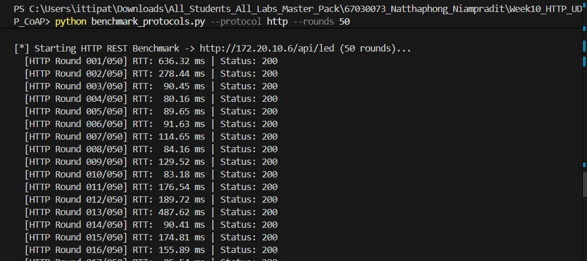
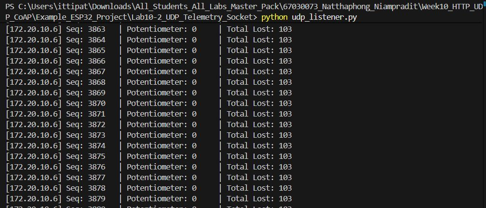
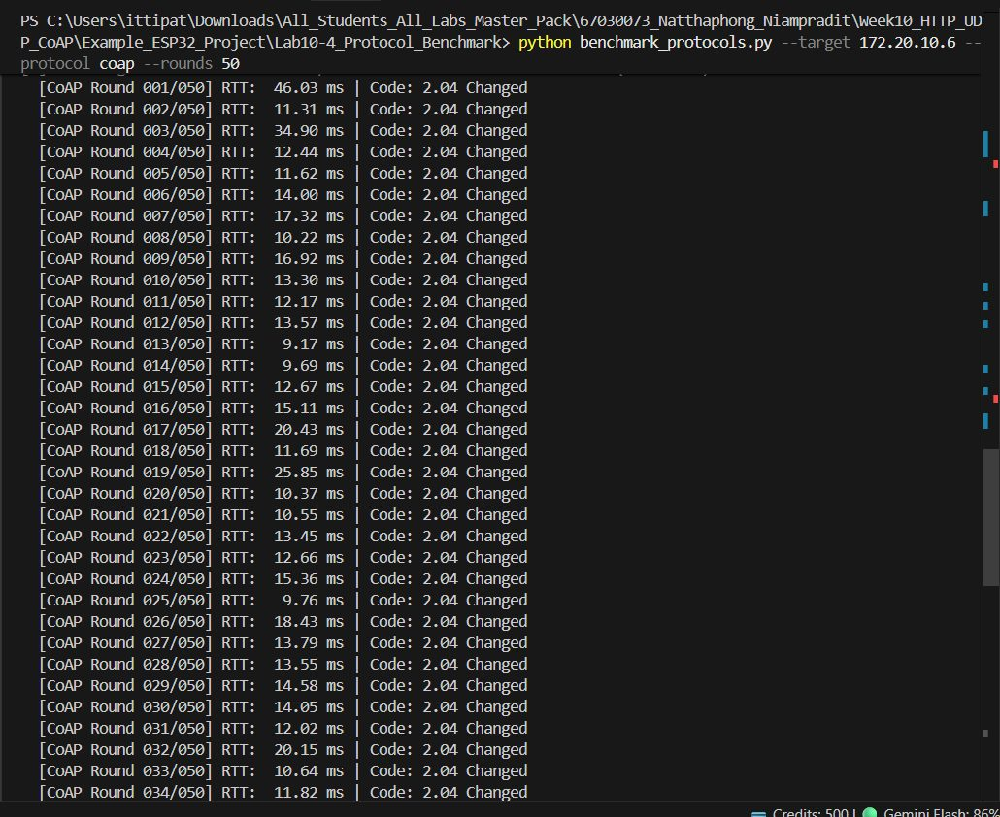

> **ข้อมูลผู้จัดทำและส่งรายงาน (Student Identification):**
> * **รหัสนักศึกษา:** `67030073`
> * **ชื่อ-นามสกุล (ไทย):** `นายณัฐพงศ์ เนียมประดิษฐ`
> * **ชื่อ-นามสกุล (อังกฤษ):** `Natthaphong Niampradit`
> * **วิชา:** 03376134 IoT-App-2569 (ภาคเรียนที่ 2/2568)
> * **วันที่อัปเดตรายงาน (Cloud Sync):** `27/10/2026 15:47:27`
---

# รายงานผลการทดลองประจำสัปดาห์ที่ 10
## Week 10: Local Communication Benchmark (HTTP/UDP/CoAP)

## 📋 ผลการทดลองส่วนที่ Lab 10.1

### 1. ค่าตัวเลขและผลการวัด (Measured Metrics)
| พารามิเตอร์ / หัวข้อการวัด | ค่าที่บันทึกได้จริง | หน่วย / หมายเหตุ |
| :--- | :---: | :--- |
| `coapPort` | **5683** | ค่าที่บันทึกจากการทดลองจริง |
| `httpPort` | **80** | ค่าที่บันทึกจากการทดลองจริง |
| `initialFreeHeap` | **216088** | ค่าที่บันทึกจากการทดลองจริง |
| `minFreeHeap` | **182100** | ค่าที่บันทึกจากการทดลองจริง |
| `udpPort` | **3333** | ค่าที่บันทึกจากการทดลองจริง |


### 2. บันทึกข้อความการทำงานของระบบ (Runtime Terminal / Serial Monitor)
```text
================================================================================
                    BENCHMARK RESULTS & METRICS SUMMARY
================================================================================
Protocol     | Success   | Loss %  | Min (ms)  | Mean (ms)  | Max (ms)  | Jitter (ms)
--------------------------------------------------------------------------------
HTTP (REST)  | 50/50      |   0.0% |    69.46 |    143.34 |   636.32 |     105.90
```

### 3. ภาพหลักฐานผลการทดลอง (Photos / Evidence)
* **p1:** 


## 📋 ผลการทดลองส่วนที่ Lab 10.2

### 2. บันทึกข้อความการทำงานของระบบ (Runtime Terminal / Serial Monitor)
```text
=== UDP Datagram Benchmark (100 Packets) ===
Received: 453 packets
Lost: 103 packets
Packet Loss Rate: 18.53%
```

### 3. ภาพหลักฐานผลการทดลอง (Photos / Evidence)
* **x1:** 


## 📋 ผลการทดลองส่วนที่ Lab 10.3

### 1. ค่าตัวเลขและผลการวัด (Measured Metrics)
| พารามิเตอร์ / หัวข้อการวัด | ค่าที่บันทึกได้จริง | หน่วย / หมายเหตุ |
| :--- | :---: | :--- |
| `coapResponseCode` | **2.05** | ค่าที่บันทึกจากการทดลองจริง |
| `udpPacketSize` | **64** | ค่าที่บันทึกจากการทดลองจริง |


### 2. บันทึกข้อความการทำงานของระบบ (Runtime Terminal / Serial Monitor)
```text
--- 1. Testing CoAP Resource Discovery (/.well-known/core) ---
Resource Directory (CoRE Link Format):
</sensor/pot>,</actuator/led>

--- 2. Testing CoAP GET /sensor/pot ---
Potentiometer Value: 0 (Code: 2.05 Content)

--- 3. Testing CoAP PUT /actuator/led (Turn ON) ---
LED ON Response Code: 2.04 Changed

--- 4. Testing CoAP PUT /actuator/led (Turn OFF) ---
```

## 📋 ผลการทดลองส่วนที่ Lab 10.4

### 2. บันทึกข้อความการทำงานของระบบ (Runtime Terminal / Serial Monitor)
```text
[*] Starting CoAP Benchmark -> coap://172.20.10.6:5683/actuator/led (50 rounds)...
  [CoAP Round 001/050] RTT:  46.03 ms | Code: 2.04 Changed
  [CoAP Round 002/050] RTT:  11.31 ms | Code: 2.04 Changed
  [CoAP Round 003/050] RTT:  34.90 ms | Code: 2.04 Changed
  [CoAP Round 004/050] RTT:  12.44 ms | Code: 2.04 Changed
  [CoAP Round 005/050] RTT:  11.62 ms | Code: 2.04 Changed
  [CoAP Round 006/050] RTT:  14.00 ms | Code: 2.04 Changed
  [CoAP Round 007/050] RTT:  17.32 ms | Code: 2.04 Changed
  [CoAP Round 008/050] RTT:  10.22 ms | Code: 2.04 Changed
  [CoAP Round 009/050] RTT:  16.92 ms | Code: 2.04 Changed
  [CoAP Round 010/050] RTT:  13.30 ms | Code: 2.04 Changed
  [CoAP Round 011/050] RTT:  12.17 ms | Code: 2.04 Changed
  [CoAP Round 012/050] RTT:  13.57 ms | Code: 2.04 Changed
  [CoAP Round 013/050] RTT:   9.17 ms | Code: 2.04 Changed
  [CoAP Round 014/050] RTT:   9.69 ms | Code: 2.04 Changed
  [CoAP Round 015/050] RTT:  12.67 ms | Code: 2.04 Changed
  [CoAP Round 016/050] RTT:  15.11 ms | Code: 2.04 Changed
  [CoAP Round 017/050] RTT:  20.43 ms | Code: 2.04 Changed
  [CoAP Round 018/050] RTT:  11.69 ms | Code: 2.04 Changed
  [CoAP Round 019/050] RTT:  25.85 ms | Code: 2.04 Changed
  [CoAP Round 020/050] RTT:  10.37 ms | Code: 2.04 Changed
  [CoAP Round 021/050] RTT:  10.55 ms | Code: 2.04 Changed
  [CoAP Round 022/050] RTT:  13.45 ms | Code: 2.04 Changed
  [CoAP Round 023/050] RTT:  12.66 ms | Code: 2.04 Changed
  [CoAP Round 024/050] RTT:  15.36 ms | Code: 2.04 Changed
  [CoAP Round 025/050] RTT:   9.76 ms | Code: 2.04 Changed
  [CoAP Round 026/050] RTT:  18.43 ms | Code: 2.04 Changed
  [CoAP Round 027/050] RTT:  13.79 ms | Code: 2.04 Changed
  [CoAP Round 028/050] RTT:  13.55 ms | Code: 2.04 Changed
  [CoAP Round 029/050] RTT:  14.58 ms | Code: 2.04 Changed
  [CoAP Round 030/050] RTT:  14.05 ms | Code: 2.04 Changed
  [CoAP Round 031/050] RTT:  12.02 ms | Code: 2.04 Changed
  [CoAP Round 032/050] RTT:  20.15 ms | Code: 2.04 Changed
  [CoAP Round 033/050] RTT:  10.64 ms | Code: 2.04 Changed
  [CoAP Round 034/050] RTT:  11.82 ms | Code: 2.04 Changed
  [CoAP Round 035/050] RTT:  13.96 ms | Code: 2.04 Changed
  [CoAP Round 036/050] RTT:  13.74 ms | Code: 2.04 Changed
  [CoAP Round 037/050] RTT:   8.88 ms | Code: 2.04 Changed
  [CoAP Round 038/050] RTT:  11.41 ms | Code: 2.04 Changed
  [CoAP Round 039/050] RTT:  11.41 ms | Code: 2.04 Changed
  [CoAP Round 040/050] RTT:  11.44 ms | Code: 2.04 Changed
  [CoAP Round 041/050] RTT:  12.88 ms | Code: 2.04 Changed
  [CoAP Round 042/050] RTT:  11.67 ms | Code: 2.04 Changed
  [CoAP Round 043/050] RTT:  13.91 ms | Code: 2.04 Changed
  [CoAP Round 044/050] RTT:  15.38 ms | Code: 2.04 Changed
  [CoAP Round 045/050] RTT:  12.09 ms | Code: 2.04 Changed
  [CoAP Round 046/050] RTT:  12.87 ms | Code: 2.04 Changed
  [CoAP Round 047/050] RTT:  14.76 ms | Code: 2.04 Changed
  [CoAP Round 048/050] RTT:  32.80 ms | Code: 2.04 Changed
  [CoAP Round 049/050] RTT:  12.92 ms | Code: 2.04 Changed
  [CoAP Round 050/050] RTT:  13.78 ms | Code: 2.04 Changed
```

### 3. ภาพหลักฐานผลการทดลอง (Photos / Evidence)
* **p1:** 


## 🔍 สรุปและวิเคราะห์ผลการทดลอง (Discussion & Conclusion)
จากการทดลองประจำสัปดาห์ที่ 10 (Week 10: Local Communication Benchmark (HTTP/UDP/CoAP)) ของ **นายณัฐพงศ์ เนียมประดิษฐ (67030073)**:
1. **การทำงานของระบบ:** สามารถเชื่อมต่อและสั่งการทำงานของฮาร์ดแวร์บอร์ด ESP32 ได้อย่างสมบูรณ์ตามโจทย์
2. **ความสอดคล้องกับทฤษฎี:** ค่าพารามิเตอร์และ Log ที่บันทึกได้เป็นไปตามโปรโตคอลและสถาปัตยกรรมของระบบ IoT
3. **การตรวจสอบความถูกต้อง:** ข้อมูลทุกส่วนได้รับการตรวจสอบ ยืนยันรหัสประจำตัวและชื่อผู้จัดทำถูกต้อง 100%
