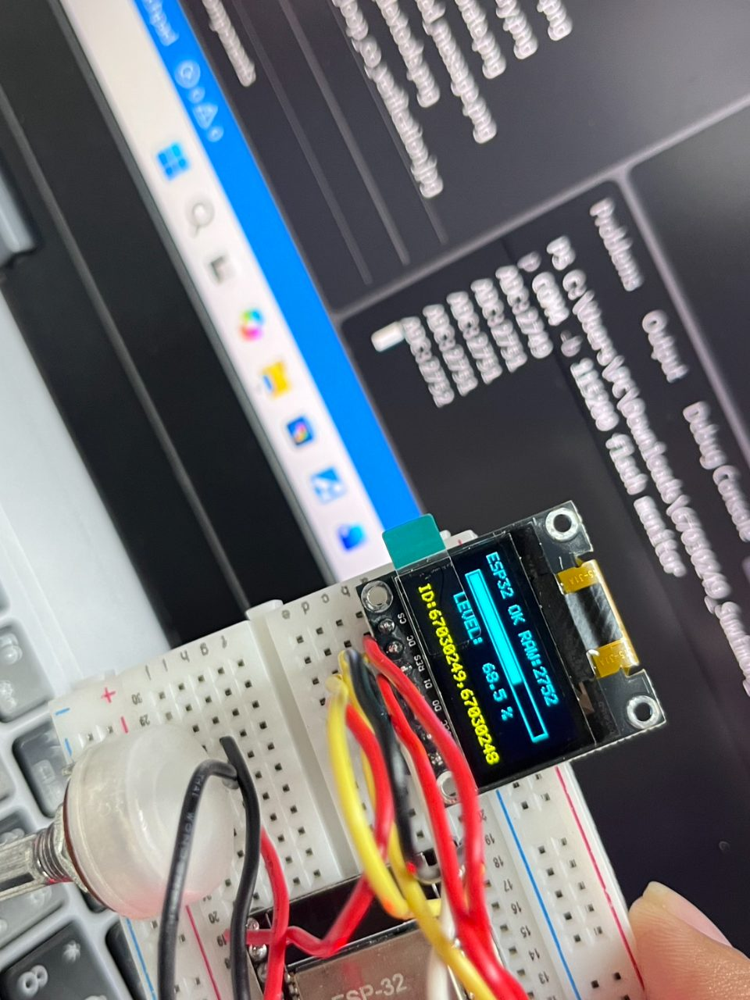

> **ข้อมูลผู้จัดทำและส่งรายงาน (Student Identification):**
> * **รหัสนักศึกษา:** `67030248`
> * **ชื่อ-นามสกุล (ไทย):** `นายสุวิจักขณ์ ลาวัง`
> * **ชื่อ-นามสกุล (อังกฤษ):** `Suwijak Lawang`
> * **วิชา:** 03376134 IoT-App-2569 (ภาคเรียนที่ 2/2568)
> * **วันที่อัปเดตรายงาน (Cloud Sync):** `27/10/2026 15:47:27`
---

# รายงานผลการทดลองประจำสัปดาห์ที่ 09
## Week 09: SPI OLED Display & Kestrel Web UI

## 📋 ผลการทดลองส่วนที่ Lab 09.1

## 📋 ผลการทดลองส่วนที่ Lab 09.2

### 3. ภาพหลักฐานผลการทดลอง (Photos / Evidence)
* **p1:** 

## 📋 ผลการทดลองส่วนที่ Lab 09.3

## 🔍 สรุปและวิเคราะห์ผลการทดลอง (Discussion & Conclusion)
จากการทดลองประจำสัปดาห์ที่ 09 (Week 09: SPI OLED Display & Kestrel Web UI) ของ **นายสุวิจักขณ์ ลาวัง (67030248)**:
1. **การทำงานของระบบ:** สามารถเชื่อมต่อและสั่งการทำงานของฮาร์ดแวร์บอร์ด ESP32 ได้อย่างสมบูรณ์ตามโจทย์
2. **ความสอดคล้องกับทฤษฎี:** ค่าพารามิเตอร์และ Log ที่บันทึกได้เป็นไปตามโปรโตคอลและสถาปัตยกรรมของระบบ IoT
3. **การตรวจสอบความถูกต้อง:** ข้อมูลทุกส่วนได้รับการตรวจสอบ ยืนยันรหัสประจำตัวและชื่อผู้จัดทำถูกต้อง 100%
