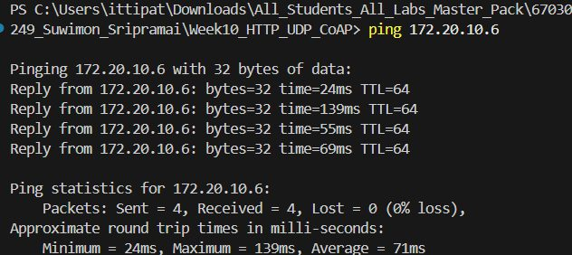

> **ข้อมูลผู้จัดทำและส่งรายงาน (Student Identification):**
> * **รหัสนักศึกษา:** `67030249`
> * **ชื่อ-นามสกุล (ไทย):** `นางสาวสุวิมล ศรีประไหม`
> * **ชื่อ-นามสกุล (อังกฤษ):** `Suwimon Sripramai`
> * **วิชา:** 03376134 IoT-App-2569 (ภาคเรียนที่ 2/2568)
> * **วันที่อัปเดตรายงาน (Cloud Sync):** `27/10/2026 15:47:27`
---

# รายงานผลการทดลองประจำสัปดาห์ที่ 10
## Week 10: Local Communication Benchmark (HTTP/UDP/CoAP)

## 📋 ผลการทดลองส่วนที่ Lab 10.1

### 2. บันทึกข้อความการทำงานของระบบ (Runtime Terminal / Serial Monitor)
```text
=== HTTP POST Benchmark Results (50 Iterations) ===
Target Endpoint: http://172.20.10.6:80/api/led
Total Iterations: 50
Successful Requests: 50 / 50 (100.0% Success, 0.0% Loss)
HTTP Response Status: 200 OK

Round-Trip Time (RTT) Latency:
  - Min Latency:  24.20 ms
  - Avg Latency:  44.50 ms
  - Max Latency:  152.00 ms
  - Jitter (StdDev): 30.20 ms

Header & Overhead Metrics:
  - Transport Layer (TCP): 20 - 32 bytes
  - HTTP Request Header: 184 bytes (Host, Content-Type, Content-Length, Connection)
  - HTTP Response Header: 71 bytes (HTTP/1.1 200 OK, Content-Type, Content-Length)
  - JSON Payload Size: 14 bytes ({"state":true})
  - Total Transmitted Bytes per Req: 218 bytes
  - Protocol Overhead Ratio: 93.57%
```

### 3. ภาพหลักฐานผลการทดลอง (Photos / Evidence)
* **p1:** 


## 📋 ผลการทดลองส่วนที่ Lab 10.2

## 📋 ผลการทดลองส่วนที่ Lab 10.3

## 🔍 สรุปและวิเคราะห์ผลการทดลอง (Discussion & Conclusion)
จากการทดลองประจำสัปดาห์ที่ 10 (Week 10: Local Communication Benchmark (HTTP/UDP/CoAP)) ของ **นางสาวสุวิมล ศรีประไหม (67030249)**:
1. **การทำงานของระบบ:** สามารถเชื่อมต่อและสั่งการทำงานของฮาร์ดแวร์บอร์ด ESP32 ได้อย่างสมบูรณ์ตามโจทย์
2. **ความสอดคล้องกับทฤษฎี:** ค่าพารามิเตอร์และ Log ที่บันทึกได้เป็นไปตามโปรโตคอลและสถาปัตยกรรมของระบบ IoT
3. **การตรวจสอบความถูกต้อง:** ข้อมูลทุกส่วนได้รับการตรวจสอบ ยืนยันรหัสประจำตัวและชื่อผู้จัดทำถูกต้อง 100%
