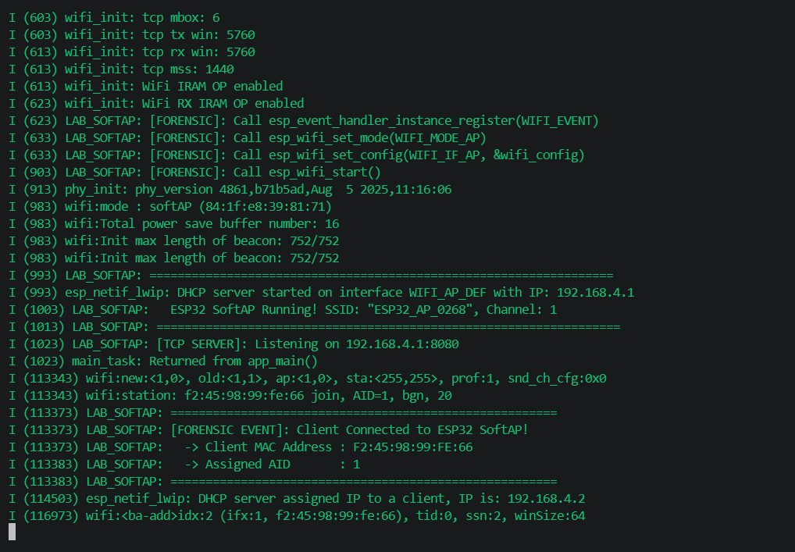

> **ข้อมูลผู้จัดทำและส่งรายงาน (Student Identification):**
> * **รหัสนักศึกษา:** `67030268`
> * **ชื่อ-นามสกุล (ไทย):** `นายกร แดงทอง`
> * **ชื่อ-นามสกุล (อังกฤษ):** `Korn Daengthong`
> * **วิชา:** 03376134 IoT-App-2569 (ภาคเรียนที่ 2/2568)
> * **วันที่อัปเดตรายงาน (Cloud Sync):** `27/10/2026 15:47:27`
---

# รายงานผลการทดลองประจำสัปดาห์ที่ 06
## Week 06: Wi-Fi SoftAP, Throughput & FreeRTOS

## 📋 ผลการทดลองส่วนที่ Lab 06.1

### 2. บันทึกข้อความการทำงานของระบบ (Runtime Terminal / Serial Monitor)
```text
I (29) boot: ESP-IDF v5.5.1 2nd stage bootloader
I (29) boot: compile time Oct 26 2026 20:51:48
I (29) boot: Multicore bootloader
I (31) boot: chip revision: v3.1
I (33) boot.esp32: SPI Speed      : 40MHz
I (37) boot.esp32: SPI Mode       : DIO
I (41) boot.esp32: SPI Flash Size : 2MB
I (44) boot: Enabling RNG early entropy source...
I (49) boot: Partition Table:
I (51) boot: ## Label            Usage          Type ST Offset   Length
I (58) boot:  0 nvs              WiFi data        01 02 00009000 00006000
I (64) boot:  1 phy_init         RF data          01 01 0000f000 00001000
I (71) boot:  2 factory          factory app      00 00 00010000 00100000
I (77) boot: End of partition table
I (81) esp_image: segment 0: paddr=00010020 vaddr=3f400020 size=19380h (103296) map
I (123) esp_image: segment 1: paddr=000293a8 vaddr=3ffb0000 size=03efch ( 16124) load
I (130) esp_image: segment 2: paddr=0002d2ac vaddr=40080000 size=02d6ch ( 11628) load
I (134) esp_image: segment 3: paddr=00030020 vaddr=400d0020 size=86b04h (551684) map
I (323) esp_image: segment 4: paddr=000b6b2c vaddr=40082d6c size=14bf8h ( 84984) load
I (356) esp_image: segment 5: paddr=000cb72c vaddr=50000000 size=00020h (    32) load
I (368) boot: Loaded app from partition at offset 0x10000
I (368) boot: Disabling RNG early entropy source...
I (379) cpu_start: Multicore app
I (387) cpu_start: Pro cpu start user code
I (387) cpu_start: cpu freq: 160000000 Hz
I (387) app_init: Application information:
I (387) app_init: Project name:     wifi_softap_tracking
I (392) app_init: App version:      1
I (396) app_init: Compile time:     Oct 26 2026 20:51:00
I (401) app_init: ELF file SHA256:  6a0fa888e...
I (405) app_init: ESP-IDF:          v5.5.1
I (409) efuse_init: Min chip rev:     v0.0
I (413) efuse_init: Max chip rev:     v3.99 
I (417) efuse_init: Chip rev:         v3.1
I (421) heap_init: Initializing. RAM available for dynamic allocation:
I (427) heap_init: At 3FFAE6E0 len 00001920 (6 KiB): DRAM
I (432) heap_init: At 3FFB7FD0 len 00028030 (160 KiB): DRAM
I (437) heap_init: At 3FFE0440 len 00003AE0 (14 KiB): D/IRAM
I (443) heap_init: At 3FFE4350 len 0001BCB0 (111 KiB): D/IRAM
I (448) heap_init: At 40097964 len 0000869C (33 KiB): IRAM
I (455) spi_flash: detected chip: generic
I (457) spi_flash: flash io: dio
W (460) spi_flash: Detected size(4096k) larger than the size in the binary image header(2048k). Using the size in the binary image header.
I (473) main_task: Started on CPU0
I (483) main_task: Calling app_main()
I (483) LAB_SOFTAP: [FORENSIC]: Call nvs_flash_init()
I (513) LAB_SOFTAP: [FORENSIC]: Call esp_netif_init()
I (513) LAB_SOFTAP: [FORENSIC]: Call esp_event_loop_create_default()
I (513) LAB_SOFTAP: [FORENSIC]: Call esp_netif_create_default_wifi_ap()
I (523) LAB_SOFTAP: [FORENSIC]: SoftAP Interface created at 0x3ffbd890 (Default IP: 192.168.4.1)
I (523) LAB_SOFTAP: [FORENSIC]: Call esp_wifi_init(&cfg)
I (543) wifi:wifi driver task: 3ffbffd0, prio:23, stack:6656, core=0
I (563) wifi:wifi firmware version: 14da9b7
I (563) wifi:wifi certification version: v7.0
I (563) wifi:config NVS flash: enabled
I (563) wifi:config nano formatting: disabled
I (563) wifi:Init data frame dynamic rx buffer num: 32
I (573) wifi:Init static rx mgmt buffer num: 5
I (573) wifi:Init management short buffer num: 32
I (573) wifi:Init dynamic tx buffer num: 32
I (583) wifi:Init static rx buffer size: 1600
I (583) wifi:Init static rx buffer num: 10
I (593) wifi:Init dynamic rx buffer num: 32
I (593) wifi_init: rx ba win: 6
I (593) wifi_init: accept mbox: 6
I (603) wifi_init: tcpip mbox: 32
I (603) wifi_init: udp mbox: 6
I (603) wifi_init: tcp mbox: 6
I (603) wifi_init: tcp tx win: 5760
I (613) wifi_init: tcp rx win: 5760
I (613) wifi_init: tcp mss: 1440
I (613) wifi_init: WiFi IRAM OP enabled
I (623) wifi_init: WiFi RX IRAM OP enabled
I (623) LAB_SOFTAP: [FORENSIC]: Call esp_event_handler_instance_register(WIFI_EVENT)
I (633) LAB_SOFTAP: [FORENSIC]: Call esp_wifi_set_mode(WIFI_MODE_AP)
I (633) LAB_SOFTAP: [FORENSIC]: Call esp_wifi_set_config(WIFI_IF_AP, &wifi_config)
I (903) LAB_SOFTAP: [FORENSIC]: Call esp_wifi_start()
I (913) phy_init: phy_version 4861,b71b5ad,Aug  5 2025,11:16:06
I (983) wifi:mode : softAP (84:1f:e8:39:81:71)
I (983) wifi:Total power save buffer number: 16
I (983) wifi:Init max length of beacon: 752/752
I (983) wifi:Init max length of beacon: 752/752
I (993) LAB_SOFTAP: ==================================================================
I (993) esp_netif_lwip: DHCP server started on interface WIFI_AP_DEF with IP: 192.168.4.1
I (1003) LAB_SOFTAP:   ESP32 SoftAP Running! SSID: "ESP32_AP_0268", Channel: 1
I (1013) LAB_SOFTAP: ==================================================================
I (1023) LAB_SOFTAP: [TCP SERVER]: Listening on 192.168.4.1:8080
I (1023) main_task: Returned from app_main()
I (113343) wifi:new:<1,0>, old:<1,1>, ap:<1,0>, sta:<255,255>, prof:1, snd_ch_cfg:0x0
I (113343) wifi:station: f2:45:98:99:fe:66 join, AID=1, bgn, 20
I (113373) LAB_SOFTAP: =======================================================
I (113373) LAB_SOFTAP: [FORENSIC EVENT]: Client Connected to ESP32 SoftAP!
I (113373) LAB_SOFTAP:   -> Client MAC Address : F2:45:98:99:FE:66
I (113383) LAB_SOFTAP:   -> Assigned AID       : 1
I (113383) LAB_SOFTAP: =======================================================
I (114503) esp_netif_lwip: DHCP server assigned IP to a client, IP is: 192.168.4.2
I (116973) wifi:<ba-add>idx:2 (ifx:1, f2:45:98:99:fe:66), tid:0, ssn:2, winSize:64
I (304093) wifi:<ba-add>idx:3 (ifx:1, f2:45:98:99:fe:66), tid:1, ssn:0, winSize:64
I (337653) wifi:station: f2:45:98:99:fe:66 leave, AID = 1, reason = 8, bss
```

### 3. ภาพหลักฐานผลการทดลอง (Photos / Evidence)
* **p1:** 


## 📋 ผลการทดลองส่วนที่ Lab 06.2

## 📋 ผลการทดลองส่วนที่ Lab 06.3

## 📋 ผลการทดลองส่วนที่ Lab 06.4

## 🔍 สรุปและวิเคราะห์ผลการทดลอง (Discussion & Conclusion)
จากการทดลองประจำสัปดาห์ที่ 06 (Week 06: Wi-Fi SoftAP, Throughput & FreeRTOS) ของ **นายกร แดงทอง (67030268)**:
1. **การทำงานของระบบ:** สามารถเชื่อมต่อและสั่งการทำงานของฮาร์ดแวร์บอร์ด ESP32 ได้อย่างสมบูรณ์ตามโจทย์
2. **ความสอดคล้องกับทฤษฎี:** ค่าพารามิเตอร์และ Log ที่บันทึกได้เป็นไปตามโปรโตคอลและสถาปัตยกรรมของระบบ IoT
3. **การตรวจสอบความถูกต้อง:** ข้อมูลทุกส่วนได้รับการตรวจสอบ ยืนยันรหัสประจำตัวและชื่อผู้จัดทำถูกต้อง 100%
