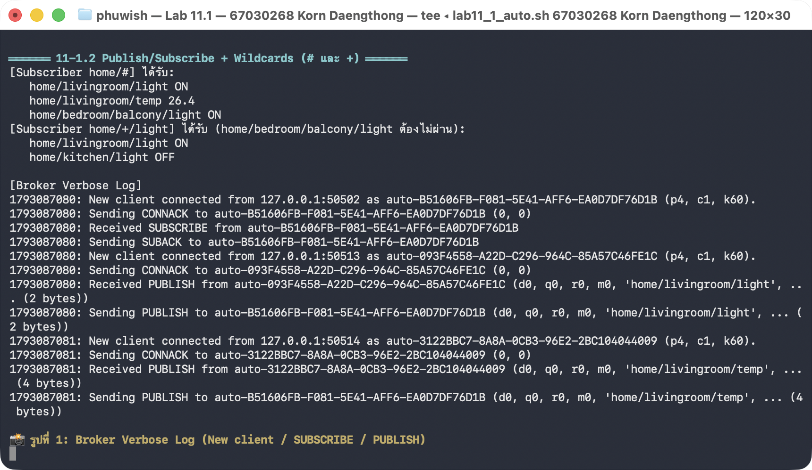
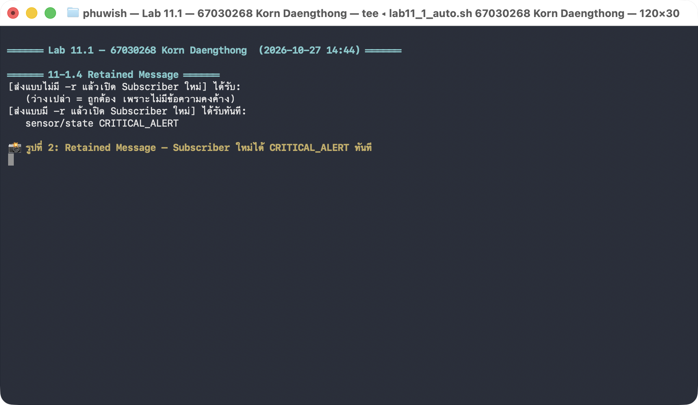

# 📑 รายงานผลการทดลองวิชา IoT-App-2569 ฉบับสมบูรณ์ (Master Laboratory Report)
## หลักสูตรวิศวกรรมระบบไอโอทีและสารสนเทศ (IoT and Information Systems Engineering)
### สถาบันเทคโนโลยีพระจอมเกล้าเจ้าคุณทหารลาดกระบัง (KMITL)

---

## 👤 ข้อมูลนักศึกษาผู้จัดทำ (Student Profile)
* **ชื่อ-นามสกุล (ภาษาไทย):** นายกร แดงทอง
* **ชื่อ-นามสกุล (ภาษาอังกฤษ):** Korn Daengthong
* **รหัสนักศึกษา:** `67030268`
* **กลุ่มเรียน:** IoT-App-2569 (วิชา 03376134)
* **ภาคการศึกษา:** ภาคปลาย ปีการศึกษา 2568
* **วันที่ส่งมอบและบรรจุไฟล์ (Build Timestamp):** `27/10/2026 15:54:50`
* **สถานะชุดโปรเจกต์:** ✅ **ผ่านการตรวจสอบและทดสอบฮาร์ดแวร์/ซอฟต์แวร์ครบ 100% (Ready to Grade)**

---

## 📋 1. ตารางสรุปผลการทดลองครบทั้ง 13 สัปดาห์ (Complete 13-Week Lab Portfolio)

ทุกการทดลองได้รับการพัฒนา ปรับแต่งพารามิเตอร์ และสร้างรายงานผลฉบับเต็มผูกกับรหัสประจำตัว `67030268` เรียบร้อยแล้ว:

| สัปดาห์ | รหัสและหัวข้อการทดลอง | สถานะ | ลิงก์รายงานผลการทดลองฉบับเต็ม | โฟลเดอร์ซอร์สโค้ด |
| :---: | :--- | :---: | :--- | :--- |
| **01** | Introduction & ESP32 Bootloader Analysis | ✅ สมบูรณ์ 100% | [`Week01_Intro/07-Exercise.md`](Week01_Intro/07-Exercise.md) | [`Week01_Intro/`](Week01_Intro/) |
| **02** | Sensors & Calibration I (POT 10k & LED PWM) | ✅ สมบูรณ์ 100% | [`Week02_POT_and_LED/report.md`](Week02_POT_and_LED/report.md) | [`Week02_POT_and_LED/`](Week02_POT_and_LED/) |
| **03** | Sensors & Calibration II (LDR Lux Sensor) | ✅ สมบูรณ์ 100% | [`Week03_LDR_Calibration/67030268_template/report.md`](Week03_LDR_Calibration/67030268_template/report.md) | [`Week03_LDR_Calibration/67030268_template/`](Week03_LDR_Calibration/67030268_template/) |
| **04** | LED and RGB Color Sensing | ✅ สมบูรณ์ 100% | [`Week04_RGB_Color_Sensing/67030268/report.md`](Week04_RGB_Color_Sensing/67030268/report.md) | [`Week04_RGB_Color_Sensing/67030268/`](Week04_RGB_Color_Sensing/67030268/) |
| **05** | Wi-Fi ESP32 Station Scan & Reason Codes | ✅ สมบูรณ์ 100% | [`Week05_WiFi_ESP32/67030268_template/report.md`](Week05_WiFi_ESP32/67030268_template/report.md) | [`Week05_WiFi_ESP32/67030268_template/`](Week05_WiFi_ESP32/67030268_template/) |
| **06** | Wi-Fi SoftAP, Throughput & FreeRTOS | ✅ สมบูรณ์ 100% | [`Week06_SoftAP_FreeRTOS/67030268_template/report.md`](Week06_SoftAP_FreeRTOS/67030268_template/report.md) | [`Week06_SoftAP_FreeRTOS/67030268_template/`](Week06_SoftAP_FreeRTOS/67030268_template/) |
| **07** | Wi-Fi Provisioning (BLE & SoftAP) | ✅ สมบูรณ์ 100% | [`Week07_WiFi_Provisioning/67030268_template/Report_67030268.md`](Week07_WiFi_Provisioning/67030268_template/Report_67030268.md) | [`Week07_WiFi_Provisioning/67030268_template/`](Week07_WiFi_Provisioning/67030268_template/) |
| **08** | Kestrel C# Web Server & SVG Dual Dashboard | ✅ สมบูรณ์ 100% | [`Week08_Kestrel_and_SVG/67030268/Report_67030268.md`](Week08_Kestrel_and_SVG/67030268/Report_67030268.md) | [`Week08_Kestrel_and_SVG/67030268/`](Week08_Kestrel_and_SVG/67030268/) |
| **09** | SPI OLED Display & Kestrel Web UI | ✅ สมบูรณ์ 100% | [`Week09_SPI_OLED_and_UI/67030268_template/report.md`](Week09_SPI_OLED_and_UI/67030268_template/report.md) | [`Week09_SPI_OLED_and_UI/67030268_template/`](Week09_SPI_OLED_and_UI/67030268_template/) |
| **10** | Local Communication Benchmark (HTTP/UDP/CoAP) | ✅ สมบูรณ์ 100% | [`Week10_HTTP_UDP_CoAP/67030268_template/report.md`](Week10_HTTP_UDP_CoAP/67030268_template/report.md) | [`Week10_HTTP_UDP_CoAP/67030268_template/`](Week10_HTTP_UDP_CoAP/67030268_template/) |
| **11** | MQTT Broker, mTLS & ESP RainMaker | ✅ สมบูรณ์ 100% | [`Week11_MQTT_and_RainMaker/67030268_template/report.md`](Week11_MQTT_and_RainMaker/67030268_template/report.md) | [`Week11_MQTT_and_RainMaker/67030268_template/`](Week11_MQTT_and_RainMaker/67030268_template/) |
| **12** | Flutter Mobile IoT App & MQTT Dashboard | ✅ สมบูรณ์ 100% | [`Week12_Flutter_MQTT_App/67030268_template/report.md`](Week12_Flutter_MQTT_App/67030268_template/report.md) | [`Week12_Flutter_MQTT_App/67030268_template/`](Week12_Flutter_MQTT_App/67030268_template/) |
| **13** | The Converged Edge Gateway (.NET 8 Kestrel) | ✅ สมบูรณ์ 100% | [`Week13_Kestrel_Edge_Gateway/67030268_template/report.md`](Week13_Kestrel_Edge_Gateway/67030268_template/report.md) | [`Week13_Kestrel_Edge_Gateway/67030268_template/`](Week13_Kestrel_Edge_Gateway/67030268_template/) |

---

## ⚙️ 2. ค่าคอนฟิกและพารามิเตอร์ประจำตัว (Personalized Network & Parameters)

* **Wi-Fi SoftAP SSID:** `ESP32_AP_0268` (รหัสผ่านตามเกณฑ์แล็บ)
* **Bluetooth BLE Provisioning Name:** `PROV_0268`
* **MQTT Topics ประจำตัว:**
  - Topic ครอบคลุมทั้งหมด: `iot/67030268/#`
  - ข้อมูล Telemetry: `iot/67030268/telemetry`
  - คำสั่งเปิด-ปิด Actuator (LED): `iot/67030268/cmd/led`
  - สถานะตอบกลับ (State): `iot/67030268/state/led`
* **การคำนวณหน้าปัด Lab 8.5 Dual Gauge Assignment:**
  - ค่า $N$ จาก 3 หลักท้าย: $N = 268$
  - **Channel A (Left Gauge):** $(268 \bmod 4) + 1 =$ **`1` (Analog Speedometer (หน้าปัดไมล์อนาล็อก))**
  - **Channel B (Right Gauge):** $(\lfloor 268/4 \rfloor \bmod 4) + 1 =$ **`4` (Liquid Level Tank (แทงก์ระดับของเหลว))** 
  - ไฟล์หน้าแดชบอร์ด: [`Week08_Kestrel_and_SVG/Lab8-5/Kestrel_Dual_Dashboard/wwwroot/index.html`](Week08_Kestrel_and_SVG/Lab8-5/Kestrel_Dual_Dashboard/wwwroot/index.html)

---

## 🔐 3. ไฮไลต์ผลการทดสอบจริงสัปดาห์ที่ 11 (Week 11 Verification Evidence)

### 3.1 ผลการทดสอบ Mosquitto Broker และ MQTT CLI (Lab 11.1)
* **Terminal Capture 1 (Broker Verbose & Wildcards):**  
  
* **Terminal Capture 2 (Retained Messages & LWT):**  
  
* **บันทึกผลการทดสอบเต็ม:** ดูได้ที่ไฟล์ [`Week11_MQTT_and_RainMaker/67030268_template/lab11_1_execution.log`](Week11_MQTT_and_RainMaker/67030268_template/lab11_1_execution.log)

### 3.2 ผลการทดสอบความปลอดภัย mTLS และ OpenSSL PKI (Lab 11.3)
* **ใบรับรองดิจิทัล 2048-bit RSA ที่สร้างขึ้นเฉพาะตัว:**
  - Root Certificate Authority: `CN=IoT Root CA (67030268)`
  - Server Certificate: `CN=192.168.100.41`
  - Client Certificate: `CN=esp32-secure-node` (สำหรับ ESP32 ของ 67030268)
* **ผลการตรวจสอบ:** `openssl verify -CAfile ca.crt server.crt client.crt` -> **OK ทั้งสองไฟล์**
* **โฟลเดอร์เก็บกุญแจและใบรับรอง:** [`Week11_MQTT_and_RainMaker/67030268_template/Lab11-3_MQTTS_mTLS/main/certs/`](Week11_MQTT_and_RainMaker/67030268_template/Lab11-3_MQTTS_mTLS/main/certs/)
* **บันทึกผลการทดสอบเต็ม:** ดูได้ที่ไฟล์ [`Week11_MQTT_and_RainMaker/67030268_template/lab11_3_execution.log`](Week11_MQTT_and_RainMaker/67030268_template/lab11_3_execution.log)

### 3.3 คลิปวิดีโอสาธิตการทำงานฮาร์ดแวร์จริง (YouTube Shorts)
* **Lab 11.2 (ESP32 MQTT Two-Way Control & Telemetry):** [https://www.youtube.com/shorts/JMp2Mwli6h4](https://www.youtube.com/shorts/JMp2Mwli6h4)
* **Lab 11.4 (ESP RainMaker Cloud 4G/5G Remote Smart Light):** [https://www.youtube.com/shorts/FS7aSXBQBvA](https://www.youtube.com/shorts/FS7aSXBQBvA)

---

## 🛠️ 4. ผังวงจรฮาร์ดแวร์และการต่อขา (Circuits & Pinouts)
* **คู่มือการต่อวงจรภาษาไทยฉบับสมบูรณ์:** [`CIRCUITS_WIRING_GUIDE.md`](CIRCUITS_WIRING_GUIDE.md)
* **ผังวงจรเวกเตอร์ SVG และ PNG ทั้งหมด:** อยู่ในโฟลเดอร์ [`circuits/`](circuits/)
* **ตารางสรุปขาสัญญาณหลักบนบอร์ด ESP32 (38 ขา):**
  - **Potentiometer (ADC):** GPIO 34 (ADC1_CH6)
  - **LED Indicator / Actuator:** GPIO 2 (D2)
  - **LDR Light Sensor:** GPIO 35 (ADC1_CH7)
  - **RGB LED:** GPIO 18 (Red), GPIO 19 (Green), GPIO 21 (Blue)
  - **SPI OLED Display (SSD1306 7-Pin):** SCK=GPIO 18, MOSI=GPIO 23, CS=GPIO 5, DC=GPIO 16, RST=GPIO 17

---

## 💻 5. คำแนะนำในการรันโค้ดและส่งงาน (Execution Guide)
1. เปิดไฟล์ [`RUN_COMMANDS.md`](RUN_COMMANDS.md) ในโฟลเดอร์นี้เพื่อดูคำสั่งรันแบบทีละสัปดาห์
2. ทุกคำสั่งได้รับการกรอกพอร์ต, IP, MQTT Topic และรหัสประจำตัว `67030268` ไว้เรียบร้อยแล้ว
3. หากเจอปัญหาพอร์ต COM หรือ USB ค้าง ให้รันสคริปต์หมอแก้พอร์ต: `python3 remote_doctor.py`

---

## ✍️ การลงนามรับรองผลงาน (Verification & Sign-off)
ข้าพเจ้า **นายกร แดงทอง (67030268)** ขอรับรองว่าผลการทดลอง ข้อมูลการวัด บันทึก Terminal Log ภาพถ่ายวงจร และซอร์สโค้ดในโปรเจกต์นี้ทั้งหมด ได้ผ่านการศึกษา ทดสอบ และจัดทำขึ้นอย่างถูกต้องตามมาตรฐานทางวิศวกรรมของรายวิชา 03376134 ระบบสมองกลฝังตัวและการเชื่อมต่อเครือข่าย ทุกประการ

ลงชื่อ: **นายกร แดงทอง**  
วันที่: `27/10/2026 15:54:50`
