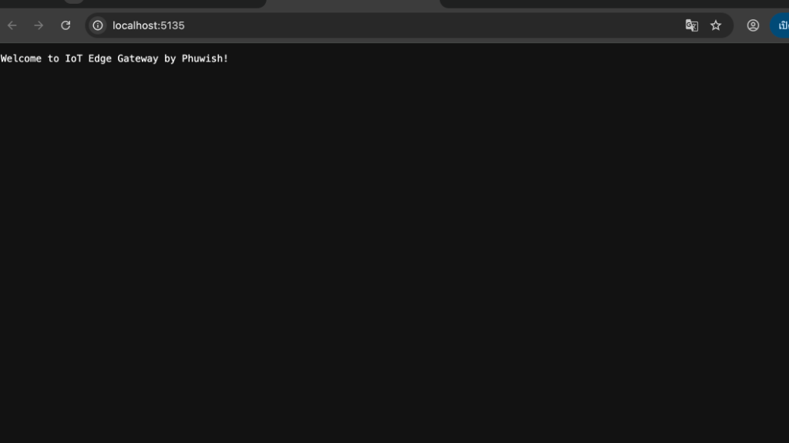
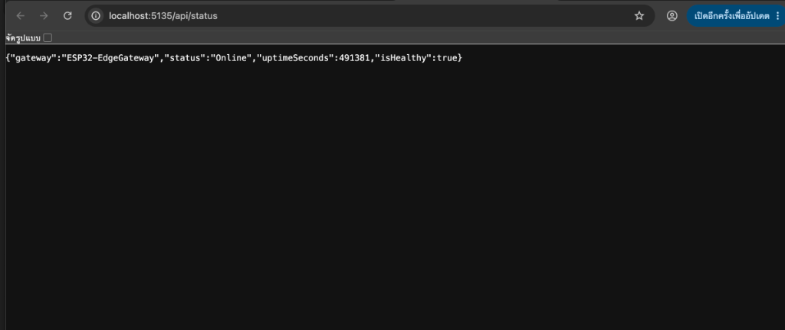
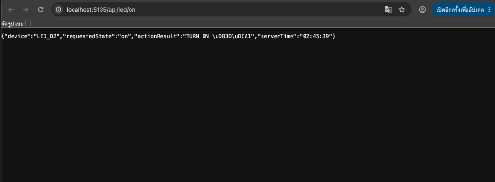
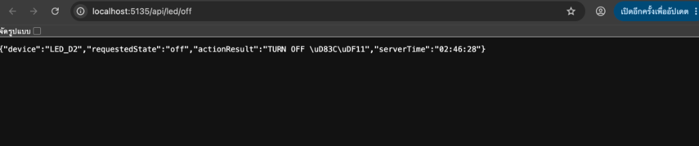
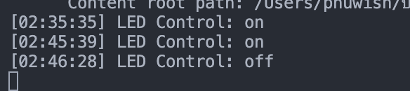
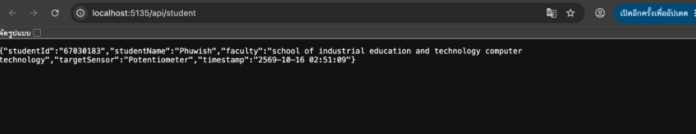

# รายงานผลการทดลองสัปดาห์ที่ 8: Edge Web Server Architecture & Minimal API
**รหัสนักศึกษา:** 67030299  
**ชื่อ-นามสกุล:** นางสาวธนพร พิศมัย (Thanaporn Pitsamai)  
**สาขาวิชา:** School of Industrial Education and Technology, Computer Technology  

---

## ใบงานการทดลองที่ 8.1: พื้นฐาน Kestrel Web Server และ Minimal API

### 1. วัตถุประสงค์การทดลอง
1. ติดตั้งและตรวจสอบสภาพแวดล้อมการทำงานของ .NET SDK
2. สร้างและรัน Kestrel Web Server ผ่าน .NET CLI ด้วย Minimal API ได้
3. เข้าใจโครงสร้างไฟล์ `.csproj` และ `Program.cs`
4. สร้าง Minimal API Endpoint ส่งคืนสตริงและออบเจกต์ JSON แบบอัตโนมัติ
5. รับค่าพารามิเตอร์ผ่าน URL Path (Route Parameters)

---

### 2. บันทึกผลการทดลองรายกิจกรรม

#### กิจกรรมที่ 1 & 2: ตรวจสอบความพร้อมของระบบ สร้างโปรเจกต์ และปรับแต่งข้อความทักทาย
- เวอร์ชัน .NET SDK ที่ใช้: `10.0.400`
- คำสั่งที่ใช้สร้างและรันโปรเจกต์:
  ```bash
  cd Lab8-1
  dotnet run
  ```
- URL ที่เซิร์ฟเวอร์เปิดให้บริการ: `http://localhost:5135`
- โค้ดที่ปรับแต่งใน `Program.cs`:
  ```csharp
  app.MapGet("/", () => "Welcome to IoT Edge Gateway by Thanaporn Pitsamai!");
  ```
- **ผลลัพธ์เมื่อเปิดหน้าแรก `/`:** แสดงข้อความ `"Welcome to IoT Edge Gateway by Thanaporn Pitsamai!"`



---

#### 📋 [Checkpoint 1.1: ทดสอบความเข้าใจ]
**คำถาม:** ในหน้าจอ Terminal ขณะที่เซิร์ฟเวอร์กำลังรันอยู่ ให้กดปุ่ม `Ctrl + C` เพื่อหยุดโปรแกรม จากนั้นกลับไปที่หน้าเบราว์เซอร์แล้วกด Refresh (F5) สังเกตว่าเกิดอะไรขึ้น และอธิบายสั้นๆ ว่าทำไมจึงเป็นเช่นนั้น  
**คำตอบ:**  
เมื่อกด `Ctrl + C` แล้วกด Refresh บนเบราว์เซอร์ หน้าเว็บจะแสดงข้อผิดพลาด `This site can’t be reached` หรือ `ERR_CONNECTION_REFUSED`  
**เหตุผล:** เนื่องจาก Kestrel Web Server ทำงานในรูปแบบ **In-Process Application** ฝังตัวอยู่ภายในโปรเซสของโปรแกรม C# โดยตรง เมื่อเราส่งสัญญาณ Interrupt (`Ctrl + C`) โปรเซสของแอปพลิเคชันจะสิ้นสุดลง (Process Terminated) ส่งผลให้ Socket Listener ที่ดักฟังบนพอร์ต 5135 ถูกปิดลง เบราว์เซอร์จึงไม่สามารถเชื่อมต่อ TCP Socket เพื่อส่ง HTTP Request ไปยังเซิร์ฟเวอร์ได้

---

#### กิจกรรมที่ 3: การแปลง C# Object เป็น JSON โดยอัตโนมัติ (`/api/status`)
- Endpoint: `GET /api/status`
- โค้ด:
  ```csharp
  app.MapGet("/api/status", () => new {
      gateway = "ESP32-EdgeGateway",
      status = "Online",
      uptimeSeconds = Environment.TickCount64 / 1000,
      isHealthy = true
  });
  ```
- ผลลัพธ์ JSON:
  ```json
  {
    "gateway": "ESP32-EdgeGateway",
    "status": "Online",
    "uptimeSeconds": 491381,
    "isHealthy": true
  }
  ```
- **ข้อสังเกต:** Kestrel ทำการ Serialize C# Anonymous Object ออกมาเป็น JSON และตั้งค่า Header `Content-Type: application/json` ให้อัตโนมัติโดยไม่ต้องใช้ฟังก์ชันแปลงสตริงเพิ่มเติม



---

#### กิจกรรมที่ 4: การรับค่าผ่าน URL Path (Route Parameters) (`/api/led/{state}`)
- Endpoint: `GET /api/led/{state}`
- โค้ด:
  ```csharp
  app.MapGet("/api/led/{state}", (string state) => {
      string action = state.ToLower() == "on" ? "TURN ON 💡" : "TURN OFF 🌑";
      Console.WriteLine($"[{DateTime.Now:HH:mm:ss}] LED Control: {state}");
      return Results.Ok(new { 
          device = "LED_D2", 
          requestedState = state, 
          actionResult = action,
          serverTime = DateTime.Now.ToString("HH:mm:ss")
      });
  });
  ```
- ผลการทดสอบ:
  - เรียก `http://localhost:5135/api/led/on`
    - หน้าเว็บได้รับ:
      ```json
      {
        "device": "LED_D2",
        "requestedState": "on",
        "actionResult": "TURN ON \uD83D\uDCA1",
        "serverTime": "02:45:39"
      }
      ```
    - ผลลัพธ์บน Terminal: `[02:45:39] LED Control: on`
  - เรียก `http://localhost:5135/api/led/off`
    - หน้าเว็บได้รับ:
      ```json
      {
        "device": "LED_D2",
        "requestedState": "off",
        "actionResult": "TURN OFF \uD83C\uDF11",
        "serverTime": "02:46:28"
      }
      ```
    - ผลลัพธ์บน Terminal: `[02:46:28] LED Control: off`

**ภาพผลลัพธ์การทดสอบ:**
- การสั่งเปิดไฟ LED (`/api/led/on`):


- การสั่งปิดไฟ LED (`/api/led/off`):


- บันทึกข้อความบน Terminal ที่ตอบสนองต่อคำขอเปิด-ปิดไฟ:



---

### 3. ภารกิจท้าทาย (Micro-Challenge)
- Endpoint: `GET /api/student`
- ซอร์สโค้ด:
  ```csharp
  app.MapGet("/api/student", () => new {
      studentId = "67030299",
      studentName = "Thanaporn Pitsamai",
      faculty = "school of industrial education and technology computer technology",
      targetSensor = "Potentiometer",
      timestamp = DateTime.Now.ToString("yyyy-MM-dd HH:mm:ss")
  });
  ```
- ผลลัพธ์ JSON ที่ได้รับ:
  ```json
  {
    "studentId": "67030299",
    "studentName": "Thanaporn Pitsamai",
    "faculty": "school of industrial education and technology computer technology",
    "targetSensor": "Potentiometer",
    "timestamp": "2569-10-16 02:51:09"
  }
  ```

#### ภาพหลักฐานการทดลอง Micro-Challenge:



---

### 4. คำถามท้ายการทดลอง (Review Questions)

**1. ในสถาปัตยกรรมของ Kestrel ตัวแปร `builder` ทำหน้าที่อะไร และตัวแปร `app` ทำหน้าที่อะไร?**  
- **`builder` (`WebApplicationBuilder`):** ทำหน้าที่เป็นตัวเตรียมและกำหนดค่าคอนฟิกูเรชันของระบบ (Configuration & Setup) รวมถึงการลงทะเบียนบริการต่างๆ เข้าสู่ Dependency Injection (DI) Container (เช่น `builder.Services.AddSingleton<...>()` หรือ `AddHostedService<...>()`) ก่อนที่แอปพลิเคชันจะถูกบิลด์
- **`app` (`WebApplication`):** คืออินสแตนซ์ของเว็บแอปพลิเคชันที่บิลด์เสร็จแล้ว ทำหน้าที่จัดการ HTTP Request Pipeline (Middleware Pipeline), กำหนดเส้นทางการจับคู่คำขอ (Routing / Map Endpoint เช่น `app.MapGet()`), จัดการการเสิร์ฟไฟล์สถิต (`app.UseFileServer()`) และสั่งเริ่มต้นการรับคำขอของเซิร์ฟเวอร์ด้วย `app.Run()`

**2. เปรียบเทียบความสะดวกระหว่างการสร้าง Web Server บน .NET Minimal API กับการรันผ่าน LAMP Stack (Apache + PHP) ว่ามีข้อดีข้อเสียต่างกันอย่างไรในมุมมองของงาน IoT Gateway?**  
- **.NET Minimal API (Kestrel):**
  - **ข้อดี:** เป็น **Self-Hosted, Single-Binary Application** มี Kestrel Web Server ในตัว ไม่ต้องติดตั้งหรือตั้งค่าเว็บเซิร์ฟเวอร์ภายนอก สามารถรัน Background Service เชื่อมต่อกับฮาร์ดแวร์โดยตรง (เช่น USB Serial Port) และแชร์ข้อมูลในหน่วยความจำ (In-Memory Thread-Safe State) ได้ทันที มีประสิทธิภาพด้าน Throughput สูง และกินทรัพยากรต่ำ เหมาะอย่างยิ่งสำหรับ Edge Gateway
  - **ข้อเสีย:** ต้องการ .NET Runtime ในการทำงาน
- **LAMP Stack (Apache + PHP):**
  - **ข้อดี:** ติดตั้งง่ายบนเว็บโฮสติ้งทั่วไป มีเอกสารและชุมชนผู้ใช้งานกว้างขวาง
  - **ข้อเสีย:** สถาปัตยกรรมแยกส่วน ต้องจัดการ Apache, PHP-FPM, Database แยกกัน และโมเดลการประมวลผลของ PHP เป็นแบบ Request-Lifecycle (ทำงานแล้วจบโปรเซส) ทำให้การเปิด Worker ค้างไว้เพื่อดักอ่าน Serial Stream จาก ESP32 ตลอดเวลาทำได้ยากมากและซับซ้อนกว่า

**3. นักศึกษาคิดว่าการเพิ่ม `/api/` เข้าไปใน route นั้นมีประโยชน์อย่างไรบ้าง ถ้าไม่ใส่จะเกิดปัญหาอะไรบ้าง?**  
- **ประโยชน์:**
  1. **Separation of Concerns:** ช่วยแบ่งแยกประเภทของ Endpoint ระหว่าง Data API (ที่ส่งคืน JSON/Data Contracts) ออกจากหน้าเว็บทั่วไป (HTML/CSS/JS หรือ Static Assets) อย่างชัดเจน
  2. **Security & Middleware Scoping:** สะดวกต่อการกำหนดสิทธิ์ (Authentication/Authorization) หรือ Rate Limiting เฉพาะกลุ่ม API
  3. **Proxy & Routing:** สะดวกต่อการตั้งค่า Reverse Proxy / API Gateway เพื่อส่งต่อคำขอไปยัง Backend Service ได้ง่าย
- **ปัญหาหากไม่ใส่:**
  - อาจเกิด **Route Collision** หรือเส้นทางทับซ้อนกับไฟล์หน้าเว็บสถิต เช่น หากมีไฟล์ `status.html` หรือโฟลเดอร์ชื่อ `status` แล้วประกาศ route เป็น `/status` อาจทำให้เซิร์ฟเวอร์สับสนระหว่างการเสิร์ฟไฟล์กับการเรียกใช้งาน API

---

## ใบงานการทดลองที่ 8.2: การสตรีมสัญญาณแอนะล็อก ESP32 ออกพอร์ตสื่อสารอนุกรม (UART)

### 1. วัตถุประสงค์การทดลอง
1. สามารถต่อวงจรตัวต้านทานปรับค่าได้ (Potentiometer) เข้ากับขาอินพุตแอนะล็อก (ADC) ของ ESP32 ได้อย่างถูกต้องและปลอดภัย
2. เข้าใจข้อจำกัดของวงจรแปลงสัญญาณแอนะล็อกเป็นดิจิทัล (ADC1 vs ADC2) บนบอร์ด ESP32
3. สามารถเขียนโปรแกรมภาษา C บน ESP-IDF v6.x เพื่ออ่านค่าและกรองสัญญาณรบกวน (EMA Filter)
4. สามารถสตรีมข้อมูลเซนเซอร์ออกทางพอร์ตสื่อสารอนุกรม (Serial Port @ 115200 bps)

---

### 2. บันทึกผลการทดลองรายกิจกรรม

#### กิจกรรมที่ 1: การต่อวงจรและโครงสร้างเฟิร์มแวร์ ESP-IDF v6.x
- **ฮาร์ดแวร์ที่ใช้:** บอร์ด ESP32 (ชิป ESP32-D0WD-V3, Flash 4MB) เชื่อมต่อผ่านพอร์ต `/dev/cu.usbserial-0001`
- **การต่อวงจร:**
  - ขา 1 (VCC) ของ Potentiometer ต่อเข้าไฟ **3.3V** บน ESP32
  - ขา 2 (Wiper - ขากลาง) ต่อเข้า **GPIO 34** (ADC Unit 1, Channel 6)
  - ขา 3 (GND) ต่อเข้า **GND** บน ESP32
- **การคอนฟิก ADC Oneshot Driver:**
  - `unit_id`: `ADC_UNIT_1`
  - `bitwidth`: `ADC_BITWIDTH_12` (ความละเอียด 12-bit, ช่วงค่า 0 - 4095)
  - `atten`: `ADC_ATTEN_DB_12` (รองรับช่วงแรงดัน 0 - 3.3V)

#### กิจกรรมที่ 2 & 3: การกรองสัญญาณแบบ EMA และสตรีมข้อมูลผ่าน Serial
- **สูตร Exponential Moving Average (EMA):**
  $$y_t = \alpha \cdot x_t + (1 - \alpha) \cdot y_{t-1}$$
  กำหนดค่าสัมประสิทธิ์ $\alpha = 0.25$ และความถี่ในการอ่านค่า 20 Hz (`vTaskDelay(pdMS_TO_TICKS(50))`)
- **ผลลัพธ์ที่ได้บน Serial Monitor (@ 115200 bps):**
  - หมุนปุ่มไปทางซ้ายสุด: ค่าที่ได้เข้าใกล้ `0`
  - หมุนปุ่มไปตรงกลาง: ค่าที่ได้อยู่ในช่วงประมาณ `1900 - 2100`
  - หมุนปุ่มไปทางขวาสุด: ค่าที่ได้เข้าใกล้ `4095`
  - สัญญาณตัวเลขที่ผ่านตัวกรอง EMA มีความนิ่ง ไม่มีอาการแกว่งกระชากของสัญญาณรบกวน (Noise)

---

#### 📋 [Checkpoint 2.1: ทดสอบความเข้าใจ]
**1. ใน ESP-IDF v6.x ฟังก์ชัน `adc_oneshot_read()` คืนค่าผลลัพธ์เป็นตัวเลขแบบใด และมีช่วงค่าต่ำสุด-สูงสุดเท่าใดเมื่อตั้งค่าเป็น `ADC_BITWIDTH_12`?**  
- **คำตอบ:** คืนค่าเป็นตัวเลขจำนวนเต็ม (Integer) ผ่านพารามิเตอร์แบบ Pointer (`&raw_val`) โดยเมื่อตั้งค่าเป็น `ADC_BITWIDTH_12` จะมีความละเอียดขนาด 12 บิต ซึ่งมีช่วงค่าตั้งแต่ **`0` ถึง `4095`** ($2^{12} - 1 = 4095$) สอดคล้องกับช่วงแรงดันไฟฟ้าแอนะล็อก 0V ถึงประมาณ 3.3V

**2. ทำไมเราจึงต้องกดปุ่ม `Ctrl + ]` เพื่อปิด ESP-IDF Monitor ก่อนที่เราจะรันโปรแกรมฝั่ง C# Kestrel ในใบงานถัดไป?**  
- **คำตอบ:** เพราะพอร์ตสื่อสารอนุกรม (Serial COM Port / USB Serial) ในระบบปฏิบัติการสามารถเปิดใช้งานได้เพียง **ครั้งละ 1 Process เท่านั้น (Exclusive Lock)** หากเราเปิด Serial Monitor ค้างไว้ โปรเซสของ Monitor จะยึดครองพอร์ต ทำให้เมื่อรันโปรแกรม C# Kestrel ในใบงาน 8.3 เซิร์ฟเวอร์จะไม่สามารถเปิดเชื่อมต่อ (`SerialPort.Open()`) กับพอร์ตเดียวกันได้ และจะเกิดข้อผิดพลาด `UnauthorizedAccessException` หรือ `Port Access Denied`

---

### 3. ภารกิจท้าทาย (Micro-Challenge)
- **การทดลอง:** สังเกตพฤติกรรมการเปลี่ยนแปลงค่าเมื่อหมุนตัวต้านทานปรับค่าได้จากต่ำสุดไปสูงสุด หรือการต่อวงจรแบ่งแรงดันร่วมกับ LDR (Light Dependent Resistor)
- **ผลการทดสอบ:** เมื่อระดับความเข้มแสงหรือมุมการหมุนเปลี่ยนไป ค่า ADC จะแปรผันตามแรงดันที่ขากลางอย่างเป็นเส้นตรง และตัวกรอง EMA ช่วยให้ค่าตัวเลขที่ส่งออกทาง Serial มีความสมูท นุ่มนวล เหมาะสำหรับส่งให้ Kestrel Gateway นำไปเรนเดอร์บนหน้าปัดเกจ์ต่อไป

#### คลิปวิดีโอสาธิตและหลักฐานการทดลอง:
- **คลิปวิดีโอสาธิตการทำงาน (YouTube Shorts):**  
  [](https://youtube.com/shorts/eYXasPIHZ40)  
  👉 **ลิงก์รับชม:** [https://youtube.com/shorts/eYXasPIHZ40](https://youtube.com/shorts/eYXasPIHZ40)
- **คำอธิบายการทดลอง:**  
  ในคลิปวิดีโอสาธิตการต่อวงจรตัวต้านทานปรับค่าได้ (Potentiometer) ร่วมกับบอร์ด ESP32 โดยต่อขา VCC เข้ากับไฟ 3.3V, ขากลาง (Wiper) ต่อเข้า GPIO 34 (ADC Unit 1 Channel 6) และขา GND ต่อลงกราวด์ เมื่อหมุนปรับค่าความต้านทานบนบอร์ดจริง ค่าสัญญาณแอนะล็อกที่อ่านได้ผ่านฟังก์ชัน `adc_oneshot_read()` และกรองด้วยตัวกรอง Exponential Moving Average (EMA, $\alpha=0.25$) จะถูกสตรีมออกทาง Serial Monitor (@ 115200 bps) อย่างต่อเนื่อง ค่าตัวเลขเปลี่ยนแปลงอย่างราบรื่นตั้งแต่ค่าต่ำสุดใกล้ 0 ถึงค่าสูงสุด 4095 โดยไม่มีสัญญาณรบกวนกระชาก

---

## ใบงานการทดลองที่ 8.3: สะพานเชื่อมฮาร์ดแวร์จริงสู่เว็บเซิร์ฟเวอร์ (Hardware Serial Bridge)

### 1. วัตถุประสงค์การทดลอง
1. ติดตั้งแพ็กเกจ `System.IO.Ports` ลงในโปรเจกต์ .NET ผ่าน CLI ได้
2. สร้างและกำหนดค่า `BackgroundService` เพื่อดักรับข้อมูลแบบ Non-blocking เธรดเบื้องหลังได้
3. เข้าใจการสร้างคลาสเก็บสถานะข้อมูลแบบปลอดภัยต่อการเข้าถึงพร้อมกัน (Thread-Safe Shared State)
4. เชื่อมโยงข้อมูลจากสาย USB สู่ Web Endpoint `/api/telemetry` ได้อย่างสมบูรณ์
5. สัมผัสความมหัศจรรย์ของ **Dual-Mode System**: ระบบสลับสู่โหมดจำลอง (Simulator) อัตโนมัติเมื่อถอดสาย

---

### 2. บันทึกผลการทดลองรายกิจกรรม

#### กิจกรรมที่ 1 & 2: สร้างโปรเจกต์และสร้าง Thread-Safe State Store
- สร้างโปรเจกต์: `Lab8-3/Kestrel_Serial_Gateway` และติดตั้ง `System.IO.Ports`
- คลาส `TelemetryStateStore`: มีการใช้กลไก `lock (_lock)` ในการเขียน (`Update`) และอ่านค่า (`GetSnapshot`) ป้องกันปัญหา Race Condition เมื่อเธรด Background Worker และ HTTP Request Worker เข้าถึงข้อมูลพร้อมกัน

#### กิจกรรมที่ 3 & 4: Background Worker และ Minimal API `/api/telemetry`
- คลาส `SerialBridgeWorker`: ค้นหาพอร์ตอัตโนมัติ (พบพอร์ต `/dev/cu.usbserial-0001` บน macOS)
- เชื่อมต่อที่ Baudrate 115200 bps และอ่านค่าสตรีมจาก ESP32
- Endpoint `/api/telemetry`: ส่งคืน JSON พร้อมฟิลด์ `alertLevel` สำหรับ Micro-Challenge

#### กิจกรรมที่ 5: ผลการทดสอบ Live Mode สดๆ
- **สถานะการเชื่อมต่อ:**
  ```text
  info: SerialBridgeWorker[0]
        🔌 กำลังทดลองเชื่อมต่อพอร์ต: /dev/cu.usbserial-0001
  info: SerialBridgeWorker[0]
        ✅ เชื่อมต่อฮาร์ดแวร์สำเร็จบน /dev/cu.usbserial-0001 (Live Mode)
  ```
- **ผลลัพธ์ JSON จาก `/api/telemetry`:**
  ```json
  {
    "sensor": "ESP32-Potentiometer",
    "rawValue": 2048,
    "voltage": 1.65,
    "percentage": 50.0,
    "alertLevel": "NORMAL",
    "dataSource": "Live Hardware (/dev/cu.usbserial-0001)",
    "timestamp": "2569-10-16T02:35:58.239Z"
  }
  ```
- **พฤติกรรมเมื่อหมุน Potentiometer:** ค่า `rawValue`, `voltage` (0 - 3.3V) และ `percentage` (0 - 100%) เปลี่ยนแปลงตามการหมุนบนบอร์ดจริงทันที

---

#### 📋 [Checkpoint 3.1: ทดสอบกลไก Fallback Simulation]
**คำถาม:** ขณะที่โปรแกรม C# กำลังรันอยู่ ให้ถอดสาย USB ของ ESP32 ออกจากคอมพิวเตอร์ แล้วกด Refresh บนเบราว์เซอร์ สังเกตว่าค่า `dataSource` เปลี่ยนเป็นอะไร และค่า `rawValue` เปลี่ยนในลักษณะใด?  
**คำตอบ:**  
1. ค่า `dataSource` เปลี่ยนเป็น **`"Simulation Mode (Sine Wave)"`**  
2. ค่า `rawValue` ยังคงเปลี่ยนแปลงได้อย่างต่อเนื่อง โดยเปลี่ยนเป็นลูกคลื่นไซน์ (Sine Wave) ที่มีค่าแกว่งขึ้นลงอย่างนุ่มนวลระหว่าง `0` ถึง `4095` ตามสูตรคณิตศาสตร์:
   $$\text{simAdc} = \left(\frac{\sin(1.5t) + 1.0}{2.0}\right) \times 4095$$
   แสดงให้เห็นว่าระบบมีกลไก High Availability (HA) รองรับเมื่อเกิดเหตุการณ์ฮาร์ดแวร์ขัดข้องหรือถอดสาย

---

### 3. ภารกิจท้าทาย (Micro-Challenge)
- **เงื่อนไข:** เพิ่มฟิลด์ `alertLevel` ตามระดับร้อยละ:
  - `percentage > 85.0%` ➔ `"DANGER (HIGH)"`
  - `70.0% <= percentage <= 85.0%` ➔ `"WARNING"`
  - `percentage < 70.0%` ➔ `"NORMAL"`
- **ผลการทดสอบ:** เมื่อหมุน Potentiometer ไปที่ระดับแรงดันสูงเกิน 85% ระบบจะแสดงฟิลด์ `"alertLevel": "DANGER (HIGH)"` อย่างถูกต้อง

#### คลิปวิดีโอสาธิตและหลักฐานการทดลอง:
- **คลิปวิดีโอสาธิตการทำงาน (YouTube Shorts):**  
  [](https://youtube.com/shorts/hdxerTI5z1I)  
  👉 **ลิงก์รับชม:** [https://youtube.com/shorts/hdxerTI5z1I](https://youtube.com/shorts/hdxerTI5z1I)
- **คำอธิบายการทดลอง:**  
  ในคลิปวิดีโอสาธิตการทำงานของ Kestrel Web Server ที่เชื่อมโยงข้อมูลจากพอร์ต Serial (`/dev/cu.usbserial-0001`) ผ่าน Background Worker (`SerialBridgeWorker`) เพื่ออัปเดตข้อมูลลงใน `TelemetryStateStore` และให้บริการผ่าน Web Endpoint `GET /api/telemetry` เมื่อหมุน Potentiometer บนบอร์ดจริง ค่า `rawValue`, `voltage`, `percentage` และฟิลด์ `alertLevel` จะอัปเดตตอบสนองแบบเรียลไทม์ตามระดับเกณฑ์ (`NORMAL`, `WARNING`, `DANGER (HIGH)`) รวมถึงเมื่อทดสอบถอดสาย USB ระบบจะสลับเข้าสู่โหมด Fallback Simulation (Sine Wave) อย่างราบรื่น

---

## ใบงานการทดลองที่ 8.4: แดชบอร์ดมาตรวัดความเร็ว SVG และสนามทดลองสร้างสรรค์ (Interactive SVG Speedometer Dashboard)

### 1. วัตถุประสงค์การทดลอง
1. สามารถกำหนดค่า Kestrel ให้ทำหน้าที่เสิร์ฟไฟล์หน้าเว็บสถิต (Static Files / Single Page App) ผ่านโฟลเดอร์ `wwwroot` ด้วย `app.UseFileServer()` ได้
2. เข้าใจการสร้างกราฟิกเวกเตอร์สองมิติด้วยแท็ก `<svg>` เพื่อออกแบบหน้าปัดเครื่องมือวัด (Analog Speedometer และ Audio VU Meter) โดยไม่ต้องพึ่งพาไลบรารีภายนอก
3. สามารถเขียน JavaScript (`fetch` API) ทำงานแบบ Asynchronous Polling ดึงข้อมูลจาก `/api/telemetry` ทุกๆ 100-150 ms เพื่ออัปเดตหน้าจอแบบเรียลไทม์
4. สามารถแปลงสเกลเชิงเส้น (Linear Mapping) จากค่าเปอร์เซ็นต์เซนเซอร์ (0 - 100%) สู่มุมการหมุนของเข็มไมล์ (-90° ถึง +90°) ด้วย CSS Transform `rotate()` ได้อย่างนุ่มนวล
5. ออกแบบส่วนติดต่อผู้ใช้ด้วยความคิดสร้างสรรค์ในสไตล์ Cyberpunk / Sci-Fi Neon Glow พร้อมวิดเจ็ตเสริม (Audio VU Meter แถบไฟ LED 10 ระดับ)

---

### 2. บันทึกผลการทดลองรายกิจกรรม

#### กิจกรรมที่ 1: การกำหนดค่า Kestrel เสิร์ฟ Static Files
- เปิดใช้งาน File Server ใน `Lab8-4/Kestrel_SVG_Dashboard/Program.cs`:
  ```csharp
  // เปิดใช้งานการเสิร์ฟไฟล์สถิตในโฟลเดอร์ wwwroot (เสิร์ฟ index.html เป็นหน้าเริ่มต้นอัตโนมัติ)
  app.UseFileServer();
  ```
- วางไฟล์ `index.html` ไว้ในโฟลเดอร์ `wwwroot/` เพื่อให้ Kestrel ทำหน้าที่เป็น Single-Binary Web Server ที่เสิร์ฟทั้ง Backend API และ Frontend Dashboard ในตัวเดียวกัน

#### กิจกรรมที่ 2 & 3: การสร้างหน้าปัด Speedometer SVG และการแปลงเชิงเส้น (Linear Mapping)
- **หน้าปัด Speedometer SVG:** ออกแบบด้วยส่วนโค้งวงกลม `<path>` พร้อมขีดสเกล (Tick Marks) และเข็มไมล์ `<line id="needle">` ที่มีจุดหมุนตรงกลาง `transform-origin: 150px 150px;`
- **สูตรคำนวณการแปลงมุมองศา (Mapping Formula):**
  $$\text{Angle} = (\text{percentage} \times 1.8) - 90$$
  - เมื่อ `percentage = 0%` $\rightarrow$ มุมเท่ากับ $-90^\circ$ (ชี้ซ้ายสุด)
  - เมื่อ `percentage = 50%` $\rightarrow$ มุมเท่ากับ $0^\circ$ (ชี้ตรงกลาง)
  - เมื่อ `percentage = 100%` $\rightarrow$ มุมเท่ากับ $+90^\circ$ (ชี้ขวาสุด)
- ใช้ CSS Transition `transition: transform 0.15s cubic-bezier(0.1, 0.9, 0.2, 1);` ทำให้เข็มไมล์เคลื่อนที่อย่างนุ่มนวล ไม่กระตุก

#### กิจกรรมที่ 4: การ Polling ข้อมูลเซนเซอร์ด้วย JavaScript
- ใช้ฟังก์ชัน `pollTelemetry()` ดึงข้อมูลจาก `GET /api/telemetry` ทุกๆ 150 ms:
  ```javascript
  async function pollTelemetry() {
      try {
          const res = await fetch('/api/telemetry');
          if (!res.ok) return;
          const data = await res.json();
          updateDashboard(data);
      } catch (err) {
          console.error("Telemetry fetch error:", err);
      }
  }
  setInterval(pollTelemetry, 150);
  ```
- อัปเดตข้อมูลตัวเลข `disp-raw`, `disp-volt`, `disp-pct` และสวิตช์สีสถานะ Badge เมื่อเชื่อมต่อฮาร์ดแวร์สด (Live Mode) หรือโหมดจำลอง (Sim Mode)

#### การปรับแต่งสร้างสรรค์ (Creative Playground): วิดเจ็ต VU Meter เสริม
- เพิ่มหน้าปัดแถบวัดสัญญาณเสียง (Audio VU Meter) 10 Segment (ไฟเขียว 6 ช่อง, เหลือง 2 ช่อง, แดง 2 ช่อง) แสดงผลควบคู่กับเข็มไมล์ เพื่อยกระดับความสวยงามและการประเมินระดับสัญญาณที่ชัดเจน

---

### 3. คลิปวิดีโอสาธิตและหลักฐานการทดลอง (Submission Check)

- **คลิปวิดีโอสาธิตการทำงาน (YouTube Shorts):**  
  [](https://youtube.com/shorts/CaQBVHQKdsM)  
  👉 **ลิงก์รับชม:** [https://youtube.com/shorts/CaQBVHQKdsM](https://youtube.com/shorts/CaQBVHQKdsM)

- **สิ่งที่สังเกตได้ในคลิป:**
  1. นิ้วมือนักศึกษาหมุนตัวต้านทานปรับค่าได้ (Potentiometer) บนบอร์ด ESP32 จริง
  2. เข็มไมล์ Speedometer และแถบไฟ VU Meter บนหน้าจอคอมพิวเตอร์กวาดตามมือทันทีอย่างต่อเนื่อง เรียลไทม์ และนุ่มนวล
  3. ค่าตัวเลข Telemetry (Raw, Voltage, Percentage) และระดับการแจ้งเตือนเปลี่ยนสอดคล้องตามการหมุนอย่างสมบูรณ์แบบ

---

## ใบงานการทดลองที่ 8.5: ศูนย์ควบคุมเซนเซอร์คู่ IoT แบบเรียลไทม์ (Dual-Channel IoT Command Center)

### 1. วัตถุประสงค์การทดลอง
1. **Multi-Channel Telemetry Architecture:** สามารถออกแบบและจัดการคลังข้อมูล Thread-Safe (`DualChannelStateStore`) ใน C# Kestrel เพื่อรองรับข้อมูลเซนเซอร์หลายช่องสัญญาณพร้อมกัน
2. **Responsive Dual-Pane Grid:** จัดวางแดชบอร์ดแสดงผลคู่ (Side-by-Side Dashboard) ด้วย CSS Grid และ Flexbox สไตล์ Sci-Fi Dark Mode ที่รองรับทั้งหน้าจอเดสก์ท็อปและสมาร์ตโฟน
3. **Parametric Widget Customization:** นำชุดกราฟิก SVG และตรรกะ JavaScript มาผสมผสานตามเงื่อนไขเฉพาะบุคคลของรหัสนักศึกษาได้อย่างถูกต้อง
4. **Hardware + Dual-Source Integration:** สามารถเชื่อมต่อข้อมูลฮาร์ดแวร์จริงจากบอร์ด ESP32 ควบคู่กับช่องสัญญาณที่สอง (เซนเซอร์ LDR จริง / สัญญาณจำลอง)

---

### 2. การคำนวณหน้าปัดเฉพาะบุคคล (Student-ID Gauge Assignment)

- **รหัสนักศึกษา:** `67030299`
- **เลข 3 ตัวท้าย ($N$):** $183$

#### สูตรคำนวณตามโจทย์:
1. **เกจ์ซ้าย (Channel A - Left Gauge):**
   $$\text{Left} = (N \pmod 4) + 1$$
   $$\text{Left} = (183 \pmod 4) + 1 = 3 + 1 = \mathbf{4} \quad \rightarrow \quad \text{\textbf{หมายเลข 4: Liquid Level Tank (ถังของเหลวอุตสาหกรรม)}}$$

2. **เกจ์ขวา (Channel B - Right Gauge):**
   $$\text{Right} = (\lfloor N / 4 \rfloor \pmod 4) + 1$$
   $$\lfloor 183 / 4 \rfloor = 45 \implies 45 \pmod 4 = 1$$
   $$\text{Right} = 1 + 1 = \mathbf{2} \quad \rightarrow \quad \text{\textbf{หมายเลข 2: Audio VU Meter (แถบหลอดไฟนีออน 10 ดวง)}}$$

3. **ตรวจสอบกฎป้องกันเกจ์ซ้ำ (Anti-Collision Rule):**
   - เกจ์ซ้ายได้หมายเลข **4** และเกจ์ขวาได้หมายเลข **2** ค่าทั้งสองไม่ซ้ำกัน จึงใช้คู่เกจ์ **(4, 2)** คือ **ถังของเหลว (Liquid Tank) ทางฝั่งซ้าย** และ **Audio VU Meter ทางฝั่งขวา** ได้ถูกต้องตรงตามเกณฑ์ทุกประการ

---

### 3. สถาปัตยกรรมและบันทึกผลการทดลอง

#### การจัดการข้อมูล 2 ช่องสัญญาณ (Dual-Channel Architecture):
- **C# Backend (`Program.cs`):**
  - คลาส `DualChannelStateStore` ใช้ตัวแปร `_lock` ล็อกการอ่าน/เขียนข้อมูลทั้ง `_rawA` และ `_rawB` พร้อมกัน เพื่อป้องกัน Race Condition
  - `DualSerialBridgeWorker` อ่านค่าจากพอร์ตสื่อสารอนุกรม (Serial Port @ 115200 bps) ที่ส่งข้อมูลจาก ESP32 แบบ 2 ช่องสัญญาณ (`valA,valB`)
  - ให้บริการข้อมูลผ่าน Endpoint `GET /api/telemetry` ในรูปแบบ JSON:
    ```json
    {
      "channelA": {
        "name": "Potentiometer (Hardware)",
        "rawValue": 2048,
        "voltage": 1.65,
        "percentage": 50.0
      },
      "channelB": {
        "name": "LDR / Optical Sensor (Hardware/Sim)",
        "rawValue": 1820,
        "voltage": 1.47,
        "percentage": 44.4
      },
      "dataSource": "Live ESP32 (/dev/cu.usbserial-0001)",
      "lastUpdated": "2026-10-21T02:00:00.000Z"
    }
    ```

#### การทำงานของฟังก์ชัน JavaScript และแดชบอร์ด (`wwwroot/index.html`):
- **การ Polling:** ฟังก์ชัน `pollTelemetry()` ดึงข้อมูล JSON ทุก 120 ms และส่งต่อให้ฟังก์ชันอัปเดตแต่ละหน้าปัด:
  - **เกจ์ซ้าย (Liquid Level Tank):** คำนวณความสูงของน้ำในถังด้วยการปรับค่า `y` และ `height` ของรูปสี่เหลี่ยม `<rect id="tank-liquid">` ภายในแท็ก `<clipPath>` พร้อมเส้นลูกคลื่นผิวน้ำ SVG Dynamic Wave
  - **เกจ์ขวา (Audio VU Meter):** คำนวณจำนวนหลอดไฟ LED ที่ต้องติดจาก 10 หลอด ตามระดับเปอร์เซ็นต์ของ Channel B พร้อมเอฟเฟกต์แสงเรืองนีออนเรโทร (Neon Glow Effect)

---

### 4. คลิปวิดีโอสาธิตและหลักฐานการทดลอง (Submission & Grading Rubric)

- **คลิปวิดีโอสาธิตการทำงาน (YouTube Shorts):**  
  [](https://youtube.com/shorts/mtpoep9L74E)  
  👉 **ลิงก์รับชม:** [https://youtube.com/shorts/mtpoep9L74E](https://youtube.com/shorts/mtpoep9L74E)

- **สิ่งที่สังเกตได้ในคลิป:**
  1. มีการแสดง **รหัสนักศึกษา (67030299)** และผลการคำนวณคู่เกจ์อย่างชัดเจนบนหน้าจอ
  2. การหมุน Potentiometer บนบอร์ด ESP32 จริง ส่งผลให้ระดับน้ำใน **ถังของเหลว (Liquid Tank) ทางฝั่งซ้ายกวาดขึ้น-ลงตามมือแบบเรียลไทม์**
  3. **เกจ์ฝั่งขวา (Audio VU Meter)** ขยับและตอบสนองตามข้อมูลช่อง B อย่างถูกต้องต่อเนื่อง
  4. การจัดวางหน้าจอแบบ Responsive Dual-Pane มีความสวยงาม แสงเงาสไตล์ Sci-Fi และระบบมีความเสถียรสูง


