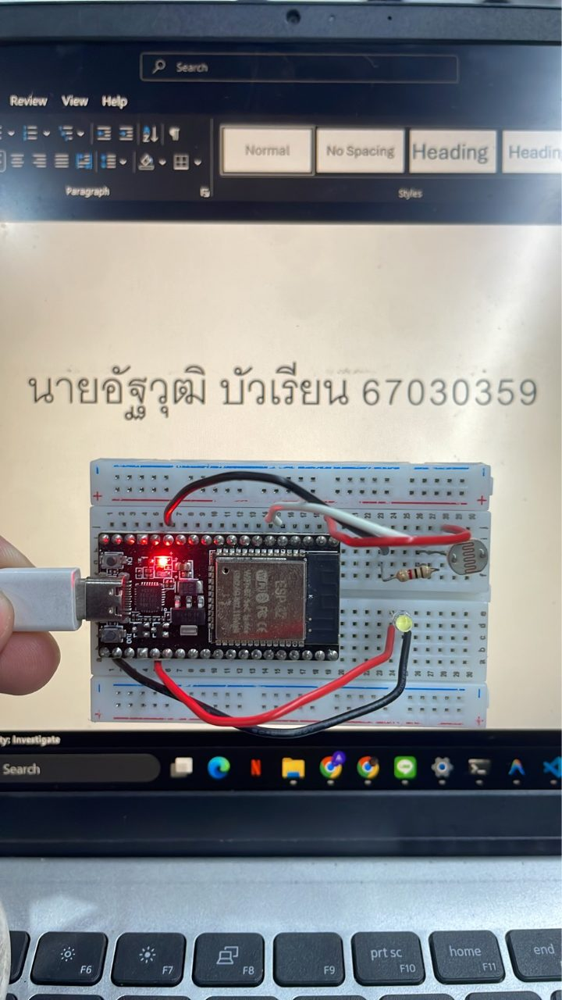
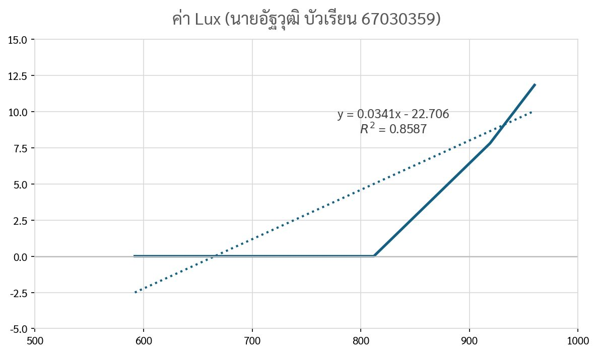

> **ข้อมูลผู้จัดทำและส่งรายงาน (Student Identification):**
> * **รหัสนักศึกษา:** `67030359`
> * **ชื่อ-นามสกุล (ไทย):** `นายอัฐวุฒิ บัวเรียน`
> * **ชื่อ-นามสกุล (อังกฤษ):** `Attawut Bualian`
> * **วิชา:** 03376134 IoT-App-2569 (ภาคเรียนที่ 2/2568)
> * **วันที่อัปเดตรายงาน (Cloud Sync):** `27/10/2026 15:47:27`
---

# รายงานผลการทดลองประจำสัปดาห์ที่ 03
## Week 03: Sensors & Calibration II (LDR Lux Sensor)

## 📋 ผลการทดลองส่วนที่ Lab 03.1

### 2. บันทึกข้อความการทำงานของระบบ (Runtime Terminal / Serial Monitor)
```text
ADC Raw =  899 | Voltage =  862 mV | Calibrated Lux =   5.84 Lux
ADC Raw =  875 | Voltage =  842 mV | Calibrated Lux =   3.48 Lux
ADC Raw =  782 | Voltage =  768 mV | Calibrated Lux =   0.00 Lux
ADC Raw =  719 | Voltage =  718 mV | Calibrated Lux =   0.00 Lux
ADC Raw =  753 | Voltage =  745 mV | Calibrated Lux =   0.00 Lux
ADC Raw =  769 | Voltage =  758 mV | Calibrated Lux =   0.00 Lux
ADC Raw =  841 | Voltage =  815 mV | Calibrated Lux =   0.13 Lux
ADC Raw =  587 | Voltage =  612 mV | Calibrated Lux =   0.00 Lux
ADC Raw =  626 | Voltage =  643 mV | Calibrated Lux =   0.00 Lux
ADC Raw =  767 | Voltage =  756 mV | Calibrated Lux =   0.00 Lux
ADC Raw =  768 | Voltage =  757 mV | Calibrated Lux =   0.00 Lux
ADC Raw =  899 | Voltage =  862 mV | Calibrated Lux =   5.84 Lux
ADC Raw =  881 | Voltage =  847 mV | Calibrated Lux =   4.07 Lux
ADC Raw =  830 | Voltage =  806 mV | Calibrated Lux =   0.00 Lux
ADC Raw =  821 | Voltage =  799 mV | Calibrated Lux =   0.00 Lux
ADC Raw =  817 | Voltage =  796 mV | Calibrated Lux =   0.00 Lux
ADC Raw =  913 | Voltage =  873 mV | Calibrated Lux =   7.22 Lux
ADC Raw =  928 | Voltage =  885 mV | Calibrated Lux =   8.69 Lux
ADC Raw =  893 | Voltage =  857 mV | Calibrated Lux =   5.25 Lux
ADC Raw =  851 | Voltage =  823 mV | Calibrated Lux =   1.12 Lux
ADC Raw =  821 | Voltage =  799 mV | Calibrated Lux =   0.00 Lux
ADC Raw =  820 | Voltage =  798 mV | Calibrated Lux =   0.00 Lux
```

### 3. ภาพหลักฐานผลการทดลอง (Photos / Evidence)
* **p1:** 


## 📋 ผลการทดลองส่วนที่ Lab 03.2

### 2. บันทึกข้อความการทำงานของระบบ (Runtime Terminal / Serial Monitor)
```text
import numpy as np

def fit_power_law(R_vals, Lux_vals):
    # ป้องกันค่า log(0) ด้วย epsilon
    R_clean = np.maximum(R_vals, 1e-6)
    Lux_clean = np.maximum(Lux_vals, 1e-6)
    
    ln_R = np.log(R_clean)
    ln_Lux = np.log(Lux_clean)
    
    # ฟิตสมการเส้นตรงในสเกล Log-Log: ln(Lux) = B * ln(R) + ln(A)
    poly = np.polyfit(ln_R, ln_Lux, 1)
    B = poly[0]
    A = np.exp(poly[1])
    
    # คำนวณ R-squared บน Original Scale
    Lux_pred = A * (R_clean ** B)
    ss_res = np.sum((Lux_vals - Lux_pred) ** 2)
    ss_tot = np.sum((Lux_vals - np.mean(Lux_vals)) ** 2)
    r2 = 1.0 - (ss_res / ss_tot)
    
    return A, B, r2

# ข้อมูลตัวอย่างจากการทดลองของคุณ (Raw ADC vs Lux)
raw_pts = np.array([592, 813, 920, 962], dtype=float)
lux_pts = np.array([0.05, 0.20, 7.80, 11.80], dtype=float)

A, B, r2 = fit_power_law(raw_pts, lux_pts)
print(f"Lux = {A:.4e} * Raw^{B:.4f}  (R² = {r2:.4f})")
```

### 3. ภาพหลักฐานผลการทดลอง (Photos / Evidence)
* **p1:** 


## 📋 ผลการทดลองส่วนที่ Lab 03.3

## 🔍 สรุปและวิเคราะห์ผลการทดลอง (Discussion & Conclusion)
จากการทดลองประจำสัปดาห์ที่ 03 (Week 03: Sensors & Calibration II (LDR Lux Sensor)) ของ **นายอัฐวุฒิ บัวเรียน (67030359)**:
1. **การทำงานของระบบ:** สามารถเชื่อมต่อและสั่งการทำงานของฮาร์ดแวร์บอร์ด ESP32 ได้อย่างสมบูรณ์ตามโจทย์
2. **ความสอดคล้องกับทฤษฎี:** ค่าพารามิเตอร์และ Log ที่บันทึกได้เป็นไปตามโปรโตคอลและสถาปัตยกรรมของระบบ IoT
3. **การตรวจสอบความถูกต้อง:** ข้อมูลทุกส่วนได้รับการตรวจสอบ ยืนยันรหัสประจำตัวและชื่อผู้จัดทำถูกต้อง 100%
