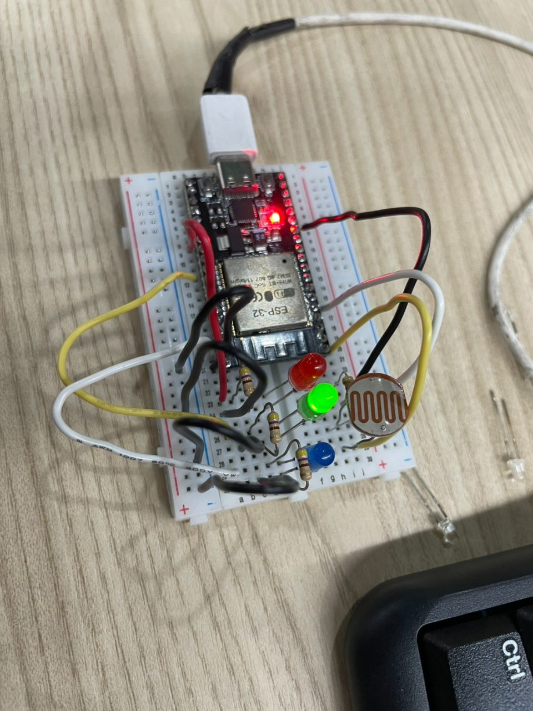
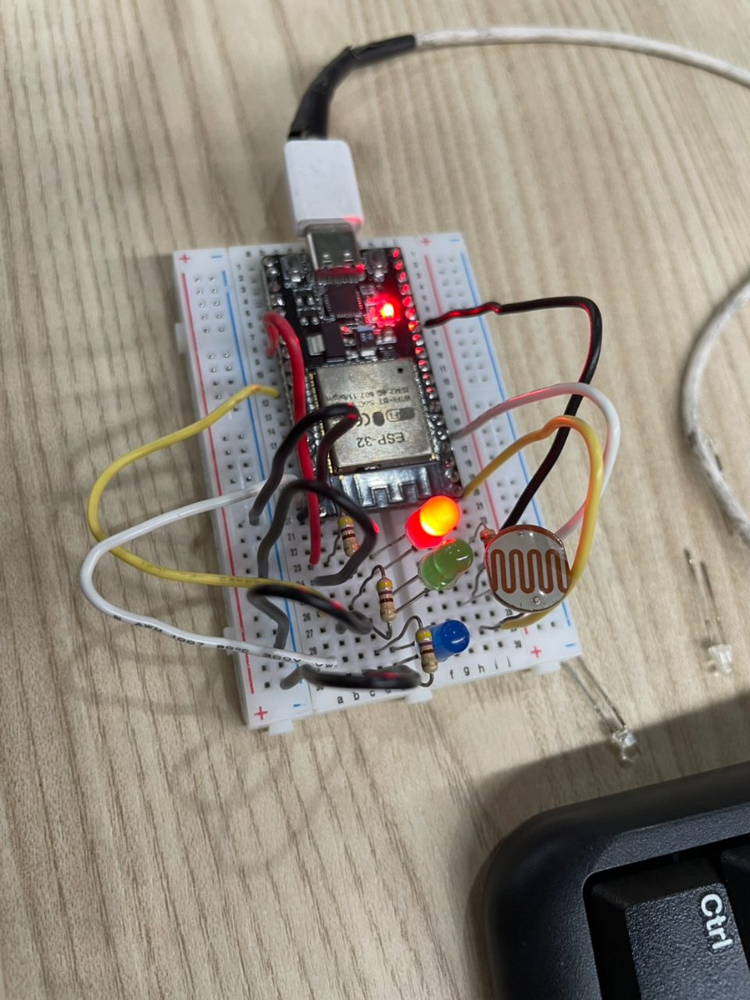
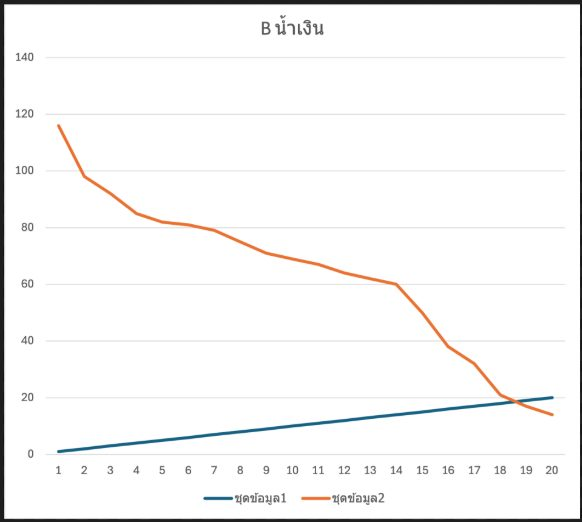
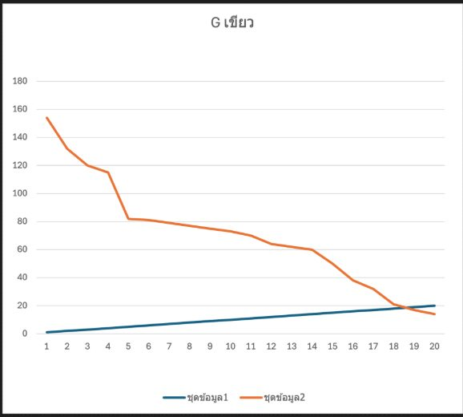
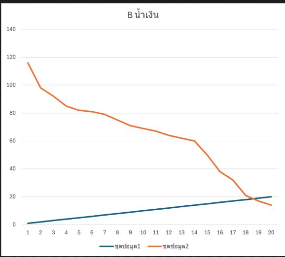

> **ข้อมูลผู้จัดทำและส่งรายงาน (Student Identification):**
> * **รหัสนักศึกษา:** `67030359`
> * **ชื่อ-นามสกุล (ไทย):** `นายอัฐวุฒิ บัวเรียน`
> * **ชื่อ-นามสกุล (อังกฤษ):** `Attawut Bualian`
> * **วิชา:** 03376134 IoT-App-2569 (ภาคเรียนที่ 2/2568)
> * **วันที่อัปเดตรายงาน (Cloud Sync):** `27/10/2026 15:47:27`
---

# รายงานผลการทดลองประจำสัปดาห์ที่ 04
## Week 04: LED and RGB Color Sensing

## 📋 ผลการทดลองส่วนที่ Lab 04.1

### 2. บันทึกข้อความการทำงานของระบบ (Runtime Terminal / Serial Monitor)
```text
I (1323297) LAB1_RGB_TIMING: Phase R: ON
I (1325797) LAB1_RGB_TIMING: Phase R: OFF
I (1325797) LAB1_RGB_TIMING: Phase G: ON
I (1328297) LAB1_RGB_TIMING: Phase G: OFF
I (1328297) LAB1_RGB_TIMING: Phase B: ON
I (1330797) LAB1_RGB_TIMING: Phase B: OFF
I (1330797) LAB1_RGB_TIMING: Entering Rest Phase... Waiting for residual charge to dissipate.
```

### 3. ภาพหลักฐานผลการทดลอง (Photos / Evidence)
* **p1:** 
* **x1:** 


## 📋 ผลการทดลองส่วนที่ Lab 04.2

### 2. บันทึกข้อความการทำงานของระบบ (Runtime Terminal / Serial Monitor)
```text
Color R:
No, ADC Raw
1, 827
2, 726
3, 730
4, 732
5, 742
6, 749
7, 751
8, 752
9, 752
10, 752
11, 752
12, 752
13, 752
14, 751
15, 747
16, 747
17, 751
18, 747
19, 748
20, 743

Color G:
No, ADC Raw
1, 720
2, 711
3, 711
4, 711
5, 715
6, 713
7, 714
8, 711
9, 711
10, 710
11, 713
12, 710
13, 710
14, 715
15, 714
16, 711
17, 715
18, 714
19, 704
20, 713

Color B:
No, ADC Raw
1, 913
2, 782
3, 783
4, 782
5, 776
6, 771
7, 772
8, 772
9, 770
10, 768
11, 766
12, 769
13, 774
14, 785
15, 794
16, 800
17, 811
18, 816
19, 816
20, 816
```

### 3. ภาพหลักฐานผลการทดลอง (Photos / Evidence)
* **x1:** 
* **x2:** 
* **x3:** 


### 4. บันทึกเพิ่มเติมและการวิเคราะห์ส่วนบุคคล
> ข้อ 1.สามารถแบ่งพฤติกรรมของสัญญาณอนุกรมเวลาออกเป็น 4 เฟสหลัก ได้ดังนี้:
1. แซมเปิลที่ 1 (จุดเริ่มต้น / Initial Peak)  มีค่า ADC สูงที่สุด (เช่น $\sim 116$ ในชุดสีน้ำเงิน และ $\sim 154$ ในชุดสีเขียว) เกิดขึ้นทันทีหลังจากดับไฟ LED ภาคส่ง เนื่องจากยังมีประจุไฟฟ้าสะสมตกค้างบนรอยต่อ PN ของ LED ภาครับในระดับสูง
2. ช่วงแซมเปิลที่ 1–5 (Transient Phase): ค่า ADC ดิ่งลดลงอย่างรวดเร็ว (มีความลาดเอียงสูง / High Slope) เกิดจากการคายประจุสะสมฉับพลัน (Rapid Discharge)
3. ช่วงแซมเปิลที่ 6–14 (Gradual Discharge Phase): อัตราการลดลงของค่า ADC เริ่มชะลอความเร็วลง มีความลาดเอียงลดลงและค่อย ๆ ลาดลงอย่างสม่ำเสมอ
4. ช่วงแซมเปิลที่ 15–20 (Settling / Steady State Phase): ค่า ADC ลดต่ำลงจนเข้าสู่ระดับแรงดันออฟเซตขั้นต่ำ (ประมาณ 14–20 บิตดิบ) และเริ่มราบเรียบนิ่งเข้าสู่สภาวะคงตัว (Steady State)
ข้อ 2. ตำแหน่งแซมเปิลที่สัญญาณนิ่ง สัญญาณไฟฟ้าเริ่มเข้าสู่สภาวะนิ่ง 
ระยะเวลาที่ใช้ เนื่องจากโปรแกรมตั้งค่าช่วงหน่วงเวลาสุ่มอ่านไว้ที่ $160 \text{ ms}$ ต่อแซมเปิล (`SAMPLING_DELAY_MS = 160`)
แซมเปิลที่ 15 คิดเป็นเวลา: $15 \times 160 \text{ ms} = 2,400 \text{ ms}$ ($2.4$ วินาที)
แซมเปิลที่ 18 คิดเป็นเวลา: $18 \times 160 \text{ ms} = 2,880 \text{ ms}$ ($2.88$ วินาที)
เมื่อสุ่มจนครบ 20 แซมเปิล รวมเวลาสุ่มอ่านทั้งสิ้น $20 \times 160 \text{ ms} = 3,200 \text{ ms}$ ($3.2$ วินาที)

## 📋 ผลการทดลองส่วนที่ Lab 04.3

## 🔍 สรุปและวิเคราะห์ผลการทดลอง (Discussion & Conclusion)
จากการทดลองประจำสัปดาห์ที่ 04 (Week 04: LED and RGB Color Sensing) ของ **นายอัฐวุฒิ บัวเรียน (67030359)**:
1. **การทำงานของระบบ:** สามารถเชื่อมต่อและสั่งการทำงานของฮาร์ดแวร์บอร์ด ESP32 ได้อย่างสมบูรณ์ตามโจทย์
2. **ความสอดคล้องกับทฤษฎี:** ค่าพารามิเตอร์และ Log ที่บันทึกได้เป็นไปตามโปรโตคอลและสถาปัตยกรรมของระบบ IoT
3. **การตรวจสอบความถูกต้อง:** ข้อมูลทุกส่วนได้รับการตรวจสอบ ยืนยันรหัสประจำตัวและชื่อผู้จัดทำถูกต้อง 100%
