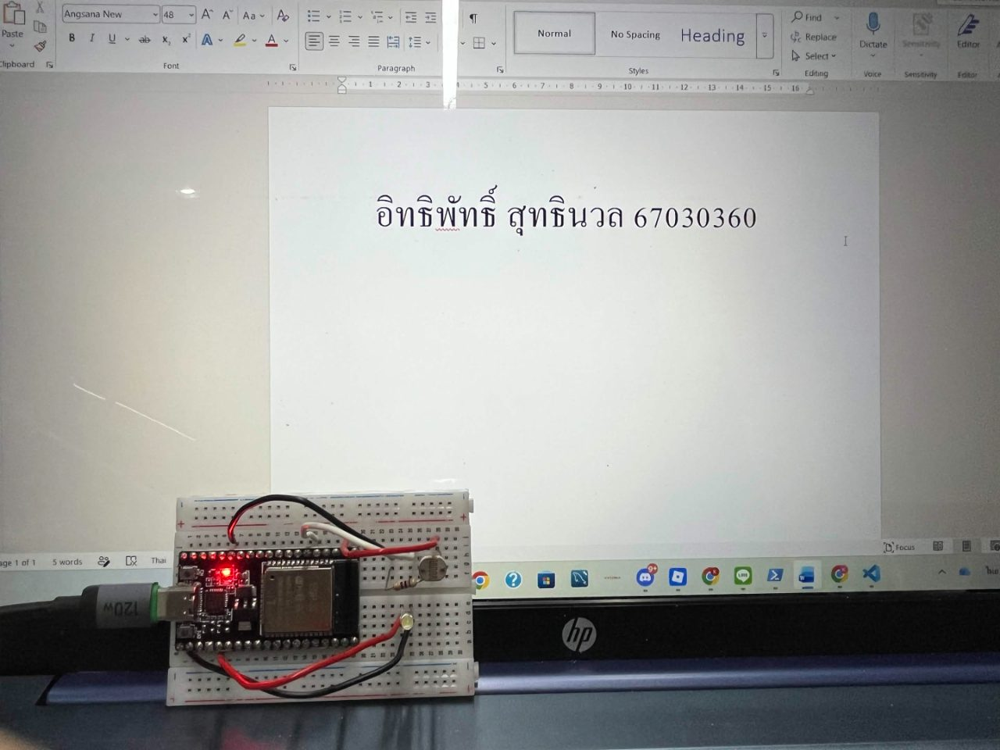
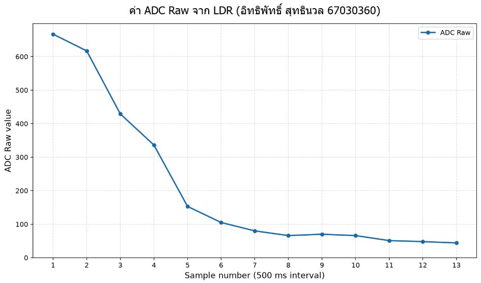

> **ข้อมูลผู้จัดทำและส่งรายงาน (Student Identification):**
> * **รหัสนักศึกษา:** `67030360`
> * **ชื่อ-นามสกุล (ไทย):** `นายอิทธิพัทธิ์ สุทธินวล`
> * **ชื่อ-นามสกุล (อังกฤษ):** `Ittipat Sutthinuan`
> * **วิชา:** 03376134 IoT-App-2569 (ภาคเรียนที่ 2/2568)
> * **วันที่อัปเดตรายงาน (Cloud Sync):** `27/10/2026 15:47:27`
---

# รายงานผลการทดลองประจำสัปดาห์ที่ 03
## Week 03: Sensors & Calibration II (LDR Lux Sensor)

## 📋 ผลการทดลองส่วนที่ Lab 03.1

### 3. ภาพหลักฐานผลการทดลอง (Photos / Evidence)
* **p1:** 

## 📋 ผลการทดลองส่วนที่ Lab 03.2

### 3. ภาพหลักฐานผลการทดลอง (Photos / Evidence)
* **p1:** 

## 📋 ผลการทดลองส่วนที่ Lab 03.3

## 🔍 สรุปและวิเคราะห์ผลการทดลอง (Discussion & Conclusion)
จากการทดลองประจำสัปดาห์ที่ 03 (Week 03: Sensors & Calibration II (LDR Lux Sensor)) ของ **นายอิทธิพัทธิ์ สุทธินวล (67030360)**:
1. **การทำงานของระบบ:** สามารถเชื่อมต่อและสั่งการทำงานของฮาร์ดแวร์บอร์ด ESP32 ได้อย่างสมบูรณ์ตามโจทย์
2. **ความสอดคล้องกับทฤษฎี:** ค่าพารามิเตอร์และ Log ที่บันทึกได้เป็นไปตามโปรโตคอลและสถาปัตยกรรมของระบบ IoT
3. **การตรวจสอบความถูกต้อง:** ข้อมูลทุกส่วนได้รับการตรวจสอบ ยืนยันรหัสประจำตัวและชื่อผู้จัดทำถูกต้อง 100%
